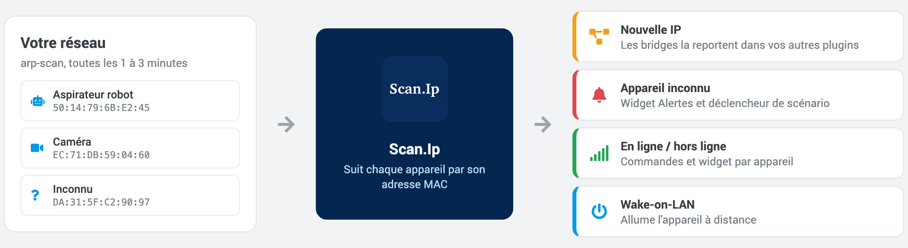
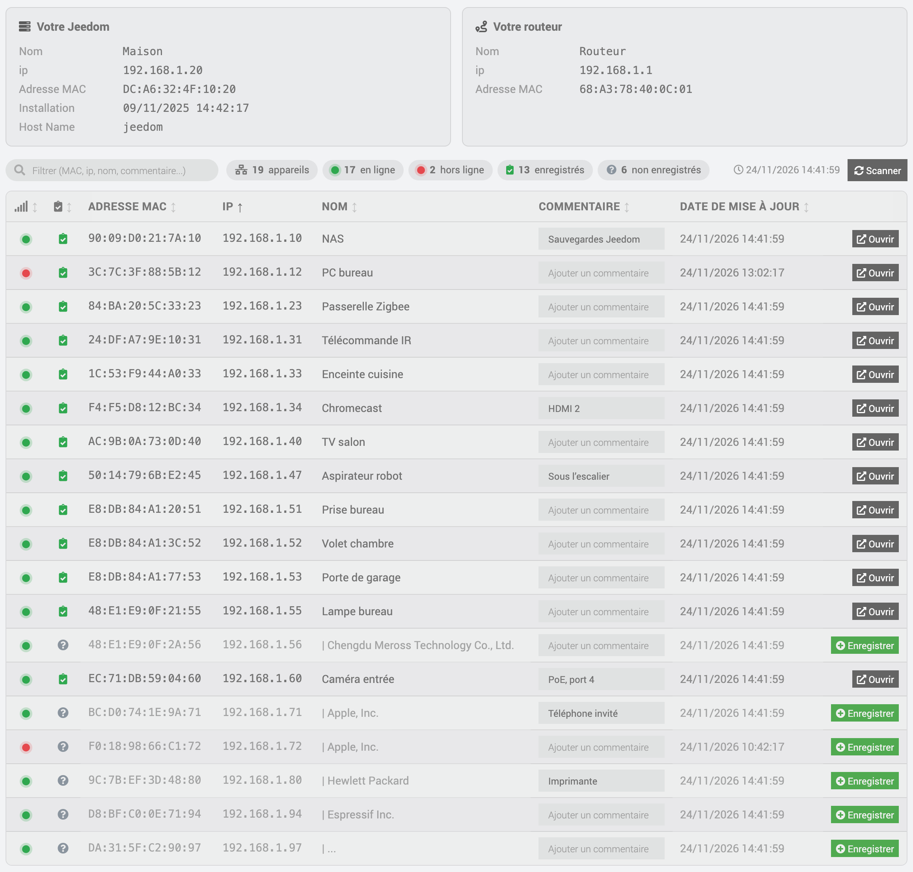
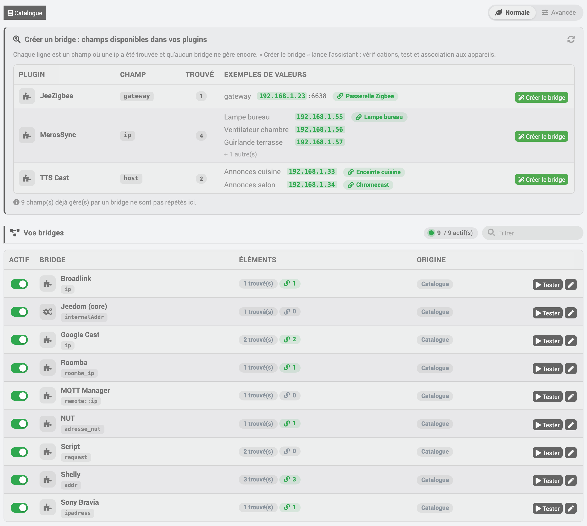

# Scan.Ip — plugin Jeedom

[🇫🇷 Français](docs/fr_FR/index.md) · [🇬🇧 English](docs/en_US/index.md) · [🇩🇪 Deutsch](docs/de_DE/index.md) · [🇪🇸 Español](docs/es_ES/index.md) · [🇮🇹 Italiano](docs/it_IT/index.md)

Scanne le réseau local, suit chaque appareil par son **adresse MAC**, alerte quand un appareil apparaît, disparaît ou change d'IP, et reporte les changements d'IP dans les autres plugins grâce aux **bridges**. Réveil à distance (Wake-on-LAN) inclus.



- Identifiant du plugin : `scan_ip`
- Jeedom requis : 4.0 minimum (PHP 7 et PHP 8)
- Dépendances : `arp-scan`, `wakeonlan`, `etherwake` (installées par Jeedom)
- Sous Docker : conteneur en `network_mode: host`
- [Forum Jeedom](https://community.jeedom.com/tag/plugin-scan_ip)

| Le réseau | Les bridges |
|---|---|
|  |  |

## Documentation

| Langue | Documentation | Changelog |
|---|---|---|
| 🇫🇷 Français | [index](docs/fr_FR/index.md) | [changelog](docs/fr_FR/changelog.md) |
| 🇬🇧 English | [index](docs/en_US/index.md) | [changelog](docs/en_US/changelog.md) |
| 🇩🇪 Deutsch | [index](docs/de_DE/index.md) | [changelog](docs/de_DE/changelog.md) |
| 🇪🇸 Español | [index](docs/es_ES/index.md) | [changelog](docs/es_ES/changelog.md) |
| 🇮🇹 Italiano | [index](docs/it_IT/index.md) | [changelog](docs/it_IT/changelog.md) |

## Organisation du code

- `core/class/scan_ip.class.php` : équipement, commandes, tâches planifiées et dépendances.
- `core/class/scan_ip.scan.php` et `scan_ip.shell.php` : scan du réseau (`arp-scan`), interfaces, Wake-on-LAN.
- `core/class/scan_ip.json.php` : données du réseau, dans `data/json/` (`equipements.json`, `mapping.json`, `commentMac.json`).
- `core/class/scan_ip.bridges.php` : règles des bridges, recherche des IP, simulation et mise à jour des autres plugins.
- `data/json/bridges.json` : catalogue des bridges ; `core/class/bridges/` : bridges particuliers écrits en PHP.
- `core/class/scan_ip.widget_*.php` et `core/template/dashboard/` : widgets.
- `desktop/` : page du plugin et fenêtres (Réseau, équipements, Bridges, Debug).
- `resources/` : fichiers constructeurs (`oui.txt`, `iab.txt`) et installation des dépendances.

## Ajouter un bridge

Le plus simple est de le créer depuis la fenêtre **Bridges** du plugin puis d'utiliser le bouton **Proposer**. Pour l'ajouter directement, décrire la règle dans `data/json/bridges.json` :

```json
{"id": "shelly", "plugin": "shelly", "source": "eqLogic", "key": "addr", "conditions": [{"key": "@value", "op": "notempty"}]}
```

`source` vaut `eqLogic`, `logicalId`, `cmd`, `pluginConfig` ou `php`. Voir [la documentation des bridges](docs/fr_FR/index.md#bridges).

## Installation pour le développement

Copier ce dossier dans `/var/www/html/plugins/scan_ip` sur l'installation Jeedom, puis activer le plugin.

## Licence

Voir [LICENSE](LICENSE).
