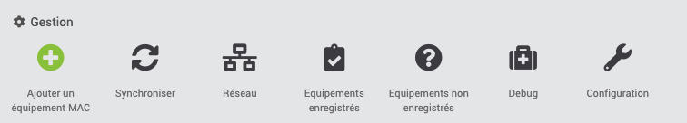
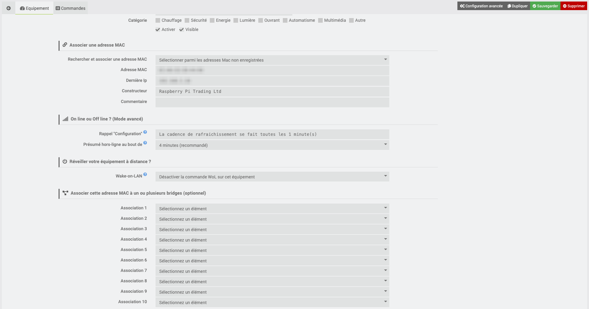

Beschreibung
===

Dieses Plugin scannt Ihr Netzwerk und ermittelt die Liste der verbundenen Geräte mit ihren MAC-Adressen.

Mit diesen Informationen ermöglicht das Plugin:
- die neue IP eines Geräts zu ermitteln
- ein Widget mit dem Zustand Ihres Netzwerks anzuzeigen
- ein Widget mit den nicht registrierten Geräten anzuzeigen, die sich gerade mit dem Netzwerk verbunden haben
- ein Widget pro registriertem Gerät anzuzeigen und die zugehörigen Befehle bereitzustellen
- Warnungen zu erstellen, wenn ein Gerät im Netzwerk verschwindet, erscheint oder seine IP ändert
- IP-Änderungen über Bridges automatisch an andere Plugins weiterzugeben
- ein Gerät aus der Ferne einzuschalten (Wake-on-LAN)

Installation und Abhängigkeiten
===

- Mindestens Jeedom 4.0, kompatibel mit PHP 7 und PHP 8.
- Dieses Plugin benötigt unbedingt "arp-scan", "wakeonlan" und "etherwake" (werden mit den Abhängigkeiten installiert).
- Es verwendet die Dateien "oui.txt" und "iab.txt" von "standards-oui.ieee.org".
- Es verwendet die APIs von "macvendors.com" und "macvendors.co".

> **Jeedom unter Docker**: Der Jeedom-Container muss mit `network_mode: host` laufen. Andernfalls sieht er nur das interne Docker-Netzwerk (oft ein `/16` mit 65.534 Adressen): Die Scans dauern mehrere Minuten und finden nur die anderen Container, nicht die Geräte in Ihrem Netzwerk.

# Konfiguration

Um die Bedienung zu erleichtern, passt das Plugin die angebotenen Optionen an drei Modi an: "normal", "erweitert" und "debug".

## Normaler Modus

Der normale Modus zeigt die wichtigsten Einstellungen, die in der Regel für Standardkonfigurationen passen.

### Widget Netzwerk

Diese Option blendet das Netzwerk-Widget ein oder aus.

> Sie können die Spalten mit einem Klick auf ihre Überschrift sortieren.

> Sie können außerdem im zugehörigen Gerät dieses Widgets eine Standardsortierung festlegen.

### Widget Warnungen

Diese Option blendet das Widget der Warnungen ein oder aus.

> Dieses Widget zeigt nur nicht registrierte Geräte an, sortiert nach Verbindungsdatum und dann nach dem Datum der ersten Erfassung. Ein ganz neues Gerät erscheint daher an erster Stelle.

### Aktualisierungsintervall

Legt das Aktualisierungsintervall der geplanten Aufgabe fest.
Standardmäßig ist es auf 1 Minute eingestellt.

> Nicht alle Geräte antworten bei jedem Scan, da manche zu lange für eine Antwort brauchen (zum Beispiel WLAN-Geräte). Es wird daher empfohlen, mindestens 3 Scans abzuwarten, bevor ein Gerät als wirklich offline gilt. Diese Einstellung kann für jedes Gerät genauer angepasst werden.

### Herstellerdateien (oui.txt und iab.txt)

Diese Dateien ermitteln den Hersteller eines Geräts anhand seiner MAC-Adresse. Sie werden jeden Monat automatisch von der IEEE-Website aktualisiert; bei einem Fehler bleiben die vorhandenen Dateien erhalten und am nächsten Tag erfolgt ein neuer Versuch.

Je nach Modus zeigt dieser Abschnitt:
- **normaler Modus**: die Aktualisierungshäufigkeit und das Datum der letzten Aktualisierung
- **erweiterter Modus**: zusätzlich die Wahl der Häufigkeit (jeden Monat, jede Woche) oder die Deaktivierung der automatischen Aktualisierung
- **Debug-Modus**: zusätzlich den Zustand jeder Datei und eine Schaltfläche „Jetzt aktualisieren“

### Liste der unterstützten Plugins

Scan.Ip verwendet Bridges, um Daten in bestimmten Plugins zu aktualisieren. Standardmäßig werden nur die in Ihrem Jeedom installierten Plugins angezeigt; aktivieren Sie „Auch nicht installierte Plugins anzeigen“, um alle unterstützten Plugins zu sehen.

> Konkret geben die Bridges die IP-Änderung eines Geräts automatisch an die anderen Plugins weiter (zum Beispiel, wenn keine feste IP im DHCP vergeben werden kann).

So können Sie ein Gerät einem oder mehreren Plugins zuordnen.

## Erweiterter Modus

### Router

Fügt den Router zur Netzwerkliste hinzu. Standardmäßig ist er entfernt.

### Jeedom

Fügt den Jeedom-Server zur Netzwerkliste hinzu. Standardmäßig ist er entfernt.

### Option Wiederholung

Legt die Anzahl der Versuche bei den Netzwerkscans fest. Nicht alle Geräte antworten beim ersten Versuch. Je mehr Versuche, desto länger dauert der Scan.

### Kompatibilität mit dem Safari-Browser

Unter Safari funktioniert das Ausblenden von Optionen in Auswahlmenüs (mit dem nur die nicht verwendeten Bridges angezeigt werden) nicht. Mit dieser Option werden bereits verwendete Elemente deaktiviert statt ausgeblendet. Aktivieren Sie diese Option nur, wenn das Problem unter Safari auftritt.

### Zu scannende Netzwerkbereiche festlegen

Wenn Sie mehrere Netzwerkkarten oder Subnetze haben, aktivieren Sie das oder die zu scannenden Subnetze. Es werden nur Schnittstellen mit einer IPv4-Adresse angeboten (virtuelle Docker-Schnittstellen oder nicht verbundene Karten werden nicht aufgeführt).

> Ein Subnetz erlaubt möglicherweise nicht, die darin befindlichen MAC-Adressen abzurufen (Sperre durch den Router oder anderes). In diesem Fall müssen Sie in diesem Subnetz ein weiteres Jeedom mit einem eigenen Scan.Ip installieren.

> Die Dauer eines Scans hängt von der Größe des Subnetzes ab: einige Sekunden für ein `/24` (254 Adressen), mehrere Minuten für ein `/16` (65.534 Adressen).

## Debug-Modus

### Versionsprüfung

Prüft, ob die vom Plugin gespeicherten Daten das Format der installierten Version haben. Jede Zeile zeigt „Aktuell“ in Grün, wenn alles korrekt ist, andernfalls „Nicht aktuell“ in Rot. Sind die Daten nicht kompatibel, kann ihre Korrektur über eine Schaltfläche gestartet werden.

### Abhängigkeiten

Zeigt auf einen Blick, welche Abhängigkeiten fehlgeschlagen sind.

# Geräteverwaltung

> Die Geräte sind in zwei Bereiche unterteilt: "Ihre MAC-Geräte" und "Von Scan.Ip verwaltete Widgets". Letztere sollten nur bei einem Fehler gelöscht werden. Um sie zu löschen, aktivieren Sie den Debug-Modus, damit die Schaltfläche "Löschen" erscheint.

## Zugangssymbole

Im Debug-Modus erscheint ein Debug-Symbol. Es erscheint oder verschwindet sofort beim Moduswechsel, ohne die Seite neu zu laden.

### MAC-Gerät hinzufügen

Fügt ein Gerät hinzu, wenn Sie die MAC-Adresse des hinzuzufügenden Geräts kennen.

> Einfacher ist es, über "Nicht registrierte Geräte" oder "Netzwerk" zu gehen, wo Sie ein oder mehrere Geräte Ihres Netzwerks direkt hinzufügen können.

### Synchronisieren

Startet einen neuen Scan und aktualisiert die Geräte. Ein Fortschrittsbalken zeigt den aktuellen Schritt, den Prozentsatz, die verstrichene Zeit und eine Schätzung der Restzeit; am Ende des Scans wird die Seite neu geladen.

> Läuft bereits ein automatischer Scan, verfolgt der Fortschrittsbalken diesen Scan, statt einen zweiten zu starten.

### Netzwerk

Oben im Fenster fassen zwei Karten Ihr Jeedom (IP, MAC-Adresse, Installationsdatum, Hostname) und Ihren Router (Name, IP, MAC-Adresse) zusammen.

Die Werkzeugleiste bietet:
- einen Filter für die Suche nach MAC-Adresse, IP, Name oder Kommentar
- Zähler (Geräte, online, offline, registriert, nicht registriert): Ein Klick auf einen Zähler filtert die Tabelle, ein zweiter Klick hebt den Filter auf; Zähler mit dem Wert null werden nicht angezeigt
- das Datum des letzten Scans und eine Schaltfläche "Scannen", um einen neuen Scan mit Fortschrittsbalken zu starten

Die Tabelle zeigt das gesamte Netzwerk:

- Die 1. Spalte zeigt, ob das Gerät "Online" oder "Offline" ist
- Die 2. Spalte zeigt, ob das Gerät "registriert", "registriert, aber deaktiviert" oder "nicht registriert" ist
- Die 3. Spalte zeigt die MAC-Adresse des Geräts
- Die 4. Spalte zeigt die IP des Geräts
- Die 5. Spalte zeigt den Namen des Geräts, falls es registriert ist, sonst den Herstellernamen mit vorangestelltem "|"
- In der 6. Spalte können Sie einem Gerät einen Kommentar zuordnen (er wird während der Eingabe automatisch gespeichert; leeren Sie das Feld, um einen Kommentar zu löschen)
- Die 7. Spalte zeigt, wann das Gerät zuletzt gesehen wurde
- Die letzte Spalte bietet "Registrieren" für ein nicht registriertes Gerät (das Gerät wird erstellt und seine Seite geöffnet, damit Sie es benennen und aktivieren können) oder "Öffnen", um zur Seite eines bereits registrierten Geräts zu gelangen

> Wenn Sie "|..." im Namen eines Geräts sehen, wurde sein Hersteller nicht erkannt.

### Registrierte Geräte

Die Werkzeugleiste bietet einen Filter und anklickbare Zähler (registriert, online, offline, IP-Änderungen).

- Die 1. Spalte zeigt den Zustand des Geräts: "Online", "Offline" oder "IP-Änderung"
- Die 2. Spalte zeigt den Namen des Geräts
- Die 3. Spalte zeigt die MAC-Adresse des Geräts
- Die 4. Spalte zeigt die IP des Geräts
- Die 5. Spalte zeigt die bei der letzten Verbindung verwendete IP (in Orange, wenn sie von der aktuellen IP abweicht)
- Die 6. Spalte zeigt das Datum der letzten Aktualisierung des Geräts
- Die 7. Spalte zeigt alle dem Gerät zugeordneten Bridges. Ein Klick darauf führt Sie zum Gerät im zugehörigen Plugin.

### Nicht registrierte Geräte

Die Werkzeugleiste bietet einen Filter und anklickbare Zähler (nicht registriert, online, offline).

- In der 1. Spalte können Sie das Gerät auswählen* (um es direkt zu Ihren Geräten hinzuzufügen oder aus dem Netzwerkarchiv zu löschen); das Kontrollkästchen in der Kopfzeile wählt alle angezeigten Zeilen aus
- Die 2. Spalte zeigt, ob das Gerät "Online" oder "Offline" ist
- Die 3. Spalte zeigt den Namen des Geräts
- In der 4. Spalte können Sie einen Kommentar zum Gerät eingeben, der automatisch gespeichert wird
- Die 5. Spalte zeigt die MAC-Adresse des Geräts
- Die 6. Spalte zeigt die vom Gerät verwendete IP
- Die 7. Spalte zeigt das Datum der ersten Erfassung in Ihrem Netzwerk
- Die 8. Spalte zeigt, wann das Gerät zuletzt gesehen wurde
- Die letzte Spalte bietet "Registrieren", um das Gerät direkt zu erstellen und seine Seite zu öffnen

> \* Wenn Sie ein oder mehrere Elemente auswählen, erscheinen Aktionsschaltflächen.

### Debug (nur im Debug-Modus)

Dieses Fenster hilft, mögliche Fehler zu verstehen.

#### # ip a

Ergebnis des Befehls "ip a", der alle von Ihrem Jeedom aus erreichbaren Netzwerke auflistet.

#### # ip route show default

Zeigt die IP des Routers an, mit dem Ihr Jeedom verbunden ist.

#### # sudo arp-scan -r 3 --interface=eth0 --localnet --ouifile=ieee-oui.txt

> Hier ist das Netzwerk "eth0" ausgewählt, dies hängt jedoch von Ihrem Netzwerk ab.

Ergebnis des Befehls "sudo arp-scan -r 3 --interface=eth0 --localnet --ouifile=ieee-oui.txt", der die Geräte auflistet, die auf den Scan antworten.

> Wie oben erwähnt, erscheinen möglicherweise nicht alle verbundenen Geräte bei einem einzigen Scan. Deshalb sind mehrere Scans nötig, um ein genaues Bild der verbundenen Geräte zu erhalten.

#### # Equipements

Zeigt die Daten aus dem Geräte-JSON. Dies ist der Verlauf aller Geräte, die sich mit Ihrem Netzwerk verbunden haben.

#### # Mappings

Zeigt die Daten aus dem Mapping-JSON. Dies ist der letzte Zustand Ihres Netzwerks mit der verwendeten Version von "arp-scan".

### Konfiguration

Dieser Punkt wurde bereits am Anfang behandelt.

## Ihre Geräte

### Im normalen Modus

#### MAC-Adresse suchen

Mit diesem Auswahlmenü können Sie direkt nach einem Element Ihres Netzwerks suchen und seine MAC-Adresse übernehmen.

> Es werden nur noch nicht zugeordnete MAC-Adressen angeboten, um Duplikate zu vermeiden.

#### Zugeordnete MAC-Adresse

Dieses Feld wird:
- entweder automatisch über das Menü "MAC-Adresse suchen" ausgefüllt
- oder manuell ausgefüllt, wenn Sie die Ankunft eines Geräts in Ihrem Netzwerk vorwegnehmen möchten

#### Hersteller

Wurde der Hersteller erkannt, wird er hier angezeigt.

#### Wake-on-LAN

Fügt einen WoL-Aktionsbefehl hinzu, der das Gerät aus der Ferne einschaltet.

> Prüfen Sie, ob Ihr Gerät kompatibel ist und die Option darauf aktiviert ist, damit dies funktioniert.

#### Zuordnung

Wie im Konfigurationsteil gesehen, werden hier Plugins über Bridges mit Scan.Ip verknüpft.

> Im Auswahlmenü wird die Information so dargestellt: [Name des Plugins][im Plugin gespeicherte IP :: Unterbezeichnung der Konfiguration (falls vorhanden)] Name des Geräts im Ziel-Plugin.

> Achtung: Diese Option ändert andere Plugins. Verwenden Sie sie bewusst. Der Autor des Ziel-Plugins ist in keiner Weise für Fehlfunktionen verantwortlich, die dadurch in seinem Plugin entstehen könnten.

> Solange Sie kein Plugin zuordnen, nimmt Scan.Ip daran keine Änderung vor.

> Wenn Sie Entwickler sind und eine zusätzliche Bridge vorschlagen möchten, ist das gern möglich: entweder direkt auf GitHub (https://ynats.github.io/jeedom-plugin-scan.ip/) oder über das Forum.

### Im erweiterten Modus

#### Hinweis "Konfiguration"

Erinnert Sie an das in der Plugin-Konfiguration gespeicherte Aktualisierungsintervall.

#### Als offline betrachtet nach

Standardmäßig 4 Minuten: Wenn Sie alles auf den Standardwerten gelassen haben, sind das 1 Scan pro Minute und 4 Durchläufe, um festzustellen, ob das Gerät wirklich offline ist.
Denken Sie daran, dass nicht jedes Gerät bei jedem Scan erscheint.

> Wenn Sie das Aktualisierungsintervall auf 3 Minuten eingestellt haben, setzen Sie diesen Parameter auf mindestens 15 Minuten.

> Bei sehr reaktionsschnellen kabelgebundenen Geräten kann dieser Parameter gesenkt werden, zum Beispiel auf 2 Minuten bei einem Intervall von 1 Minute. Das entspricht 2 Durchläufen, um den Zustand festzustellen.

### Im Debug-Modus

#### MAC Id

Im Debug-Modus zeigt das Feld „MAC Id“ die interne Kennung des Geräts an: die letzten drei Bytes seiner MAC-Adresse. Es ist schreibgeschützt und hilft bei der Diagnose einer MAC-Zuordnung, die nicht funktioniert.

### Zugeordnete Befehle

- IpV4 (IP des Geräts im v4-Format)
- Wol (der Aktionsbefehl, um das Gerät aus der Ferne einzuschalten; nur vorhanden, wenn Wake-on-LAN für das Gerät aktiviert ist)
- Last Date (Datum im Format TT/MM/JJJJ HH:MM:SS, an dem das Gerät zuletzt wieder online kam oder seine IP änderte)
- Last IpV4 (letzte vom Gerät verwendete IP)
- Last Time (dasselbe Datum wie "Last Date", als Zeitstempel)
- mac (MAC-Adresse des Geräts)
- Online (Zustand des Geräts)

### Zugeordnete Widgets

Das Widget zeigt die MAC-Adresse des Geräts, seine IP, seinen Zustand, seine letzte bekannte IP (in Orange, wenn sie von der aktuellen IP abweicht) und das Datum, an dem es zuletzt wieder online kam oder seine IP änderte. Die Schaltfläche WoL erscheint, wenn Wake-on-LAN für das Gerät aktiviert ist.

# Von Scan.Ip verwaltete Widgets

Standardmäßig enthält dieser Bereich 2 Widgets (sie können umbenannt werden):
- Scan.Ip Widget Alertes
- Scan.Ip Widget Network

Diese Geräte werden direkt vom Plugin verwaltet und entsprechen Ihrer Konfiguration des Plugins.

> Zur Erinnerung: Ihre Anzeige wird in der Konfiguration des Plugins verwaltet.

## Das Widget Netzwerk

## Das Widget Warnungen

#### Zugeordnete Befehle

Es werden 10 Befehlsgruppen erstellt. Sie entsprechen den 10 letzten nicht registrierten Geräten, die sich verbunden haben. Die chronologische Reihenfolge beginnt bei null (das neueste) und endet bei neun (das älteste).

Jedes Element hat 6 Unterbefehle:

- Connexion 0 Création (Zeitstempel der ersten Erfassung)
- Connexion 0 Date (Datum im Format TT/MM/JJJJ HH:MM:SS, an dem es zuletzt gesehen wurde)
- Connexion 0 Time (Zeitstempel, an dem es zuletzt gesehen wurde)
- Connexion 0 Equipement (Name des Herstellers, falls bekannt)
- Connexion 0 IpV4 (zugewiesene IP im v4-Format)
- Connexion 0 MAC (MAC-Adresse des Geräts)

## Subnetze und Scan.Ip

#### Wenn Sie mehrere Netzwerke verwalten möchten (zum Beispiel einen Hub, der an Ihren Router angeschlossen ist)

Scan.Ip kann mehrere Netzwerke gleichzeitig verwalten.
Dazu muss Ihr Jeedom mit den verschiedenen Netzwerken verbunden sein.
Sie können zum Beispiel das WLAN Ihres Jeedom-Rechners mit einem Netzwerk und das Netzwerkkabel mit dem anderen verbinden oder einfach "USB/Ethernet"- oder "USB/WLAN"-Adapter an Ihr Jeedom anschließen.
Scan.Ip zeigt Ihnen die Subnetze an, die Sie anschließend in der Konfiguration des Plugins (im erweiterten Modus) aktivieren können.

# Beispielszenarien

Die Befehle des Plugins können als Auslöser in Jeedom-Szenarien verwendet werden. Ersetzen Sie in den folgenden Beispielen `[Aucun]` durch das übergeordnete Objekt Ihrer Geräte und den Sendebefehl durch den Ihres Benachrichtigungs-Plugins (SMS, Telegram, Jeedom Connect…).

## Eine SMS erhalten, wenn sich ein neues Gerät verbindet

Das Widget Warnungen hält das neueste unbekannte Gerät auf Position 0. Dieses Szenario wird ausgelöst, wenn sich diese Position ändert, und prüft, ob das Gerät gerade zum ersten Mal erkannt wurde.

- **Modus**: Ausgelöst
- **Auslöser**: `#[Aucun][Scan.Ip Widget Alertes][Connexion 0 Création]#`
- **WENN**: `#[Aucun][Scan.Ip Widget Alertes][Connexion 0 Création]# > #timestamp# - 180`
- **DANN**: SMS-Sendebefehl mit der Nachricht
  `Neues Gerät im Netzwerk: #[Aucun][Scan.Ip Widget Alertes][Connexion 0 MAC]# (#[Aucun][Scan.Ip Widget Alertes][Connexion 0 IpV4]#, #[Aucun][Scan.Ip Widget Alertes][Connexion 0 Equipement]#)`

> Die Bedingung lässt nur Geräte durch, die vor weniger als 3 Minuten zum ersten Mal erkannt wurden: Eine bloße Änderung der Reihenfolge der Liste löst keine Warnung aus.

> Das Widget Warnungen muss in der Konfiguration des Plugins aktiviert sein. Kommen mehrere neue Geräte im selben Scan hinzu, wird nur eine Warnung gesendet.

## Benachrichtigt werden, wenn ein registriertes Gerät das Netzwerk verlässt

Bei einem registrierten MAC-Gerät (zum Beispiel "Aspirateur robot") wechselt der Befehl **Online** auf 0, wenn das Gerät als offline gilt.

- **Modus**: Ausgelöst
- **Auslöser**: `#[Aucun][Aspirateur robot][Online]#`
- **WENN**: `#[Aucun][Aspirateur robot][Online]# == 0`
- **DANN**: Benachrichtigungsbefehl mit der Nachricht
  `Der Saugroboter ist nicht mehr mit dem Netzwerk verbunden`

> Die Zeit, bis das Gerät als offline gilt, wird im Gerät eingestellt („Als offline betrachtet nach“, im erweiterten Modus).

> Variante: Mit dem Auslöser `#[Aucun][Aspirateur robot][IpV4]#` und der Bedingung `#[Aucun][Aspirateur robot][IpV4]# != ""` werden Sie bei jeder IP-Änderung des Geräts benachrichtigt.
