# Plugin Scan.Ip

Dieses Plugin scannt Ihr Netzwerk und ermittelt die Liste der verbundenen Geräte mit ihren MAC-Adressen.

Mit diesen Informationen ermöglicht das Plugin:
- die neue IP eines Geräts zu ermitteln
- ein Widget mit dem Zustand Ihres Netzwerks anzuzeigen
- ein Widget mit den nicht registrierten Geräten anzuzeigen, die sich gerade mit dem Netzwerk verbunden haben
- ein Widget pro registriertem Gerät anzuzeigen und die zugehörigen Befehle bereitzustellen
- Warnungen zu erstellen, wenn ein Gerät im Netzwerk verschwindet, erscheint oder seine IP ändert
- IP-Änderungen über Bridges automatisch an andere Plugins weiterzugeben
- ein Gerät aus der Ferne einzuschalten (Wake-on-LAN)

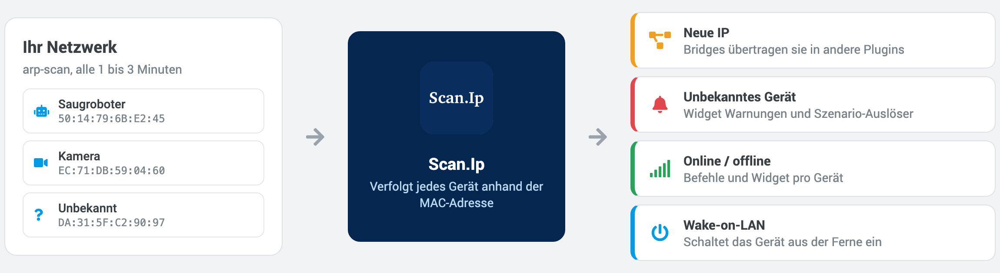

## Installation

- Mindestens Jeedom 4.0, kompatibel mit PHP 7 und PHP 8.
- Dieses Plugin benötigt unbedingt "arp-scan", "wakeonlan" und "etherwake" (werden mit den Abhängigkeiten installiert).
- Es verwendet die Dateien "oui.txt" und "iab.txt" von "standards-oui.ieee.org".
- Es verwendet die APIs von "macvendors.com" und "macvendors.co".

> **Jeedom unter Docker**: Der Jeedom-Container muss mit `network_mode: host` laufen. Andernfalls sieht er nur das interne Docker-Netzwerk (oft ein `/16` mit 65.534 Adressen): Die Scans dauern mehrere Minuten und finden nur die anderen Container, nicht die Geräte in Ihrem Netzwerk.

## Erste Schritte

1. **Installieren und aktivieren Sie das Plugin** und warten Sie, bis die Abhängigkeiten installiert sind.
2. Öffnen Sie die Plugin-Seite und klicken Sie auf **Synchronisieren**: Der erste Scan listet die Geräte im Netzwerk auf.
3. Öffnen Sie **Netzwerk** und klicken Sie bei jedem Gerät, das Sie verfolgen möchten, auf **Registrieren**. Seine Seite öffnet sich: Benennen und aktivieren Sie es, dann speichern.
4. Wenn ein anderes Plugin die IP dieses Geräts verwendet, wählen Sie das passende Element unter **Zuordnung**: Scan.Ip überträgt jede IP-Änderung dorthin.
5. Warten Sie einige Scans ab, bevor Sie sich auf den Zustand „Offline“ verlassen: Manche WLAN-Geräte antworten nicht jedes Mal.

## Geräteverwaltung

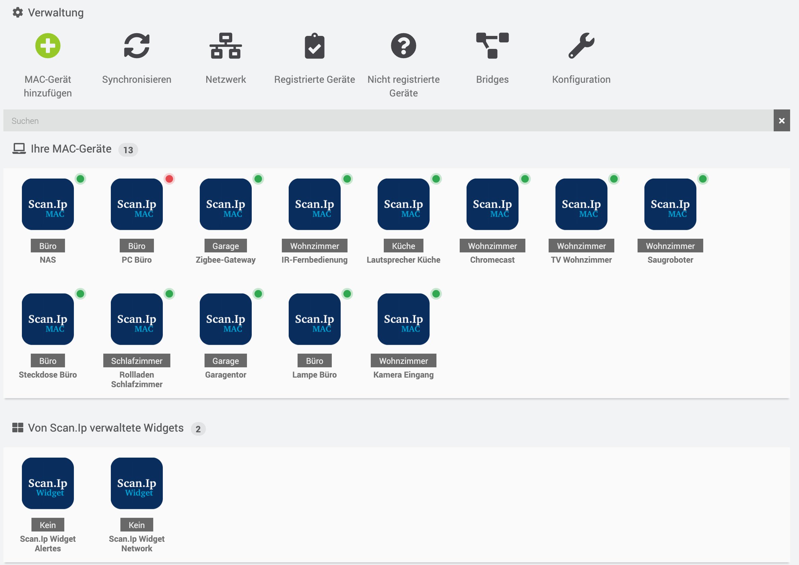

> Die Geräte sind in zwei Bereiche unterteilt: "Ihre MAC-Geräte" und "Von Scan.Ip verwaltete Widgets". Letztere sollten nur bei einem Fehler gelöscht werden. Um sie zu löschen, aktivieren Sie den Debug-Modus, damit die Schaltfläche "Löschen" erscheint.

### Zugangssymbole

Die Leiste „Verwaltung“ bündelt die Zugänge des Plugins: MAC-Gerät hinzufügen, Synchronisieren, Netzwerk, Registrierte Geräte, Nicht registrierte Geräte, Bridges, Debug (nur im Debug-Modus) und Konfiguration.

Im Debug-Modus erscheint ein Debug-Symbol. Es erscheint oder verschwindet sofort beim Moduswechsel, ohne die Seite neu zu laden.

### MAC-Gerät hinzufügen

Fügt ein Gerät hinzu, wenn Sie die MAC-Adresse des hinzuzufügenden Geräts kennen.

> Einfacher ist es, über "Nicht registrierte Geräte" oder "Netzwerk" zu gehen, wo Sie ein oder mehrere Geräte Ihres Netzwerks direkt hinzufügen können.

### Synchronisieren

Startet einen neuen Scan und aktualisiert die Geräte. Ein Fortschrittsbalken zeigt den aktuellen Schritt, den Prozentsatz, die verstrichene Zeit und eine Schätzung der Restzeit; am Ende des Scans wird die Seite neu geladen.

> Läuft bereits ein automatischer Scan, verfolgt der Fortschrittsbalken diesen Scan, statt einen zweiten zu starten.

### Netzwerk

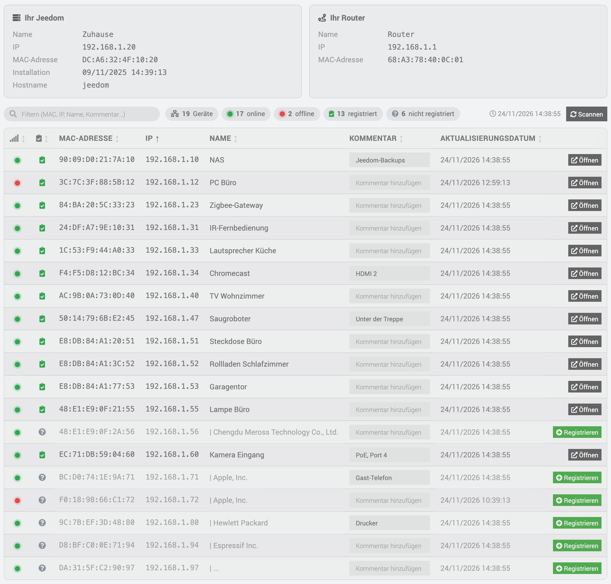

Oben im Fenster fassen zwei Karten Ihr Jeedom (IP, MAC-Adresse, Installationsdatum, Hostname) und Ihren Router (Name, IP, MAC-Adresse) zusammen.

Die Werkzeugleiste bietet:
- einen Filter für die Suche nach MAC-Adresse, IP, Name oder Kommentar
- Zähler (Geräte, online, offline, registriert, nicht registriert): Ein Klick auf einen Zähler filtert die Tabelle, ein zweiter Klick hebt den Filter auf; Zähler mit dem Wert null werden nicht angezeigt
- das Datum des letzten Scans und eine Schaltfläche "Scannen", um einen neuen Scan mit Fortschrittsbalken zu starten

Die Tabelle zeigt das gesamte Netzwerk:

- Die 1. Spalte zeigt, ob das Gerät "Online" oder "Offline" ist
- Die 2. Spalte zeigt, ob das Gerät "registriert", "registriert, aber deaktiviert" oder "nicht registriert" ist
- Die 3. Spalte zeigt die MAC-Adresse des Geräts
- Die 4. Spalte zeigt die IP des Geräts
- Die 5. Spalte zeigt den Namen des Geräts, falls es registriert ist, sonst den Herstellernamen mit vorangestelltem "|"
- In der 6. Spalte können Sie einem Gerät einen Kommentar zuordnen (er wird während der Eingabe automatisch gespeichert; leeren Sie das Feld, um einen Kommentar zu löschen)
- Die 7. Spalte zeigt, wann das Gerät zuletzt gesehen wurde
- Die letzte Spalte bietet "Registrieren" für ein nicht registriertes Gerät (das Gerät wird erstellt und seine Seite geöffnet, damit Sie es benennen und aktivieren können) oder "Öffnen", um zur Seite eines bereits registrierten Geräts zu gelangen

> Wenn Sie "|..." im Namen eines Geräts sehen, wurde sein Hersteller nicht erkannt.

### Registrierte Geräte

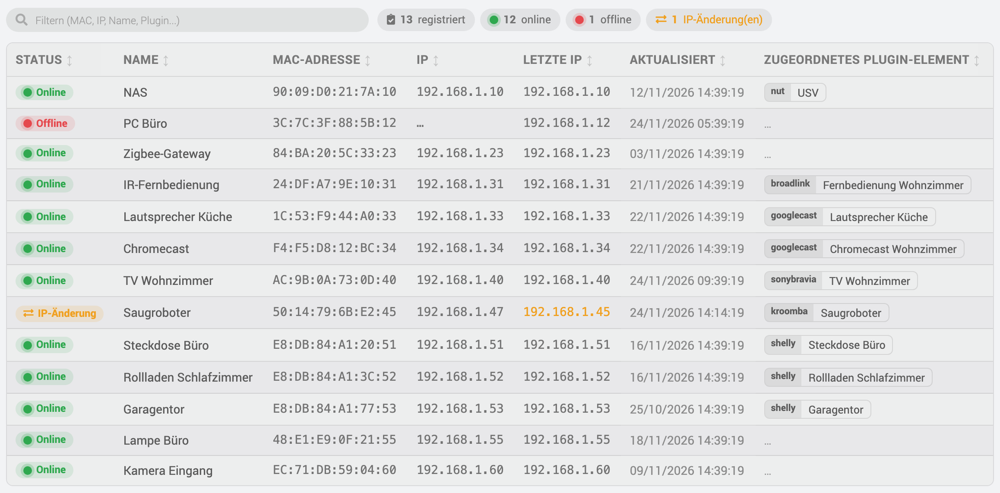

Die Werkzeugleiste bietet einen Filter und anklickbare Zähler (registriert, online, offline, IP-Änderungen).

- Die 1. Spalte zeigt den Zustand des Geräts: "Online", "Offline" oder "IP-Änderung"
- Die 2. Spalte zeigt den Namen des Geräts
- Die 3. Spalte zeigt die MAC-Adresse des Geräts
- Die 4. Spalte zeigt die IP des Geräts
- Die 5. Spalte zeigt die bei der letzten Verbindung verwendete IP (in Orange, wenn sie von der aktuellen IP abweicht)
- Die 6. Spalte zeigt das Datum der letzten Aktualisierung des Geräts
- Die 7. Spalte zeigt alle dem Gerät zugeordneten Bridges. Ein Klick darauf führt Sie zum Gerät im zugehörigen Plugin.

### Nicht registrierte Geräte

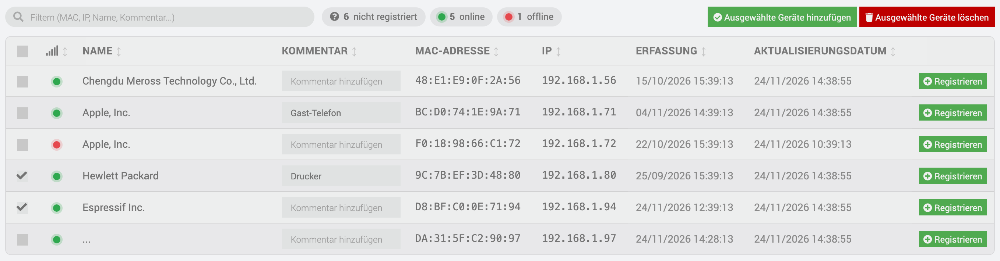

Die Werkzeugleiste bietet einen Filter und anklickbare Zähler (nicht registriert, online, offline).

- In der 1. Spalte können Sie das Gerät auswählen* (um es direkt zu Ihren Geräten hinzuzufügen oder aus dem Netzwerkarchiv zu löschen); das Kontrollkästchen in der Kopfzeile wählt alle angezeigten Zeilen aus
- Die 2. Spalte zeigt, ob das Gerät "Online" oder "Offline" ist
- Die 3. Spalte zeigt den Namen des Geräts
- In der 4. Spalte können Sie einen Kommentar zum Gerät eingeben, der automatisch gespeichert wird
- Die 5. Spalte zeigt die MAC-Adresse des Geräts
- Die 6. Spalte zeigt die vom Gerät verwendete IP
- Die 7. Spalte zeigt das Datum der ersten Erfassung in Ihrem Netzwerk
- Die 8. Spalte zeigt, wann das Gerät zuletzt gesehen wurde
- Die letzte Spalte bietet "Registrieren", um das Gerät direkt zu erstellen und seine Seite zu öffnen

> \* Wenn Sie ein oder mehrere Elemente auswählen, erscheinen Aktionsschaltflächen.

## Ihre Geräte

### Im normalen Modus

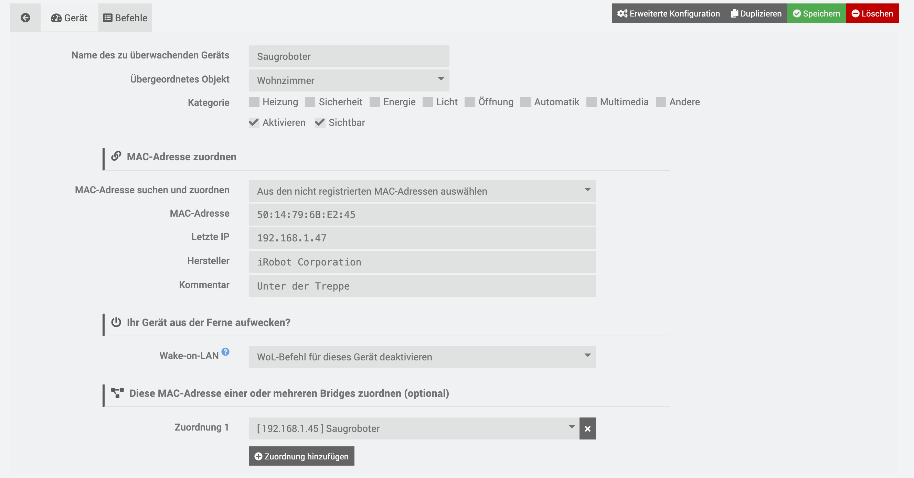

#### MAC-Adresse suchen

Mit diesem Auswahlmenü können Sie direkt nach einem Element Ihres Netzwerks suchen und seine MAC-Adresse übernehmen.

> Es werden nur noch nicht zugeordnete MAC-Adressen angeboten, um Duplikate zu vermeiden.

#### Zugeordnete MAC-Adresse

Dieses Feld wird:
- entweder automatisch über das Menü "MAC-Adresse suchen" ausgefüllt
- oder manuell ausgefüllt, wenn Sie die Ankunft eines Geräts in Ihrem Netzwerk vorwegnehmen möchten

#### Hersteller

Wurde der Hersteller erkannt, wird er hier angezeigt.

#### Wake-on-LAN

Fügt einen WoL-Aktionsbefehl hinzu, der das Gerät aus der Ferne einschaltet.

> Prüfen Sie, ob Ihr Gerät kompatibel ist und die Option darauf aktiviert ist, damit dies funktioniert.

#### Zuordnung

Ordnen Sie hier die MAC-Adresse des Geräts einem oder mehreren Elementen der Bridges zu (höchstens 10). Bei jedem Scan erhält jedes zugeordnete Element die aktuelle IP des Geräts.

- Das Auswahlmenü gruppiert die Elemente nach Plugin; jedes Element wird so angezeigt: `[im Plugin gespeicherte IP] Name des Elements`. Ein Element, dessen Bridge deaktiviert ist, wird mit „Bridge deaktiviert“ gekennzeichnet.
- Ein Element, das bereits einem anderen Scan.Ip-Gerät zugeordnet ist, wird nicht angeboten.
- „Zuordnung hinzufügen“ öffnet eine zusätzliche Zeile, das Kreuz entfernt eine Zuordnung.

> Achtung, diese Option verändert andere Plugins. Verwenden Sie sie in voller Kenntnis der Sache. Der Autor des Ziel-Plugins ist in keiner Weise für Fehlfunktionen verantwortlich, die dadurch in seinem Plugin entstehen könnten.

> Solange Sie keine Zuordnung zu einem Plugin vornehmen, nimmt Scan.Ip keine Änderung daran vor.

> Eine Zuordnung, die keine Bridge erkennt (Bridge gelöscht, Element nicht gefunden…), bleibt angezeigt und erhalten, wird aber nicht mehr aktualisiert.

> Um eine zusätzliche Bridge vorzuschlagen, verwenden Sie die Schaltfläche „Vorschlagen“ im Fenster „Bridges“ (siehe „Eine Bridge für den Katalog vorschlagen“).

### Im erweiterten Modus

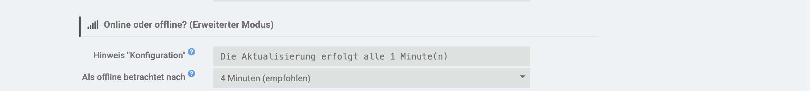

#### Hinweis "Konfiguration"

Erinnert Sie an das in der Plugin-Konfiguration gespeicherte Aktualisierungsintervall.

#### Als offline betrachtet nach

Standardmäßig 4 Minuten: Wenn Sie alles auf den Standardwerten gelassen haben, sind das 1 Scan pro Minute und 4 Durchläufe, um festzustellen, ob das Gerät wirklich offline ist.
Denken Sie daran, dass nicht jedes Gerät bei jedem Scan erscheint.

> Wenn Sie das Aktualisierungsintervall auf 3 Minuten eingestellt haben, setzen Sie diesen Parameter auf mindestens 15 Minuten.

> Bei sehr reaktionsschnellen kabelgebundenen Geräten kann dieser Parameter gesenkt werden, zum Beispiel auf 2 Minuten bei einem Intervall von 1 Minute. Das entspricht 2 Durchläufen, um den Zustand festzustellen.

### Im Debug-Modus

Im Debug-Modus zeigt das Feld „MAC Id“ die interne Kennung des Geräts an: die letzten drei Bytes seiner MAC-Adresse. Es ist schreibgeschützt und hilft bei der Diagnose einer MAC-Zuordnung, die nicht funktioniert.

### Zugeordnete Befehle

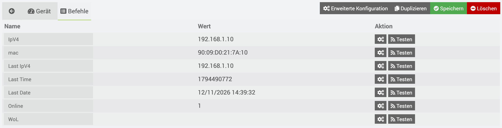

| Befehl | Beschreibung |
|---|---|
| IpV4 | IP des Geräts im v4-Format |
| Wol | der Aktionsbefehl, um das Gerät aus der Ferne einzuschalten; nur vorhanden, wenn Wake-on-LAN für das Gerät aktiviert ist |
| Last Date | Datum im Format TT/MM/JJJJ HH:MM:SS, an dem das Gerät zuletzt wieder online kam oder seine IP änderte |
| Last IpV4 | letzte vom Gerät verwendete IP |
| Last Time | dasselbe Datum wie "Last Date", als Zeitstempel |
| mac | MAC-Adresse des Geräts |
| Online | Zustand des Geräts |

### Zugeordnete Widgets

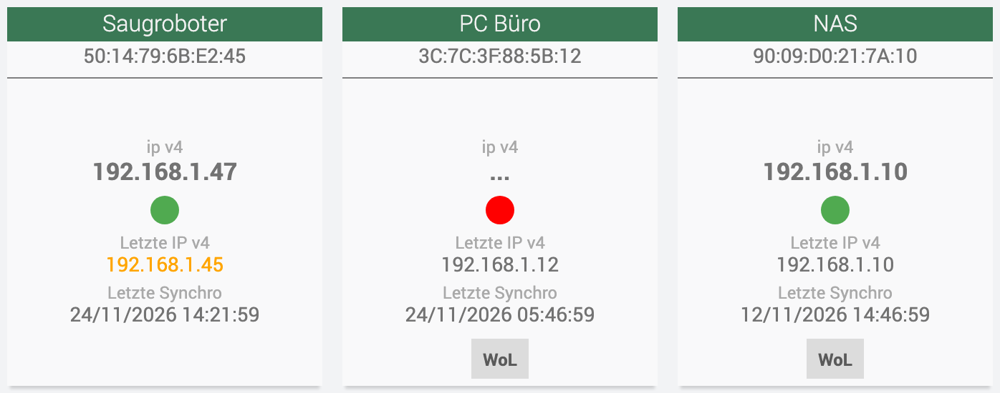

Das Widget zeigt die MAC-Adresse des Geräts, seine IP, seinen Zustand, seine letzte bekannte IP (in Orange, wenn sie von der aktuellen IP abweicht) und das Datum, an dem es zuletzt wieder online kam oder seine IP änderte. Die Schaltfläche WoL erscheint, wenn Wake-on-LAN für das Gerät aktiviert ist.

## Bridges

Scan.Ip verwendet Bridges, um Daten in anderen Plugins zu aktualisieren.

> Konkret übertragen Bridges die IP-Änderung eines Geräts automatisch in die anderen Plugins (zum Beispiel, wenn sich seine IP im DHCP nicht festlegen lässt).

Die Konfiguration zeigt die Anzahl der aktiven Bridges. Die Schaltfläche „Bridges verwalten“ bzw. das Symbol „Bridges“ auf der Plugin-Seite öffnet ihre Verwaltung.

Eine Bridge bezeichnet **ein Feld, das eine IP enthält**, in einem Plugin:

- die Konfiguration seiner Geräte (zum Beispiel `addr` bei Shelly);
- die logische Kennung (logicalId) seiner Geräte;
- die Konfiguration seiner Befehle (zum Beispiel ein Skript-Befehl, der eine IP enthält);
- die Konfiguration des Plugins selbst (zum Beispiel die Adresse eines Gateways). `{n}` ersetzt eine Nummer, wenn das Plugin mehrere Gateways verwaltet (`wifizigate_{n}`).

Die Art der Aktualisierung wird bei jeder IP-Änderung automatisch erkannt: Ein leeres Feld oder ein Feld, das nur die IP enthält, wird vollständig ersetzt; bei einem Feld, das die IP innerhalb eines Werts enthält (URL, `host:port`…), wird nur die IP ersetzt; ein Feld ohne IP (Hostname…) wird nicht verändert. In der normalen Ansicht gilt immer diese automatische Erkennung; in der erweiterten Ansicht können Sie das eine oder andere Verhalten erzwingen.

Mehr als 60 Bridges werden mitgeliefert (Katalog): Die der installierten Plugins sind standardmäßig aktiv, sie verändern ein Plugin aber nur für die Elemente, die Sie einem Scan.Ip-Gerät zugeordnet haben. Die Tabelle zeigt für jede Bridge die Anzahl der gefundenen Elemente und die Anzahl der einer MAC-Adresse zugeordneten Elemente sowie ihre Herkunft: „Katalog“ (mit Scan.Ip geliefert), „Geänderter Katalog“ (geliefert und von Ihnen geändert) oder „Persönlich“ (von Ihnen erstellt). Sie können:

- eine Bridge mit dem Schalter in der ersten Spalte **aktivieren oder deaktivieren**. Eine deaktivierte Bridge aktualisiert nichts mehr, ihre Zuordnungen bleiben jedoch erhalten;
- eine Bridge **testen** (Schaltfläche „Testen“): Standardmäßig werden nur die einer MAC-Adresse zugeordneten Elemente getestet, jedes mit der aktuellen IP seines Geräts – genau das, was der nächste Scan tun wird. Sie können auch ein Element auswählen und ihm eine IP Ihrer Wahl zuweisen. Es wird nichts gespeichert;
- eine Bridge des Katalogs **ändern** (sie erscheint dann als „geänderter Katalog“) und jederzeit zu ihrer ursprünglichen Version zurückkehren;
- eigene Bridges **erstellen**.

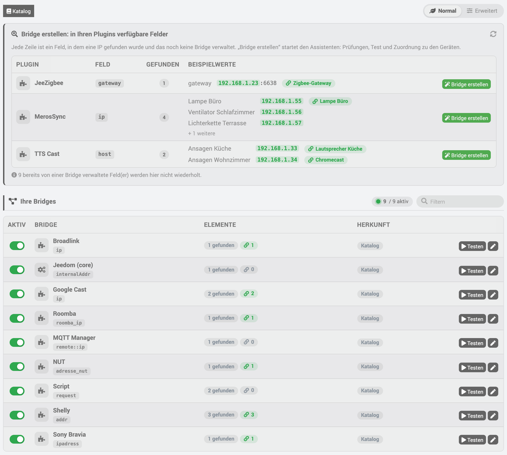

Die Schaltfläche „Katalog“ zeigt schreibgeschützt die ursprüngliche Konfiguration aller mitgelieferten Bridges (Ort, Feld, Art der Aktualisierung, Bedingungen, Optionen), auch für nicht installierte Plugins, als Vorlage beim Erstellen einer Bridge.

Die Liste zeigt die Bridges, die Elemente in Ihren Plugins finden, sowie die von Ihnen erstellten oder geänderten. Die übrigen mitgelieferten Bridges (Feld bei Ihnen leer, Plugin nicht installiert) können im Katalog eingesehen werden; sie erscheinen von selbst, sobald das betreffende Feld ausgefüllt ist.

Das Fenster bietet wie die Plugin-Konfiguration zwei Ansichten (die Standardansicht folgt dem in der Konfiguration gewählten Modus, die letzte Wahl wird gespeichert). Sie listen dieselben Bridges auf:

- **normale Ansicht**: das Wesentliche. Die Suche zeigt nur die IPs, die noch von keiner Bridge verwaltet werden; das Formular zeigt Plugin, Ort und Feld an, ohne sie ändern zu lassen, und beschränkt sich auf den Test (die Art der Aktualisierung wird automatisch erkannt). Vorhandene Bedingungen werden angezeigt und weiterhin angewendet;
- **erweiterte Ansicht**: zusätzliche Details und Einstellungen: Ort und Bedingungen in der Liste; Bedingungen, Art der Aktualisierung, Dienst (Daemon) und Präzisierung im Formular; manuelle Erstellung einer Bridge.

Dieselbe Bridge in der normalen und dann in der erweiterten Ansicht:

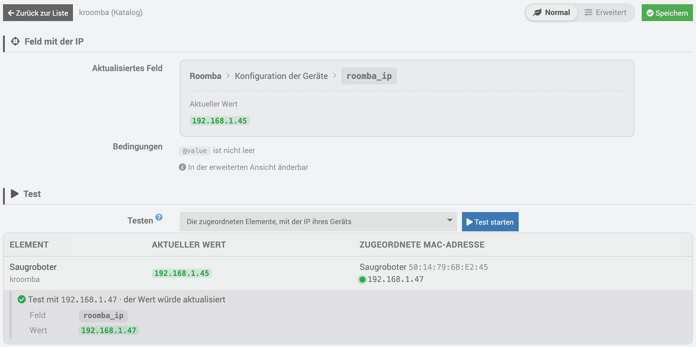

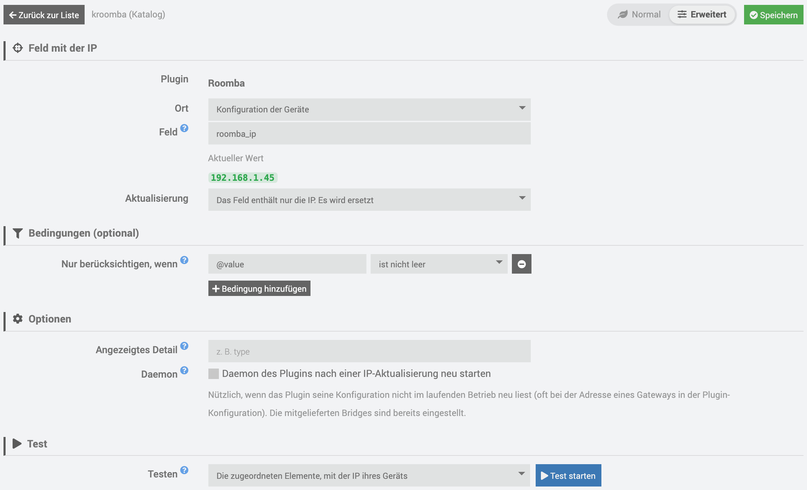

Das Plugin einer bestehenden Bridge kann nicht geändert werden: Erstellen Sie eine neue Bridge für ein anderes Plugin.

### Eine Bridge erstellen

Beim Öffnen des Fensters „Bridges“ sucht Scan.Ip nach den IPs in der Konfiguration Ihrer Plugins (Geräte, Befehle, Plugin-Konfiguration) und listet die Felder auf, die noch keine Bridge verwaltet, mit Beispielwerten. Eignet sich kein Plugin, zeigt das Fenster dies an. Das Aktualisierungssymbol startet die Suche erneut.

Die Schaltfläche „Bridge erstellen“ einer Zeile startet den Assistenten (Schritte Feld, Prüfungen, Fertig), der die Konfiguration prüft, bevor irgendetwas erstellt wird:

- die gefundenen Elemente und die Art der Aktualisierung (das ganze Feld oder nur die darin enthaltene IP);
- Werte, die mehrere IPs enthalten;
- ein Schreibtest ohne Änderung bei jedem Element (es wird nichts verändert);
- ob der Dienst des Plugins neu gestartet werden muss: Jeedom benachrichtigt das Plugin, wenn einer seiner Parameter (`postConfig_…`) oder eines seiner Geräte (`postSave`) gespeichert wird. Hat das Plugin einen Dienst und reagiert es nicht auf dieses Feld, wird der Neustart automatisch aktiviert; der Assistent weist lediglich darauf hin, die Einstellung bleibt anschließend im Formular der Bridge in der erweiterten Ansicht änderbar.

Für jedes Element können Sie den Wert testen, den die Bridge mit einer IP Ihrer Wahl schreiben würde, und es einem mit dem Plugin verbundenen Scan.Ip-Gerät zuordnen (gleiche IP oder bereits einem anderen Element des Plugins zugeordnet). Die Zuordnung ist optional: Sie kann später über die Seite des Scan.Ip-Geräts erfolgen. Die Bridge kann nicht erstellt werden, wenn das Plugin kein Element für dieses Feld hat.

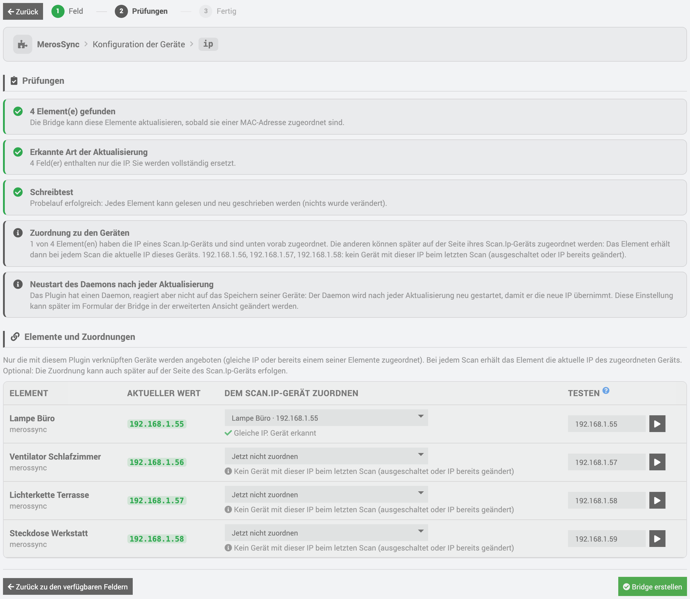

Am Ende öffnet die Schaltfläche „Bridge testen“ die Simulation, und „Fertigstellen“ kehrt zur Liste zurück.

Bereits von einer Bridge verwaltete Felder werden in der Suche unabhängig von der Ansicht nicht wiederholt: Sie stehen in der Liste der Bridges. In der erweiterten Ansicht öffnet der Stift einer Zeile das vorausgefüllte Formular, und „Manuelle Erstellung“ erstellt eine Bridge von Grund auf.

### Bedingungen

Eine Bridge kann nur für bestimmte Elemente gelten. Alle Bedingungen müssen erfüllt sein. Eine Bedingung bezieht sich auf ein anderes Feld desselben Geräts (oder desselben Befehls bzw. der Plugin-Konfiguration): ist gleich, ist ungleich, ist einer der Werte (kommagetrennte Liste), enthält, ist leer, ist nicht leer, entspricht einem regulären Ausdruck…

Besondere Felder: `@value` (der Wert des IP-Felds), `@name` (Name des Elements), `@eqName` (Name des Geräts), `@isEnable` (Gerät aktiv) und `@logicalId`.

Beispiel: Die Bridge VMware berücksichtigt nur die Geräte, deren Feld `type` gleich `ESXi` ist.

Die Option „Dienst des Plugins neu starten“ (erweiterte Ansicht) startet den Dienst des Plugins nach einer IP-Aktualisierung neu, für Plugins, die ihre Konfiguration nicht im laufenden Betrieb neu einlesen. Die mitgelieferten Bridges sind bereits eingestellt; bei einer über die Suche erstellten Bridge wird sie automatisch aktiviert, wenn sich das Feld in der Konfiguration eines Plugins mit eigenem Dienst befindet.

Anschließend können Sie ein Gerät einem oder mehreren Elementen dieser Bridges zuordnen.

### Eine Bridge für den Katalog vorschlagen

Eine von Ihnen erstellte oder geänderte Bridge kann mit der Schaltfläche „Vorschlagen“ zur Aufnahme in den Katalog vorgeschlagen werden. Die Regel wird vor dem Senden im Katalogformat angezeigt: Es wird nur die Regel übermittelt (Plugin, Ort, Feld, Bedingungen, Optionen), niemals die IPs, Werte oder Gerätenamen Ihrer Installation. Prüfen Sie einfach, dass die Werte der Bedingungen nichts Persönliches enthalten.

- **GitHub**: öffnet ein vorausgefülltes Issue im Repository des Plugins (GitHub-Konto erforderlich);
- **Jeedom-Forum**: kopiert den Vorschlag in die Zwischenablage und öffnet das Thema des Plugins auf community.jeedom.com ([Plugin Scan.Ip - MAJ](https://community.jeedom.com/t/plugin-scan-ip-maj/48722)): Klicken Sie auf „Antworten“ und fügen Sie ihn ein.

## Von Scan.Ip verwaltete Widgets

Standardmäßig enthält dieser Bereich 2 Widgets (sie können umbenannt werden):
- Scan.Ip Widget Alertes
- Scan.Ip Widget Network

Diese Geräte werden direkt vom Plugin verwaltet und entsprechen Ihrer Konfiguration des Plugins.

> Zur Erinnerung: Ihre Anzeige wird in der Konfiguration des Plugins verwaltet.

### Das Widget Netzwerk

Diese Option blendet das Netzwerk-Widget ein oder aus.

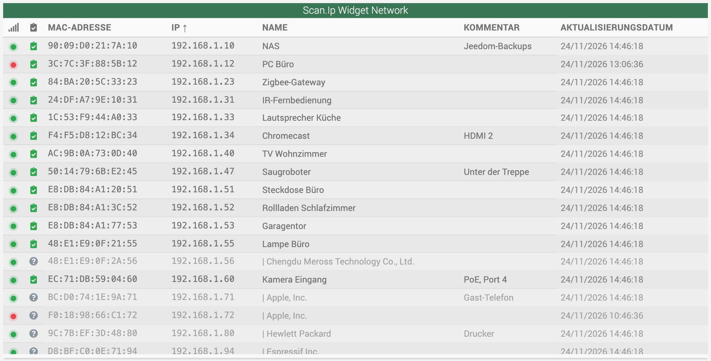

> Sie können die Spalten mit einem Klick auf ihre Überschrift sortieren.

> Sie können außerdem im zugehörigen Gerät dieses Widgets eine Standardsortierung festlegen.

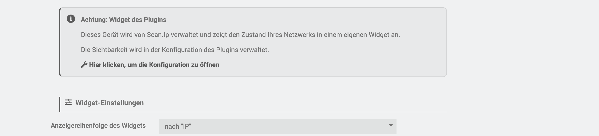

### Das Widget Warnungen

Diese Option blendet das Widget der Warnungen ein oder aus.

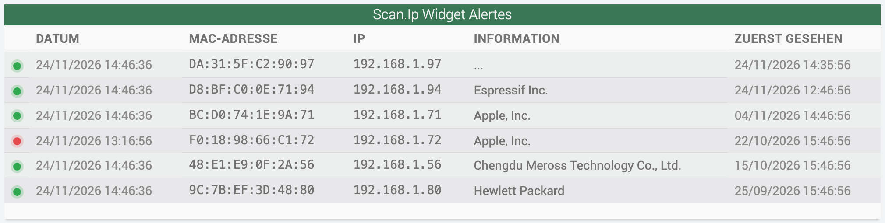

> Dieses Widget zeigt nur nicht registrierte Geräte an, sortiert nach Verbindungsdatum und dann nach dem Datum der ersten Erfassung. Ein ganz neues Gerät erscheint daher an erster Stelle.

#### Zugeordnete Befehle

Es werden 10 Befehlsgruppen erstellt. Sie entsprechen den 10 letzten nicht registrierten Geräten, die sich verbunden haben. Die chronologische Reihenfolge beginnt bei null (das neueste) und endet bei neun (das älteste).

Jedes Element hat 6 Unterbefehle:

| Befehl | Beschreibung |
|---|---|
| Connexion 0 Création | Zeitstempel der ersten Erfassung |
| Connexion 0 Date | Datum im Format TT/MM/JJJJ HH:MM:SS, an dem es zuletzt gesehen wurde |
| Connexion 0 Time | Zeitstempel, an dem es zuletzt gesehen wurde |
| Connexion 0 Equipement | Name des Herstellers, falls bekannt |
| Connexion 0 IpV4 | zugewiesene IP im v4-Format |
| Connexion 0 MAC | MAC-Adresse des Geräts |

## Konfiguration

Um die Bedienung zu erleichtern, passt das Plugin die angebotenen Optionen an drei Modi an: "normal", "erweitert" und "debug".

Der Modus wird mit dem Auswahlschalter „Anzeigemodus“ oben in der Konfiguration gewählt, der zu jedem Modus angibt, was er anzeigt. Abschnitte, die nur im erweiterten Modus oder im Debug-Modus erscheinen, tragen rechts neben ihrem Titel ein Abzeichen „Erweitert“ oder „Debug“, und Ja/Nein-Optionen werden mit Schaltern eingestellt.

### Normaler Modus

Der normale Modus zeigt die wichtigsten Einstellungen, die in der Regel für Standardkonfigurationen passen: Widgets, Aktualisierungsintervall, Herstellerdateien und Bridges.

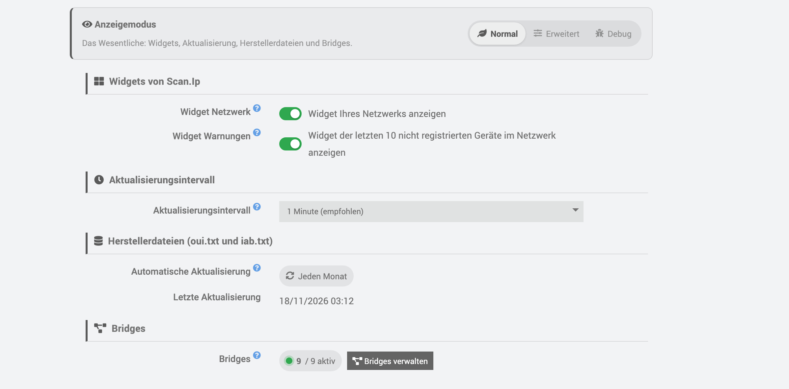

#### Aktualisierungsintervall

Legt das Aktualisierungsintervall der geplanten Aufgabe fest.
Standardmäßig ist es auf 1 Minute eingestellt.

> Nicht alle Geräte antworten bei jedem Scan, da manche zu lange für eine Antwort brauchen (zum Beispiel WLAN-Geräte). Es wird daher empfohlen, mindestens 3 Scans abzuwarten, bevor ein Gerät als wirklich offline gilt. Diese Einstellung kann für jedes Gerät genauer angepasst werden.

#### Herstellerdateien (oui.txt und iab.txt)

Diese Dateien ermitteln den Hersteller eines Geräts anhand seiner MAC-Adresse. Sie werden jeden Monat automatisch von der IEEE-Website aktualisiert; bei einem Fehler bleiben die vorhandenen Dateien erhalten und am nächsten Tag erfolgt ein neuer Versuch.

Je nach Modus zeigt dieser Abschnitt:
- **normaler Modus**: die Aktualisierungshäufigkeit und das Datum der letzten Aktualisierung
- **erweiterter Modus**: zusätzlich die Wahl der Häufigkeit (jeden Monat, jede Woche) oder die Deaktivierung der automatischen Aktualisierung
- **Debug-Modus**: zusätzlich den Zustand jeder Datei und eine Schaltfläche „Jetzt aktualisieren“

### Erweiterter Modus

Der erweiterte Modus fügt Abschnitte hinzu, die mit dem Abzeichen „Erweitert“ gekennzeichnet sind, sowie zusätzliche Einstellungen in den bestehenden Abschnitten (zum Beispiel die Aktualisierungshäufigkeit der Herstellerdateien).

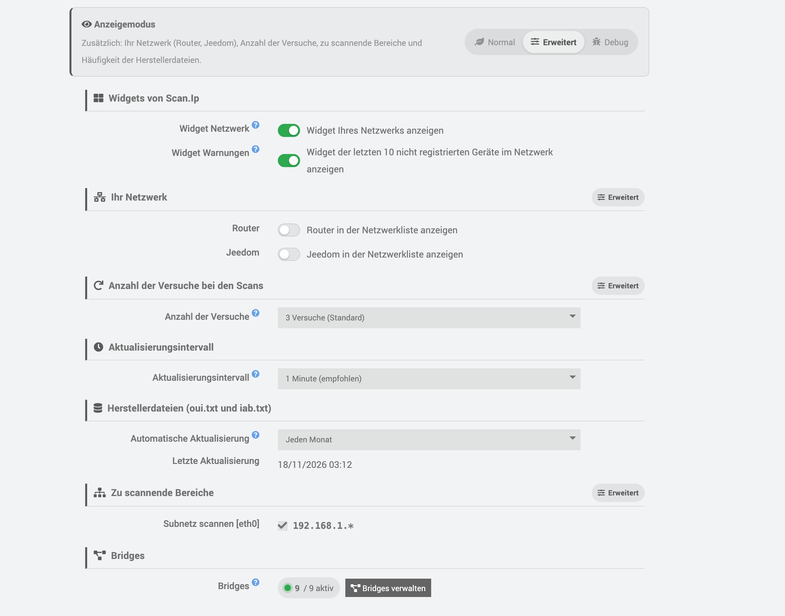

#### Ihr Netzwerk

- **Router**: zeigt den Router in der Netzwerkliste an. Standardmäßig ist er entfernt.
- **Jeedom**: zeigt den Jeedom-Server in der Netzwerkliste an. Standardmäßig ist er entfernt.

#### Anzahl der Versuche bei den Scans

Legt die Anzahl der Versuche bei den Netzwerkscans fest. Nicht alle Geräte antworten beim ersten Versuch. Je mehr Versuche, desto länger dauert der Scan.

#### Zu scannende Bereiche

Wenn Sie mehrere Netzwerkkarten oder Subnetze haben, markieren Sie das oder die zu scannenden Subnetze. Es werden nur Schnittstellen mit einer IPv4-Adresse angeboten (virtuelle Docker-Schnittstellen oder nicht verbundene Karten werden nicht aufgeführt).

> Ein Subnetz erlaubt eventuell nicht, die darin befindlichen MAC-Adressen abzurufen (Sperre am Router oder Ähnliches). In diesem Fall müssen Sie in diesem Subnetz ein weiteres Jeedom mit einem eigenen Scan.Ip installieren.

> Die Dauer eines Scans hängt von der Größe des Subnetzes ab: einige Sekunden für ein `/24` (254 Adressen), mehrere Minuten für ein `/16` (65.534 Adressen).

### Debug-Modus

Die dem Debug-Modus vorbehaltenen Abschnitte tragen das Abzeichen „Debug“.

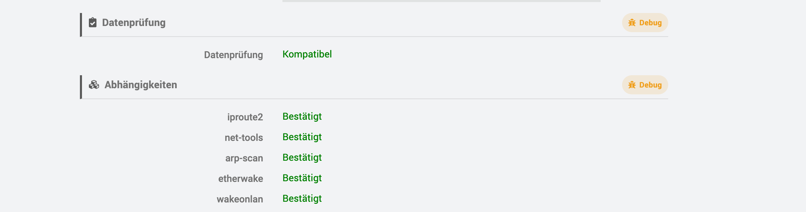

#### Datenprüfung

Prüft, ob die vom Plugin gespeicherten Daten das Format der installierten Version haben. Ist alles korrekt, wird „Kompatibel“ in Grün angezeigt; andernfalls startet eine rote Schaltfläche „Inkompatible Daten (Hier klicken, um das Problem zu beheben)“ die Korrektur.

#### Abhängigkeiten

Zeigt den Status jeder Abhängigkeit (iproute2, net-tools, arp-scan, etherwake, wakeonlan): „Bestätigt“ in Grün, wenn sie installiert ist. Zeigt auf einen Blick, welche Abhängigkeiten fehlgeschlagen sind.

## Subnetze und Scan.Ip

Scan.Ip kann mehrere Netzwerke gleichzeitig verwalten.
Dazu muss Ihr Jeedom mit den verschiedenen Netzwerken verbunden sein.
Sie können zum Beispiel das WLAN Ihres Jeedom-Rechners mit einem Netzwerk und das Netzwerkkabel mit dem anderen verbinden oder einfach "USB/Ethernet"- oder "USB/WLAN"-Adapter an Ihr Jeedom anschließen.
Scan.Ip zeigt Ihnen die Subnetze an, die Sie anschließend in der Konfiguration des Plugins (im erweiterten Modus) aktivieren können.

## Debug (nur im Debug-Modus)

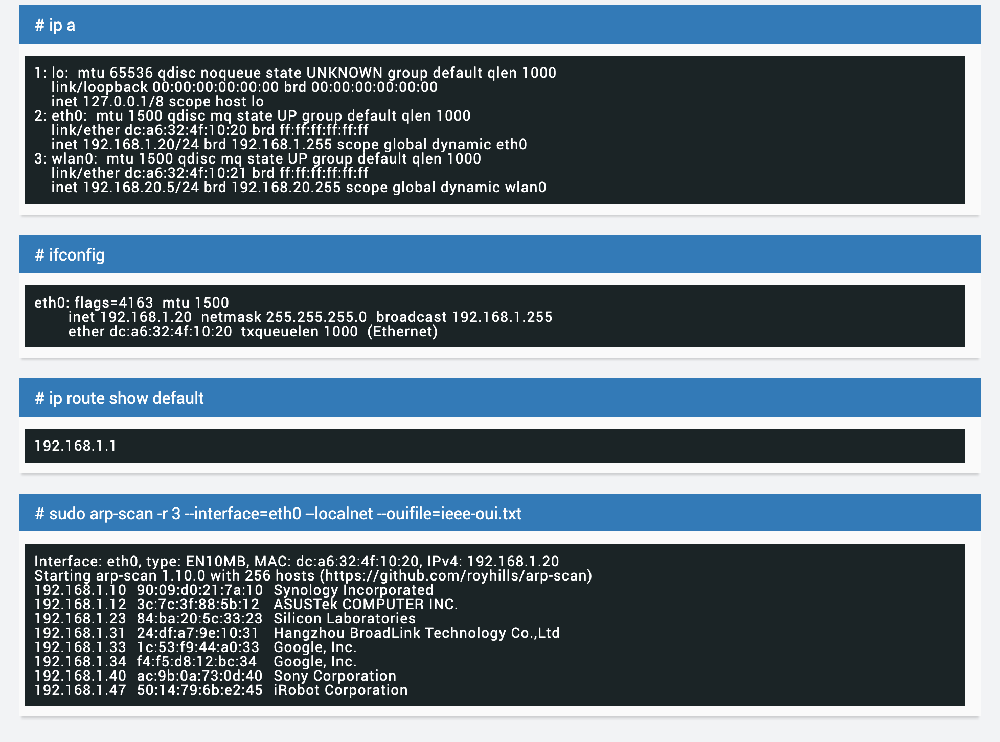

Dieses Fenster hilft, mögliche Fehler zu verstehen.

#### ip a

Ergebnis des Befehls `ip a`, der alle von Ihrem Jeedom aus erreichbaren Netzwerke auflistet.

#### ip route

Zeigt die IP des Routers an, mit dem Ihr Jeedom verbunden ist.

#### arp-scan

> Hier ist das Netzwerk "eth0" ausgewählt, dies hängt jedoch von Ihrem Netzwerk ab.

Ergebnis des Befehls `sudo arp-scan -r 3 --interface=eth0 --localnet --ouifile=ieee-oui.txt`, der die Geräte auflistet, die auf den Scan antworten.

> Wie oben erwähnt, erscheinen möglicherweise nicht alle verbundenen Geräte bei einem einzigen Scan. Deshalb sind mehrere Scans nötig, um ein genaues Bild der verbundenen Geräte zu erhalten.

#### Equipements

Zeigt die Daten aus dem Geräte-JSON. Dies ist der Verlauf aller Geräte, die sich mit Ihrem Netzwerk verbunden haben.

#### Mappings

Zeigt die Daten aus dem Mapping-JSON. Dies ist der letzte Zustand Ihres Netzwerks mit der verwendeten Version von "arp-scan".

## Beispielszenarien

Die Befehle des Plugins können als Auslöser in Jeedom-Szenarien verwendet werden. Ersetzen Sie in den folgenden Beispielen `[Aucun]` durch das übergeordnete Objekt Ihrer Geräte und den Sendebefehl durch den Ihres Benachrichtigungs-Plugins (SMS, Telegram, Jeedom Connect…).

### Eine SMS erhalten, wenn sich ein neues Gerät verbindet

Das Widget Warnungen hält das neueste unbekannte Gerät auf Position 0. Dieses Szenario wird ausgelöst, wenn sich diese Position ändert, und prüft, ob das Gerät gerade zum ersten Mal erkannt wurde.

- **Modus**: Ausgelöst
- **Auslöser**: `#[Aucun][Scan.Ip Widget Alertes][Connexion 0 Création]#`
- **WENN**: `#[Aucun][Scan.Ip Widget Alertes][Connexion 0 Création]# > #timestamp# - 180`
- **DANN**: SMS-Sendebefehl mit der Nachricht
  `Neues Gerät im Netzwerk: #[Aucun][Scan.Ip Widget Alertes][Connexion 0 MAC]# (#[Aucun][Scan.Ip Widget Alertes][Connexion 0 IpV4]#, #[Aucun][Scan.Ip Widget Alertes][Connexion 0 Equipement]#)`

> Die Bedingung lässt nur Geräte durch, die vor weniger als 3 Minuten zum ersten Mal erkannt wurden: Eine bloße Änderung der Reihenfolge der Liste löst keine Warnung aus.

> Das Widget Warnungen muss in der Konfiguration des Plugins aktiviert sein. Kommen mehrere neue Geräte im selben Scan hinzu, wird nur eine Warnung gesendet.

### Benachrichtigt werden, wenn ein registriertes Gerät das Netzwerk verlässt

Bei einem registrierten MAC-Gerät (zum Beispiel "Aspirateur robot") wechselt der Befehl **Online** auf 0, wenn das Gerät als offline gilt.

- **Modus**: Ausgelöst
- **Auslöser**: `#[Aucun][Aspirateur robot][Online]#`
- **WENN**: `#[Aucun][Aspirateur robot][Online]# == 0`
- **DANN**: Benachrichtigungsbefehl mit der Nachricht
  `Der Saugroboter ist nicht mehr mit dem Netzwerk verbunden`

> Die Zeit, bis das Gerät als offline gilt, wird im Gerät eingestellt („Als offline betrachtet nach“, im erweiterten Modus).

> Variante: Mit dem Auslöser `#[Aucun][Aspirateur robot][IpV4]#` und der Bedingung `#[Aucun][Aspirateur robot][IpV4]# != ""` werden Sie bei jeder IP-Änderung des Geräts benachrichtigt.

## FAQ

**Verändert Scan.Ip meine anderen Plugins?**
Nur die Elemente, die Sie einem Scan.Ip-Gerät zugeordnet haben, und nur das Feld mit der IP. Ohne Zuordnung wird nichts verändert.

**Ein eingeschaltetes Gerät erscheint offline**
Manche Geräte, vor allem im WLAN, antworten nicht auf jeden Scan. Erhöhen Sie „Als offline betrachtet nach“ beim Gerät oder die Anzahl der Versuche (erweiterter Modus).

**Als Hersteller wird „...“ angezeigt**
Das Präfix der MAC-Adresse fehlt in den Herstellerdateien. Das gilt auch für Telefone mit privater (zufälliger) MAC-Adresse: Sie kann sich ändern, deaktivieren Sie diese Option am Telefon, um es zu verfolgen.

**Es werden nur Container gefunden**
Jeedom läuft unter Docker ohne `network_mode: host`, siehe „Installation“.

**Brauche ich noch feste IPs im DHCP?**
Mit Bridges nicht unbedingt, es bleibt aber die einfachste Lösung, wenn Ihr Router es erlaubt.
