# Scan.Ip plugin

This plugin scans your network and retrieves the list of connected devices along with their MAC addresses.

With this information, the plugin lets you:
- retrieve the new IP of a device
- display a widget showing the state of your network
- display a widget listing the unregistered devices that have just connected to the network
- display one widget per registered device, with the commands associated with that device
- create alerts when a device disappears, appears or changes IP on the network
- automate IP changes in cascade in other plugins through bridges
- turn a device on remotely (Wake-on-LAN)

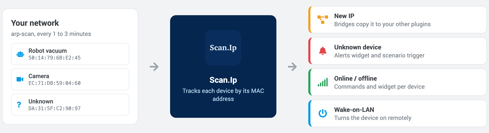

## Installation

- Jeedom 4.0 minimum, compatible with PHP 7 and PHP 8.
- This plugin requires "arp-scan", "wakeonlan" and "etherwake" (installed with the dependencies).
- It uses the "oui.txt" and "iab.txt" files provided by "standards-oui.ieee.org".
- It uses the APIs provided by "macvendors.com" and "macvendors.co".

> **Jeedom on Docker**: the Jeedom container must use `network_mode: host`. Otherwise it only sees Docker's internal network (often a `/16` of 65,534 addresses): scans take several minutes and only find the other containers, not the devices on your network.

## Getting started

1. **Install and activate the plugin**, then wait for the dependencies to finish installing.
2. Open the plugin page and click **Synchronize**: the first scan lists the devices on the network.
3. Open **Network** and click **Register** next to each device you want to track. Its page opens: name it, enable it, then save.
4. If another plugin uses this device's IP, choose the matching element under **Association**: Scan.Ip will copy every IP change to it.
5. Wait for a few scans before relying on the “Offline” state: some Wi-Fi devices do not answer every time.

## Device management

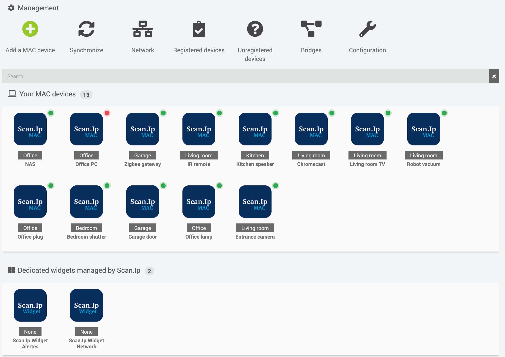

> Devices are split into two parts: "Your MAC devices" and "Widgets dedicated to and managed by Scan.Ip". Do not delete the latter unless there is a bug. To delete them, enable debug mode so that the "Delete" button appears.

### Access icons

The “Management” bar groups the plugin's shortcuts: Add a MAC device, Synchronize, Network, Registered devices, Unregistered devices, Bridges, Debug (debug mode only) and Configuration.

In debug mode, a Debug icon appears. It appears or disappears as soon as you change mode, without reloading the page.

### Add a MAC device

Adds a device when you know the MAC address of the device to add.

> It is easier to go through "Unregistered devices" or "Network", which let you add one or more devices on your network on the fly.

### Synchronize

Starts a new scan and updates the devices. A progress bar shows the current step, the percentage, the elapsed time and an estimate of the remaining time; the page reloads when the scan is complete.

> If an automatic scan is already running, the progress bar follows that scan instead of starting a second one.

### Network

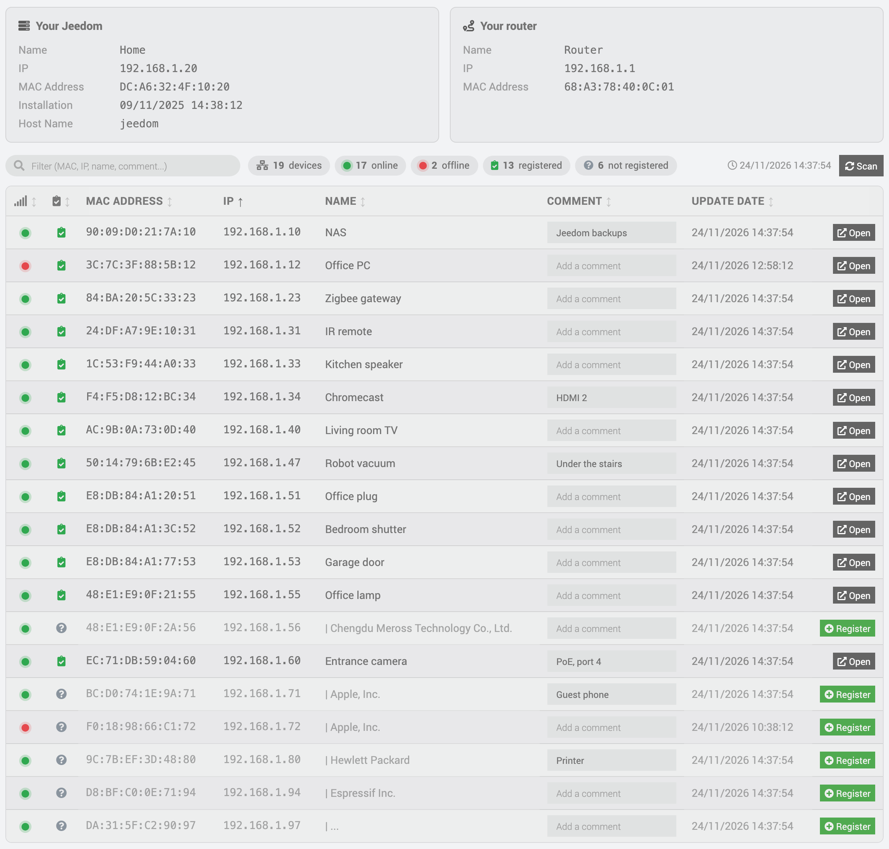

At the top of the window, two cards summarise your Jeedom (IP, MAC address, installation date, host name) and your router (name, IP, MAC address).

The toolbar offers:
- a filter to search by MAC address, IP, name or comment
- counters (devices, online, offline, registered, not registered): clicking a counter filters the table, clicking it again removes the filter; counters at zero are not shown
- the date of the last scan and a "Scan" button to start a new scan, with its progress bar

The table shows the whole network:

- The 1st column shows whether the device is "Online" or "Offline"
- The 2nd column shows whether the device is "registered", "registered but disabled" or "not registered"
- The 3rd column shows the MAC address of the device
- The 4th column shows the IP of the device
- The 5th column shows the device name if it is registered, or the manufacturer name preceded by "|"
- The 6th column lets you add a comment to a device (it is saved automatically while typing; clear the field to delete a comment)
- The 7th column shows the date the device was last seen
- The last column offers "Register" for an unregistered device (the device is created, then its page opens so you can name and enable it), or "Open" to go to the page of an already registered device

> If you see "|..." in a device name, its manufacturer was not recognised.

### Registered devices

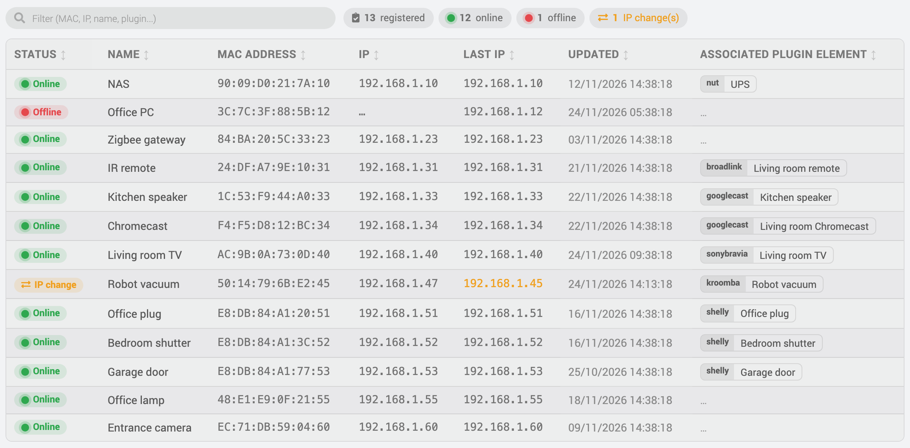

The toolbar offers a filter and clickable counters (registered, online, offline, IP changes).

- The 1st column shows the device state: "Online", "Offline" or "IP change"
- The 2nd column shows the device name
- The 3rd column shows the MAC address of the device
- The 4th column shows the IP of the device
- The 5th column shows the IP used during the last connection (in orange if it differs from the current IP)
- The 6th column shows the date the device was last updated
- The 7th column shows all the bridges associated with the device. Clicking them takes you to the device in the associated plugin.

### Unregistered devices

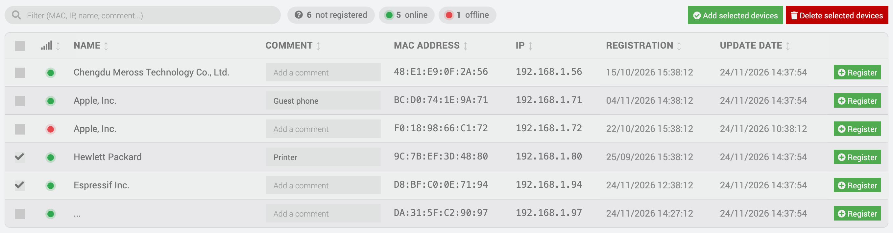

The toolbar offers a filter and clickable counters (not registered, online, offline).

- The 1st column lets you select the device* (to add it on the fly to your devices or delete it from the network archive); the checkbox in the header selects all displayed rows
- The 2nd column shows whether the device is "Online" or "Offline"
- The 3rd column shows the device name
- The 4th column lets you enter a comment for the device, saved automatically
- The 5th column shows the MAC address of the device
- The 6th column shows the IP used by the device
- The 7th column shows the date the device was first recorded on your network
- The 8th column shows the date the device was last seen
- The last column offers "Register" to create the device directly and open its page

> \* When you select one or more items, action buttons appear.

## Your devices

### In normal mode

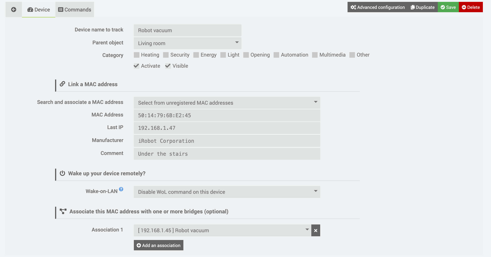

#### Search for a MAC address

This selection menu lets you search directly for an element of your network and retrieve its MAC address.

> Only MAC addresses that are not yet associated are offered, to avoid duplicates.

#### Associated MAC address

This field is:
- either filled in automatically with the "Search for a MAC address" menu
- or filled in manually if you want to anticipate a device joining your network

#### Manufacturer

If the manufacturer was identified, it is shown here.

#### Wake-on-LAN

Adds a WoL action command that turns the device on remotely.

> Check that your device is compatible and that the option is enabled on it for this to work.

#### Association

This is where you associate the device's MAC address with one or more bridge elements (10 at most). At each scan, every associated element receives the device's current IP.

- The selection menu groups the elements by plugin; each element is shown as: `[IP saved in the plugin] element name`. An element whose bridge is disabled is marked “bridge disabled”.
- An element already associated with another Scan.Ip device is not offered.
- “Add an association” opens an extra row, the cross removes an association.

> Warning: this option modifies other plugins. Use it knowingly. The author of the target plugin is in no way responsible for any malfunction this may cause in their plugin.

> As long as you do not associate a plugin, Scan.Ip makes no change to it.

> An association that no bridge recognises (bridge deleted, element not found…) remains displayed and kept, but is no longer updated.

> To suggest an additional bridge, use the “Suggest” button of the Bridges window (see "Suggesting a bridge for the catalogue").

### In advanced mode

#### "Configuration" reminder

Reminds you of the refresh rate saved in the plugin configuration.

#### Considered offline after

4 minutes by default: if you left everything at the defaults, that is 1 scan per minute and 4 passes to decide whether the device is really offline.
Remember that not every device shows up in every scan.

> If you set the refresh rate to 3 minutes, set this parameter to at least 15 minutes.

> This parameter can be lowered for very responsive wired devices, for example to 2 minutes with a 1-minute refresh rate. That means 2 passes to determine the state.

### In debug mode

In debug mode, the "MAC Id" field shows the internal identifier of the device: the last three bytes of its MAC address. It is read-only and helps diagnose a MAC association that does not work.

### Associated commands

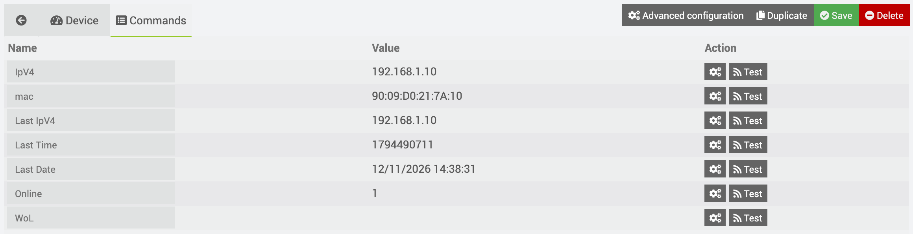

| Command | Description |
|---|---|
| IpV4 | IP of the device in v4 format |
| Wol | the action command to turn the device on remotely, only present when Wake-on-LAN is enabled on the device |
| Last Date | date in DD/MM/YYYY HH:MM:SS format of the device's last return online or last IP change |
| Last IpV4 | last IP used by the device |
| Last Time | same date as "Last Date", as a timestamp |
| mac | MAC address of the device |
| Online | state of the device |

### Associated widgets

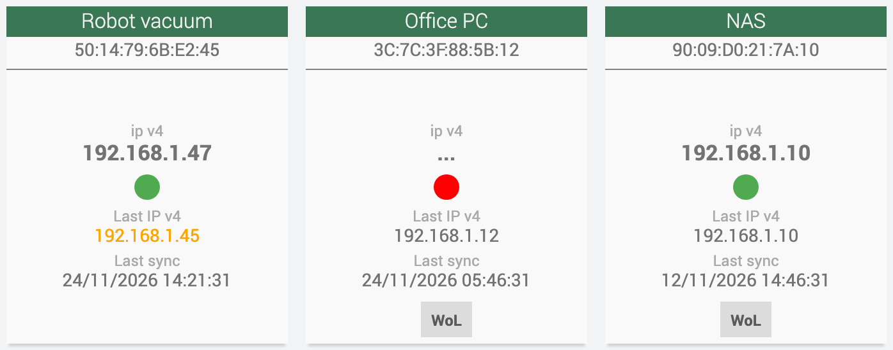

The widget shows the MAC address of the device, its IP, its state, its last known IP (in orange if it differs from the current IP) and the date of its last return online or IP change. The WoL button appears when Wake-on-LAN is enabled on the device.

## Bridges

Scan.Ip uses bridges to update data in other plugins.

> In practice, bridges automatically pass a device's IP change on to the other plugins (for example when you cannot set a fixed IP in the DHCP).

The configuration shows the number of active bridges. The “Manage bridges” button, or the “Bridges” icon on the plugin page, opens their management.

A bridge points to **a field containing an IP** in a plugin:

- the configuration of its devices (for example `addr` for Shelly);
- the logical identifier (logicalId) of its devices;
- the configuration of its commands (for example a script command containing an IP);
- the configuration of the plugin itself (for example the address of a gateway). `{n}` stands for a number when the plugin manages several gateways (`wifizigate_{n}`).

The update type is detected automatically at each IP change: a field that is empty or contains only the IP is replaced entirely, a field containing the IP within a value (URL, `host:port`…) only has its IP replaced, and a field without an IP (host name…) is not modified. In the normal view, this automatic detection always applies; in the advanced view, you can force one behaviour or the other.

More than 60 bridges are provided (catalogue): those of installed plugins are active by default, but they only modify a plugin for the elements you have associated with a Scan.Ip device. The table shows, for each one, the number of elements found and the number of elements associated with a MAC address, as well as its origin: “Catalogue” (provided with Scan.Ip), “Modified catalogue” (provided then modified by you) or “Personal” (created by you). You can:

- **enable or disable** a bridge with the switch in the first column. A disabled bridge no longer updates anything, but its associations are kept;
- **test** a bridge (“Test” button): by default, only the elements associated with a MAC address are tested, each with the current IP of its device, which is exactly what the next scan will do. You can also pick an element and apply the IP of your choice to it. Nothing is saved;
- **modify** a catalogue bridge (it then appears as "modified catalogue") and go back to its original version at any time;
- **create** your own bridges.

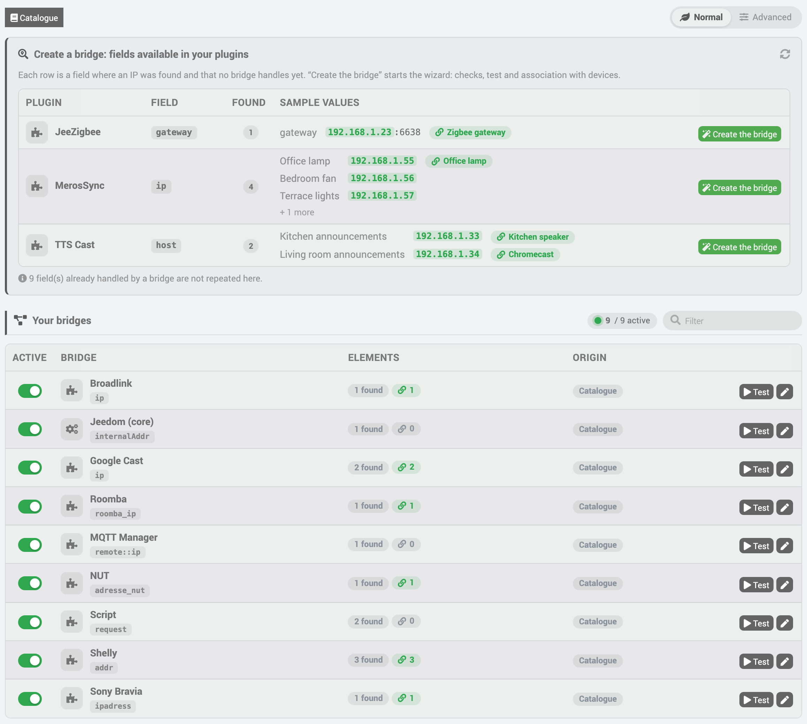

The “Catalogue” button shows, read-only, the original configuration of every bridge provided (location, field, update type, conditions, options), including for plugins you have not installed, to draw inspiration from when creating a bridge.

The list shows the bridges that find elements in your plugins, as well as those you have created or modified. The other bridges provided (field empty on your installation, plugin not installed) can be viewed in the catalogue; they appear on their own as soon as the field concerned is filled in.

The window offers two views, like the plugin configuration (the default view follows the mode chosen in the configuration, the last choice is remembered). They list the same bridges:

- **normal view**: the essentials. The search only shows the IPs not yet handled by a bridge, the form shows the plugin, location and field without allowing them to be changed and is limited to the test (the update type is detected automatically). Existing conditions are shown and still applied;
- **advanced view**: extra details and settings: location and conditions in the list; conditions, update type, daemon and detail in the form; manual creation of a bridge.

The same bridge in the normal view, then in the advanced view:

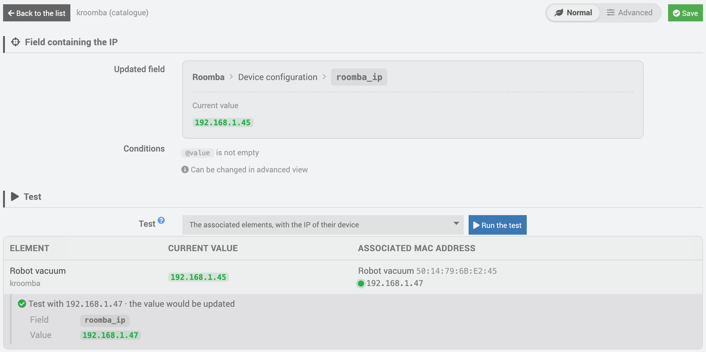

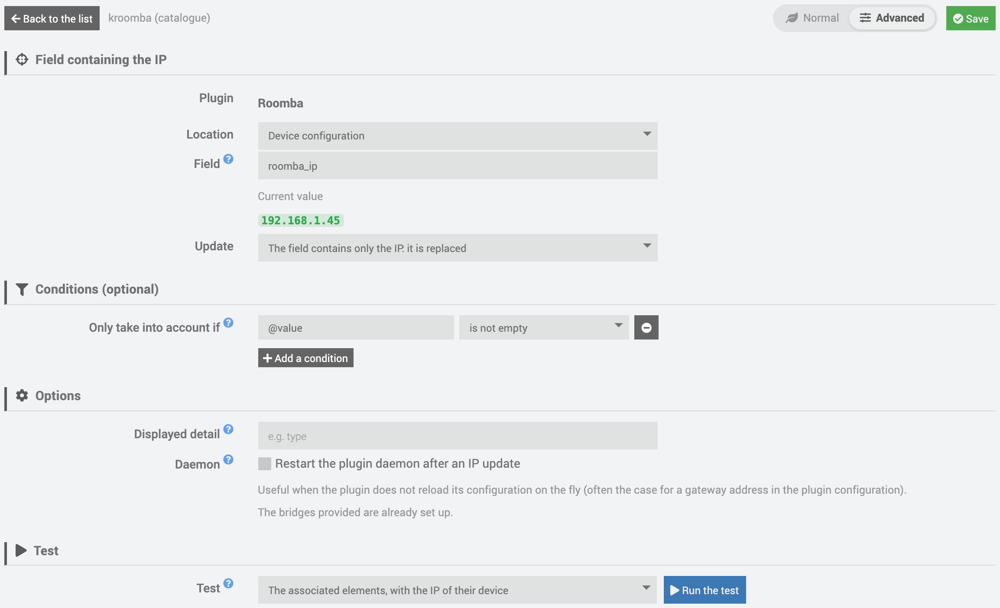

The plugin of an existing bridge cannot be changed: create a new bridge for another plugin.

### Creating a bridge

When the Bridges window opens, Scan.Ip searches for the IPs present in the configuration of your plugins (devices, commands, plugin configuration) and lists the fields no bridge handles yet, with sample values. If no plugin is suitable, the window says so. The refresh icon restarts the search.

The “Create the bridge” button of a row starts the wizard (steps Field, Checks, Done), which checks the configuration before creating anything:

- the elements found and the update type (the whole field or only the IP it contains);
- values that contain several IPs;
- a dry-run write test on each element (nothing is modified);
- whether the plugin daemon needs restarting: Jeedom notifies the plugin when one of its settings (`postConfig_…`) or one of its devices (`postSave`) is saved. If the plugin has a daemon and does not react to this field, the restart is enabled automatically; the wizard simply says so, and the setting can still be changed afterwards in the bridge form in the advanced view.

For each element, you can test the value the bridge would write with an IP of your choice, and associate it with a Scan.Ip device linked to the plugin (same IP, or already associated with another element of the plugin). The association is optional: it can be done later from the Scan.Ip device page. The bridge cannot be created if the plugin has no element for this field.

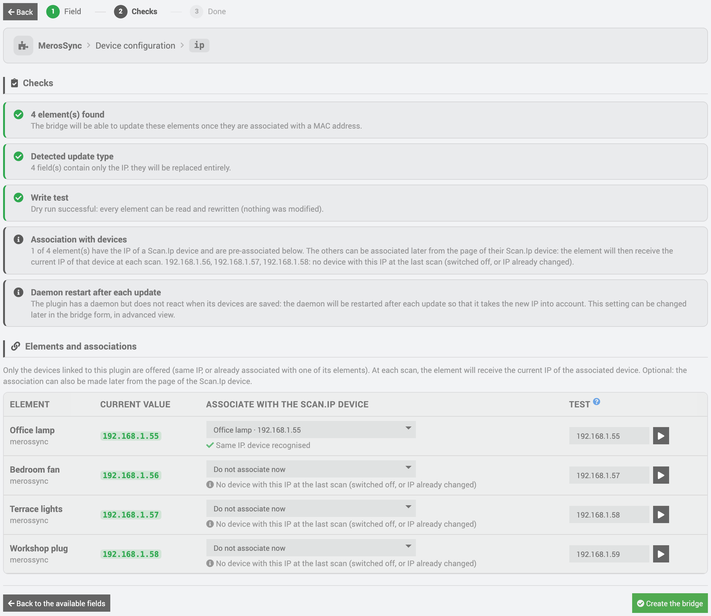

At the end, the “Test the bridge” button opens the simulation, and “Finish” goes back to the list.

Fields already handled by a bridge are not repeated in the search, whatever the view: they are in the bridge list. In the advanced view, the pencil of a row opens the pre-filled form, and “Manual creation” creates a bridge from scratch.

### Conditions

A bridge can apply only to some elements. All conditions must be true. A condition applies to another field of the same device (or of the same command, or of the plugin configuration): is equal to, is different from, is one of the values (comma-separated list), contains, is empty, is not empty, matches a regular expression…

Special fields: `@value` (the value of the IP field), `@name` (element name), `@eqName` (device name), `@isEnable` (device enabled) and `@logicalId`.

Example: the VMware bridge only takes the devices whose `type` field is equal to `ESXi`.

The "Restart the plugin daemon" option (advanced view) restarts the plugin daemon after an IP update, for plugins that do not reload their configuration on the fly. The bridges provided are already set; for a bridge created from the search, it is enabled automatically when the field is in the configuration of a plugin that has its own daemon.

You can then associate a device with one or more elements of these bridges.

### Suggesting a bridge for the catalogue

A bridge you have created or modified can be suggested for the catalogue with the “Suggest” button. The rule is shown before sending, in the catalogue format: only the rule is sent (plugin, location, field, conditions, options), never the IPs, values or device names of your installation. Just check that the condition values contain nothing personal.

- **GitHub**: opens a pre-filled issue on the plugin repository (GitHub account required);
- **Jeedom forum**: copies the suggestion to the clipboard and opens the plugin topic on community.jeedom.com ([Plugin Scan.Ip - MAJ](https://community.jeedom.com/t/plugin-scan-ip-maj/48722)): click "Reply" and paste it.

## Widgets dedicated to and managed by Scan.Ip

By default, this part contains 2 widgets (they can be renamed):
- Scan.Ip Widget Alertes
- Scan.Ip Widget Network

These devices are managed directly by the plugin and reflect what you configured in the plugin.

> As a reminder, their display is managed in the plugin configuration.

### The Network widget

This option shows or hides the network widget.

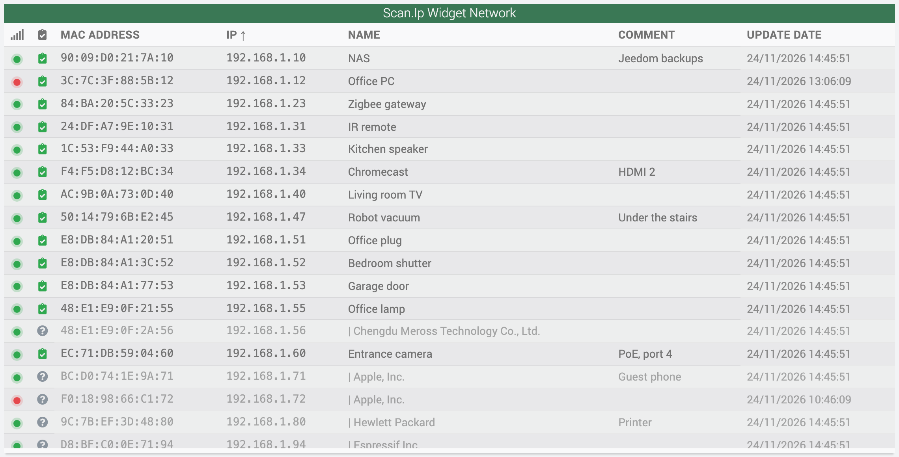

> You can sort the columns by clicking their header.

> You can also set a default sort order in the device linked to this widget.

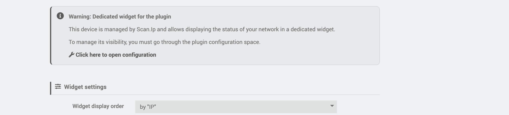

### The Alerts widget

This option shows or hides the alerts widget.

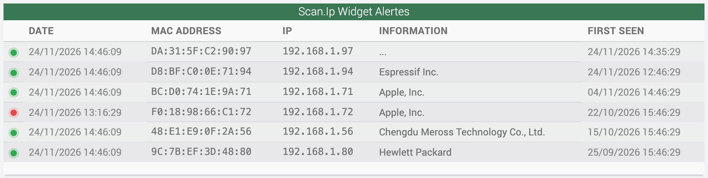

> This widget only shows unregistered devices, sorted by connection date then by first-seen date. A brand new device therefore appears first.

#### Associated commands

10 groups of commands are created. They match the last 10 unregistered devices that connected. The chronological order starts at zero (the most recent) and ends at nine (the oldest).

Each item has 6 sub-commands:

| Command | Description |
|---|---|
| Connexion 0 Création | timestamp of the first time it was seen |
| Connexion 0 Date | date in DD/MM/YYYY HH:MM:SS format of when it was last seen |
| Connexion 0 Time | timestamp of when it was last seen |
| Connexion 0 Equipement | manufacturer name if known |
| Connexion 0 IpV4 | IP in v4 format assigned to it |
| Connexion 0 MAC | MAC address of the device |

## Configuration

To make the plugin easier to use, it adapts the available options to three modes: "normal", "advanced" and "debug".

The mode is chosen with the “Display mode” selector at the top of the configuration, which recalls what each mode shows. Sections specific to advanced and debug modes have an “Advanced” or “Debug” badge to the right of their title, and yes / no options are set with switches.

### Normal mode

Normal mode shows the main settings, which generally suit standard configurations: widgets, refresh rate, vendor files and bridges.

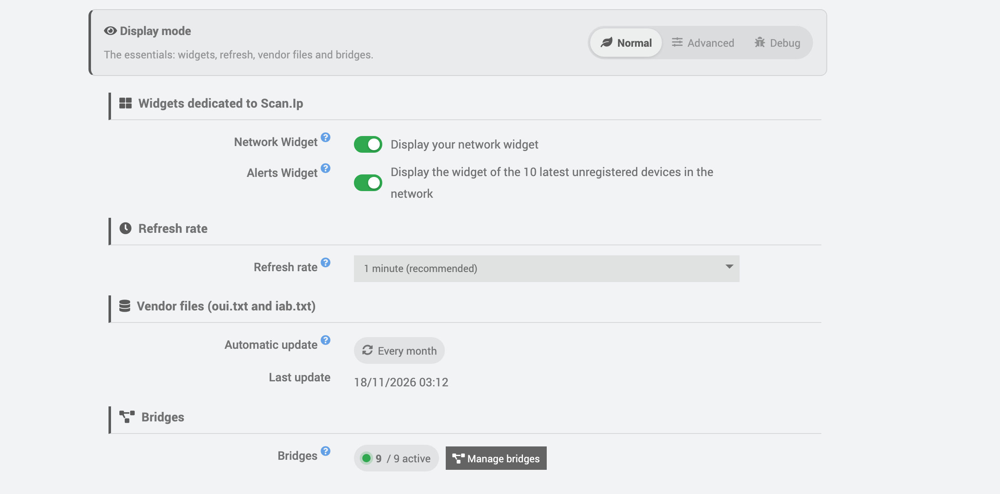

#### Refresh rate

Sets the refresh rate of the scheduled task.
By default it is set to 1 minute.

> Not every device answers every network scan, because some take too long to reply (Wi-Fi devices for example). It is therefore recommended to wait for at least 3 scans before considering a device really offline. This setting can be fine-tuned on each device.

#### Vendor files (oui.txt and iab.txt)

These files identify a device's manufacturer from its MAC address. They are updated automatically every month from the IEEE website; if it fails, the existing files are kept and a new attempt is made the next day.

Depending on the mode, this section shows:
- **normal mode**: the update frequency and the date of the last update
- **advanced mode**: in addition, the option to choose the frequency (every month, every week) or to disable the automatic update
- **debug mode**: in addition, the state of each file and an "Update now" button

### Advanced mode

Advanced mode adds sections, marked with the “Advanced” badge, and extra settings in the existing sections (for example the update frequency of the vendor files).

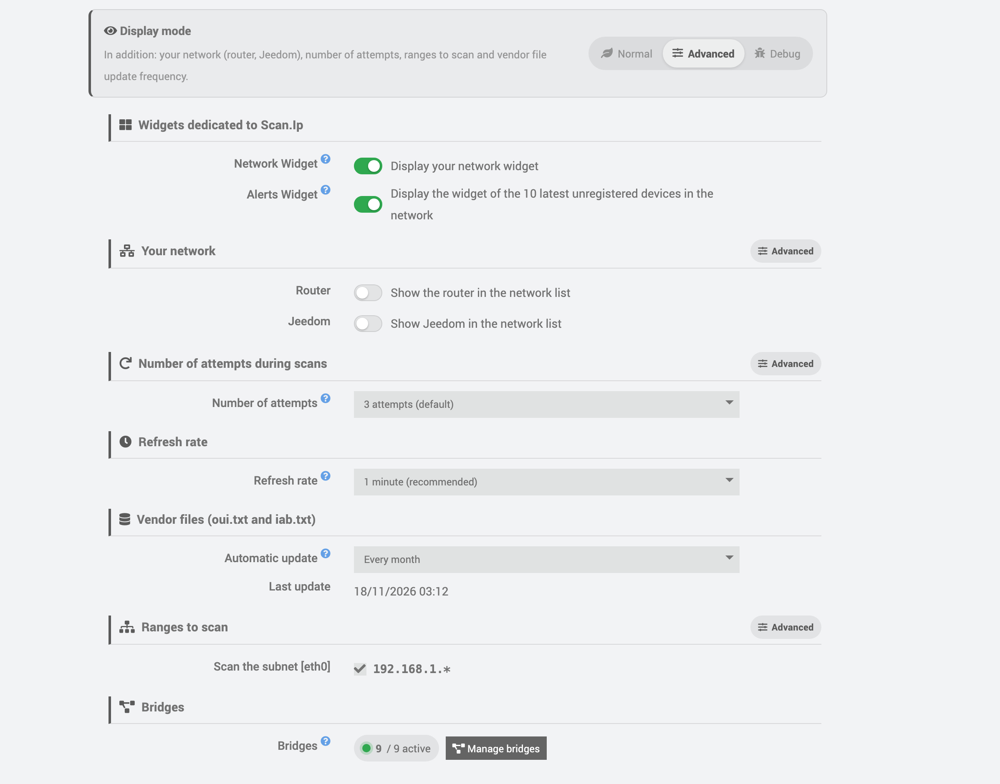

#### Your network

- **Router**: shows the router in the network list. By default it is removed.
- **Jeedom**: shows the Jeedom server in the network list. By default it is removed.

#### Number of attempts during scans

Sets the number of attempts during network scans. Not every device answers the first attempt. The more attempts, the longer the scan.

#### Ranges to scan

When you have several network cards or subnets, tick the subnet(s) to scan. Only interfaces with an IPv4 address are offered (Docker virtual interfaces or disconnected cards are not listed).

> A subnet may not allow the MAC addresses it contains to be retrieved (blocked by the router or otherwise). In that case, you will need to install another Jeedom in that subnet, with a dedicated Scan.Ip.

> The duration of a scan depends on the size of the subnet: a few seconds for a `/24` (254 addresses), several minutes for a `/16` (65,534 addresses).

### Debug mode

Sections reserved for debug mode have the “Debug” badge.

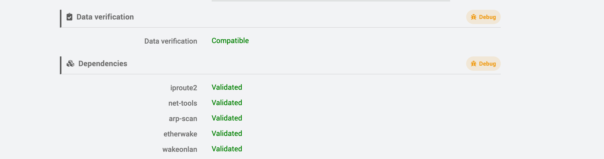

#### Data verification

Checks that the data saved by the plugin is in the format of the installed version. "Compatible" is shown in green when everything is correct; otherwise, a red "Incompatible data (Click here to fix the problem)" button starts the correction.

#### Dependencies

Shows the state of each dependency (iproute2, net-tools, arp-scan, etherwake, wakeonlan): "Validated" in green when it is installed. Shows at a glance which dependencies have failed.

## Subnets and Scan.Ip

Scan.Ip can manage several networks at the same time.
To do so, your Jeedom must be connected to the different networks.
For example, you can connect the Wi-Fi of your Jeedom machine to one network and the network cable to the other, or simply plug "USB/Ethernet" or "USB/Wi-Fi" adapters into your Jeedom.
Scan.Ip will show you the subnets, which you can then enable in the plugin configuration (in advanced mode).

## Debug (debug mode only)

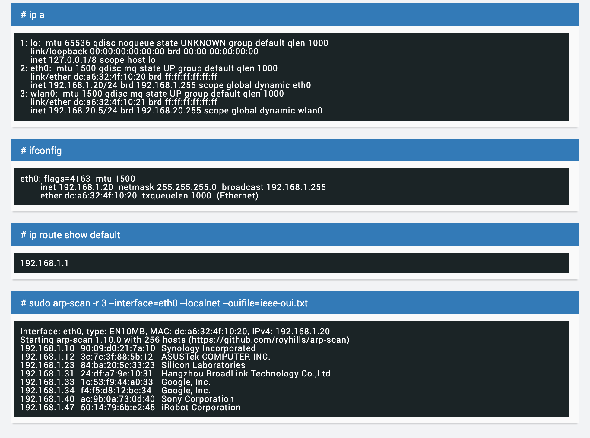

This window helps you understand possible bugs.

#### ip a

Result of the `ip a` command, which lists every network reachable from your Jeedom.

#### ip route

Shows the IP of the router associated with your Jeedom.

#### arp-scan

> Here the "eth0" network is selected, but this depends on your network.

Result of the `sudo arp-scan -r 3 --interface=eth0 --localnet --ouifile=ieee-oui.txt` command, which lists the devices that answer the scan.

> As mentioned above, not all your connected devices may show up in a single scan. That is why several scans are needed to get an accurate picture of the connected devices.

#### Equipements

Shows the data in the devices JSON. This is the history of all the devices that have connected to your network.

#### Mappings

Shows the data in the mapping JSON. This is the latest state of your network, with the version of "arp-scan" used.

## Scenario examples

The plugin commands can be used as triggers in Jeedom scenarios. In the examples below, replace `[Aucun]` with the parent object of your devices, and the sending command with the one from your notification plugin (SMS, Telegram, Jeedom Connect…).

### Receive an SMS when a new device connects

The Alerts widget keeps the most recent unknown device in position 0. This scenario triggers when that position changes, and checks that the device has just been detected for the first time.

- **Mode**: Triggered
- **Trigger**: `#[Aucun][Scan.Ip Widget Alertes][Connexion 0 Création]#`
- **IF**: `#[Aucun][Scan.Ip Widget Alertes][Connexion 0 Création]# > #timestamp# - 180`
- **THEN**: SMS sending command with the message
  `New device on the network: #[Aucun][Scan.Ip Widget Alertes][Connexion 0 MAC]# (#[Aucun][Scan.Ip Widget Alertes][Connexion 0 IpV4]#, #[Aucun][Scan.Ip Widget Alertes][Connexion 0 Equipement]#)`

> The condition only lets through devices first detected less than 3 minutes ago: a simple change in the order of the list does not trigger an alert.

> The Alerts widget must be enabled in the plugin configuration. If several new devices arrive during the same scan, only one alert is sent.

### Get notified when a registered device leaves the network

For a registered MAC device (for example "Aspirateur robot"), the **Online** command switches to 0 when the device is considered offline.

- **Mode**: Triggered
- **Trigger**: `#[Aucun][Aspirateur robot][Online]#`
- **IF**: `#[Aucun][Aspirateur robot][Online]# == 0`
- **THEN**: notification command with the message
  `The robot vacuum is no longer connected to the network`

> The delay before the device is considered offline is set in the device ("Considered offline after", in advanced mode).

> Variant: with the trigger `#[Aucun][Aspirateur robot][IpV4]#` and the condition `#[Aucun][Aspirateur robot][IpV4]# != ""`, you are notified every time the device's IP changes.

## FAQ

**Does Scan.Ip modify my other plugins?**
Only the elements you have associated with a Scan.Ip device, and only the field that contains the IP. Without an association, nothing is modified.

**A device that is on appears offline**
Some devices, especially over Wi-Fi, do not answer every scan. Increase “Considered offline after” on the device, or the number of attempts (advanced mode).

**The manufacturer is shown as “...”**
The MAC address prefix is not in the vendor files. This also applies to phones using a private (random) MAC address: it can change, so disable that option on the phone to track it.

**Only containers are found**
Jeedom runs in Docker without `network_mode: host`, see “Installation”.

**Do I still need fixed IPs in the DHCP server?**
Not necessarily with bridges, but it remains the simplest solution when your router allows it.
