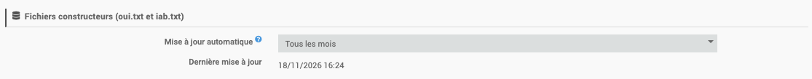
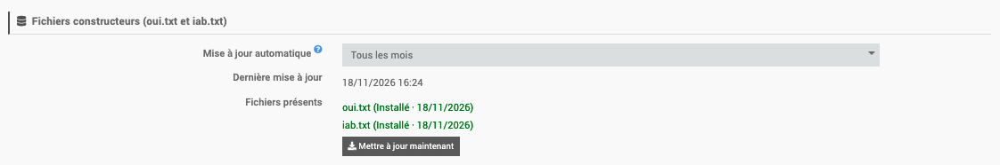
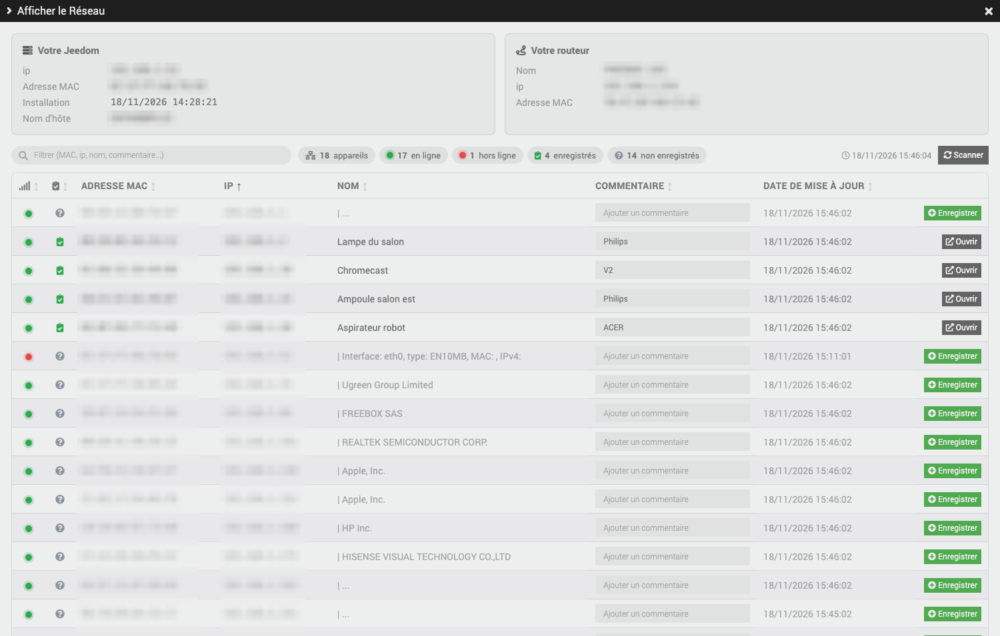
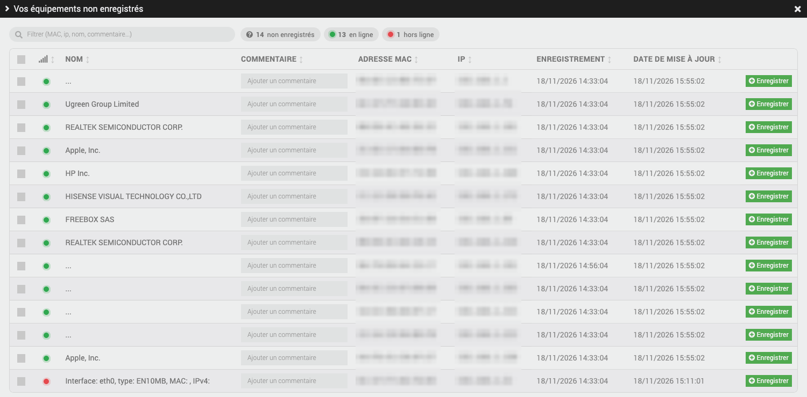
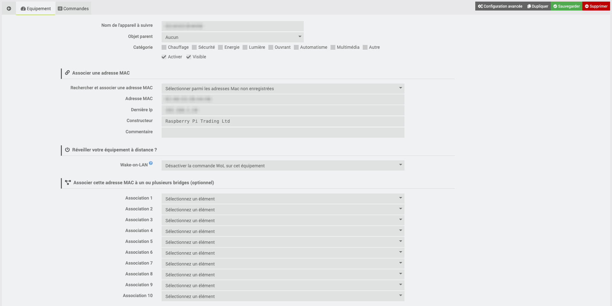
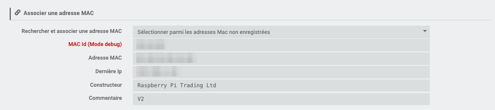
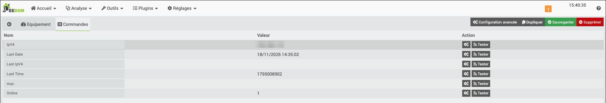
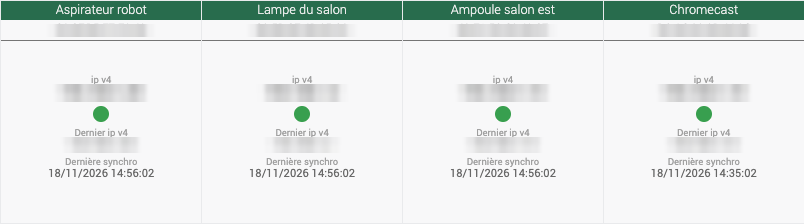

Description
===

This plugin scans your network and retrieves the list of connected devices along with their MAC addresses.

With this information, the plugin lets you:
- retrieve the new IP of a device
- display a widget showing the state of your network
- display a widget listing the unregistered devices that have just connected to the network
- display one widget per registered device, with the commands associated with that device
- create alerts when a device disappears, appears or changes IP on the network
- automate IP changes in cascade in other plugins through bridges
- turn a device on remotely (Wake-on-LAN)

Installation and dependencies
===

- Jeedom 4.0 minimum, compatible with PHP 7 and PHP 8.
- This plugin requires "arp-scan", "wakeonlan" and "etherwake" (installed with the dependencies).
- It uses the "oui.txt" and "iab.txt" files provided by "standards-oui.ieee.org".
- It uses the APIs provided by "macvendors.com" and "macvendors.co".

> **Jeedom on Docker**: the Jeedom container must use `network_mode: host`. Otherwise it only sees Docker's internal network (often a `/16` of 65,534 addresses): scans take several minutes and only find the other containers, not the devices on your network.

# Configuration

To make the plugin easier to use, it adapts the available options to three modes: "normal", "advanced" and "debug".

## Normal mode

Normal mode shows the main settings, which generally suit standard configurations.

### Network widget

This option shows or hides the network widget.

> You can sort the columns by clicking their header.

> You can also set a default sort order in the device linked to this widget.

### Alerts widget

This option shows or hides the alerts widget.

> This widget only shows unregistered devices, sorted by connection date then by first-seen date. A brand new device therefore appears first.

### Refresh rate

Sets the refresh rate of the scheduled task.
By default it is set to 1 minute.

> Not every device answers every network scan, because some take too long to reply (Wi-Fi devices for example). It is therefore recommended to wait for at least 3 scans before considering a device really offline. This setting can be fine-tuned on each device.

### Vendor files (oui.txt and iab.txt)

These files identify a device's manufacturer from its MAC address. They are updated automatically every month from the IEEE website; if it fails, the existing files are kept and a new attempt is made the next day.

Depending on the mode, this section shows:
- **normal mode**: the update frequency and the date of the last update
- **advanced mode**: in addition, the option to choose the frequency (every month, every week) or to disable the automatic update
- **debug mode**: in addition, the state of each file and an "Update now" button

### List of supported plugins

Scan.Ip uses bridges to update data in some plugins. By default, only the plugins installed on your Jeedom are shown; tick "Also show plugins that are not installed" to see every supported plugin.

> In practice, bridges automatically pass a device's IP change on to the other plugins (for example when you cannot set a fixed IP in the DHCP).

You can then associate a device with one or more plugins.

## Advanced mode

### Router

Adds the router to the network list. By default it is removed.

### Jeedom

Adds the Jeedom server to the network list. By default it is removed.

### Retry option

Sets the number of attempts during network scans. Not every device answers the first attempt. The more attempts, the longer the scan.

### Safari browser compatibility

On Safari, hiding options in selection menus (used to show only the unused bridges) does not work. With this option enabled, the elements already in use are disabled instead of hidden. Only enable this option if you run into the problem with Safari.

### Specify network ranges to scan

When you have several network cards or subnets, tick the subnet(s) to scan. Only interfaces with an IPv4 address are offered (Docker virtual interfaces or disconnected cards are not listed).

> A subnet may not allow the MAC addresses it contains to be retrieved (blocked by the router or otherwise). In that case, you will need to install another Jeedom in that subnet, with a dedicated Scan.Ip.

> The duration of a scan depends on the size of the subnet: a few seconds for a `/24` (254 addresses), several minutes for a `/16` (65,534 addresses).

## Debug mode

### Version check

Checks that the data saved by the plugin is in the format of the installed version. Each line shows "Up to date" in green when everything is correct, or "Not up to date" in red otherwise. If the data is not compatible, a button lets you start the correction.

### Dependencies

Shows at a glance which dependencies have failed.

# Device management

> Devices are split into two parts: "Your MAC devices" and "Widgets dedicated to and managed by Scan.Ip". Do not delete the latter unless there is a bug. To delete them, enable debug mode so that the "Delete" button appears.

## Access icons

In debug mode, a Debug icon appears. It appears or disappears as soon as you change mode, without reloading the page.

### Add a MAC device

Adds a device when you know the MAC address of the device to add.

> It is easier to go through "Unregistered devices" or "Network", which let you add one or more devices on your network on the fly.

### Synchronize

Starts a new scan and updates the devices. A progress bar shows the current step, the percentage, the elapsed time and an estimate of the remaining time; the page reloads when the scan is complete.

> If an automatic scan is already running, the progress bar follows that scan instead of starting a second one.

### Network

At the top of the window, two cards summarise your Jeedom (IP, MAC address, installation date, host name) and your router (name, IP, MAC address).

The toolbar offers:
- a filter to search by MAC address, IP, name or comment
- counters (devices, online, offline, registered, not registered): clicking a counter filters the table, clicking it again removes the filter; counters at zero are not shown
- the date of the last scan and a "Scan" button to start a new scan, with its progress bar

The table shows the whole network:

- The 1st column shows whether the device is "Online" or "Offline"
- The 2nd column shows whether the device is "registered", "registered but disabled" or "not registered"
- The 3rd column shows the MAC address of the device
- The 4th column shows the IP of the device
- The 5th column shows the device name if it is registered, or the manufacturer name preceded by "|"
- The 6th column lets you add a comment to a device (it is saved automatically while typing; clear the field to delete a comment)
- The 7th column shows the date the device was last seen
- The last column offers "Register" for an unregistered device (the device is created, then its page opens so you can name and enable it), or "Open" to go to the page of an already registered device

> If you see "|..." in a device name, its manufacturer was not recognised.

### Registered devices

The toolbar offers a filter and clickable counters (registered, online, offline, IP changes).

- The 1st column shows the device state: "Online", "Offline" or "IP change"
- The 2nd column shows the device name
- The 3rd column shows the MAC address of the device
- The 4th column shows the IP of the device
- The 5th column shows the IP used during the last connection (in orange if it differs from the current IP)
- The 6th column shows the date the device was last updated
- The 7th column shows all the bridges associated with the device. Clicking them takes you to the device in the associated plugin.

### Unregistered devices

The toolbar offers a filter and clickable counters (not registered, online, offline).

- The 1st column lets you select the device* (to add it on the fly to your devices or delete it from the network archive); the checkbox in the header selects all displayed rows
- The 2nd column shows whether the device is "Online" or "Offline"
- The 3rd column shows the device name
- The 4th column lets you enter a comment for the device, saved automatically
- The 5th column shows the MAC address of the device
- The 6th column shows the IP used by the device
- The 7th column shows the date the device was first recorded on your network
- The 8th column shows the date the device was last seen
- The last column offers "Register" to create the device directly and open its page

> \* When you select one or more items, action buttons appear.

### Debug (debug mode only)

This window helps you understand possible bugs.

#### # ip a

Result of the "ip a" command, which lists every network reachable from your Jeedom.

#### # ip route show default

Shows the IP of the router associated with your Jeedom.

#### # sudo arp-scan -r 3 --interface=eth0 --localnet --ouifile=ieee-oui.txt

> Here the "eth0" network is selected, but this depends on your network.

Result of the "sudo arp-scan -r 3 --interface=eth0 --localnet --ouifile=ieee-oui.txt" command, which lists the devices that answer the scan.

> As mentioned above, not all your connected devices may show up in a single scan. That is why several scans are needed to get an accurate picture of the connected devices.

#### # Equipements

Shows the data in the devices JSON. This is the history of all the devices that have connected to your network.

#### # Mappings

Shows the data in the mapping JSON. This is the latest state of your network, with the version of "arp-scan" used.

### Configuration

This topic was covered at the beginning.

## Your devices

### In normal mode

#### Search for a MAC address

This selection menu lets you search directly for an element of your network and retrieve its MAC address.

> Only MAC addresses that are not yet associated are offered, to avoid duplicates.

#### Associated MAC address

This field is:
- either filled in automatically with the "Search for a MAC address" menu
- or filled in manually if you want to anticipate a device joining your network

#### Manufacturer

If the manufacturer was identified, it is shown here.

#### Wake-on-LAN

Adds a WoL action command that turns the device on remotely.

> Check that your device is compatible and that the option is enabled on it for this to work.

#### Association

As seen in the configuration section, this is where you link plugins to Scan.Ip through bridges.

> In the selection menu, the information is shown as: [plugin name][IP saved in the plugin :: configuration sub-name (if any)] name of the device in the target plugin.

> Warning: this option modifies other plugins. Use it knowingly. The author of the target plugin is in no way responsible for any malfunction this may cause in their plugin.

> As long as you do not associate a plugin, Scan.Ip makes no change to it.

> If you are a developer and would like to suggest an additional bridge, you are welcome to: either submit it directly on GitHub (https://ynats.github.io/jeedom-plugin-scan.ip/) or through the forum.

### In advanced mode

#### "Configuration" reminder

Reminds you of the refresh rate saved in the plugin configuration.

#### Considered offline after

4 minutes by default: if you left everything at the defaults, that is 1 scan per minute and 4 passes to decide whether the device is really offline.
Remember that not every device shows up in every scan.

> If you set the refresh rate to 3 minutes, set this parameter to at least 15 minutes.

> This parameter can be lowered for very responsive wired devices, for example to 2 minutes with a 1-minute refresh rate. That means 2 passes to determine the state.

### In debug mode

#### MAC Id

In debug mode, the "MAC Id" field shows the internal identifier of the device: the last three bytes of its MAC address. It is read-only and helps diagnose a MAC association that does not work.

### Associated commands

- IpV4 (IP of the device in v4 format)
- Wol (the action command to turn the device on remotely, only present when Wake-on-LAN is enabled on the device)
- Last Date (date in DD/MM/YYYY HH:MM:SS format of the device's last return online or last IP change)
- Last IpV4 (last IP used by the device)
- Last Time (same date as "Last Date", as a timestamp)
- mac (MAC address of the device)
- Online (state of the device)

### Associated widgets

The widget shows the MAC address of the device, its IP, its state, its last known IP (in orange if it differs from the current IP) and the date of its last return online or IP change. The WoL button appears when Wake-on-LAN is enabled on the device.

# Widgets dedicated to and managed by Scan.Ip

By default, this part contains 2 widgets (they can be renamed):
- Scan.Ip Widget Alertes
- Scan.Ip Widget Network

These devices are managed directly by the plugin and reflect what you configured in the plugin.

> As a reminder, their display is managed in the plugin configuration.

## The Network widget

## The Alerts widget

#### Associated commands

10 groups of commands are created. They match the last 10 unregistered devices that connected. The chronological order starts at zero (the most recent) and ends at nine (the oldest).

Each item has 6 sub-commands:

- Connexion 0 Création (timestamp of the first time it was seen)
- Connexion 0 Date (date in DD/MM/YYYY HH:MM:SS format of when it was last seen)
- Connexion 0 Time (timestamp of when it was last seen)
- Connexion 0 Equipement (manufacturer name if known)
- Connexion 0 IpV4 (IP in v4 format assigned to it)
- Connexion 0 MAC (MAC address of the device)

## Subnets and Scan.Ip

#### If you want to manage several networks (for example, you have a hub connected to your router)

Scan.Ip can manage several networks at the same time.
To do so, your Jeedom must be connected to the different networks.
For example, you can connect the Wi-Fi of your Jeedom machine to one network and the network cable to the other, or simply plug "USB/Ethernet" or "USB/Wi-Fi" adapters into your Jeedom.
Scan.Ip will show you the subnets, which you can then enable in the plugin configuration (in advanced mode).

# Scenario examples

The plugin commands can be used as triggers in Jeedom scenarios. In the examples below, replace `[Aucun]` with the parent object of your devices, and the sending command with the one from your notification plugin (SMS, Telegram, Jeedom Connect…).

## Receive an SMS when a new device connects

The Alerts widget keeps the most recent unknown device in position 0. This scenario triggers when that position changes, and checks that the device has just been detected for the first time.

- **Mode**: Triggered
- **Trigger**: `#[Aucun][Scan.Ip Widget Alertes][Connexion 0 Création]#`
- **IF**: `#[Aucun][Scan.Ip Widget Alertes][Connexion 0 Création]# > #timestamp# - 180`
- **THEN**: SMS sending command with the message
  `New device on the network: #[Aucun][Scan.Ip Widget Alertes][Connexion 0 MAC]# (#[Aucun][Scan.Ip Widget Alertes][Connexion 0 IpV4]#, #[Aucun][Scan.Ip Widget Alertes][Connexion 0 Equipement]#)`

> The condition only lets through devices first detected less than 3 minutes ago: a simple change in the order of the list does not trigger an alert.

> The Alerts widget must be enabled in the plugin configuration. If several new devices arrive during the same scan, only one alert is sent.

## Get notified when a registered device leaves the network

For a registered MAC device (for example "Aspirateur robot"), the **Online** command switches to 0 when the device is considered offline.

- **Mode**: Triggered
- **Trigger**: `#[Aucun][Aspirateur robot][Online]#`
- **IF**: `#[Aucun][Aspirateur robot][Online]# == 0`
- **THEN**: notification command with the message
  `The robot vacuum is no longer connected to the network`

> The delay before the device is considered offline is set in the device ("Considered offline after", in advanced mode).

> Variant: with the trigger `#[Aucun][Aspirateur robot][IpV4]#` and the condition `#[Aucun][Aspirateur robot][IpV4]# != ""`, you are notified every time the device's IP changes.
