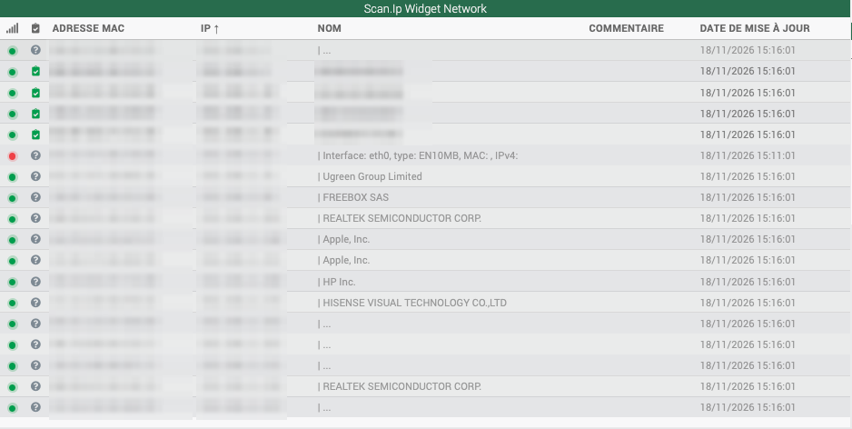
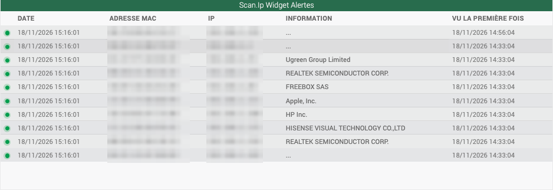
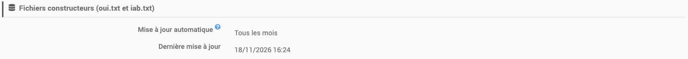
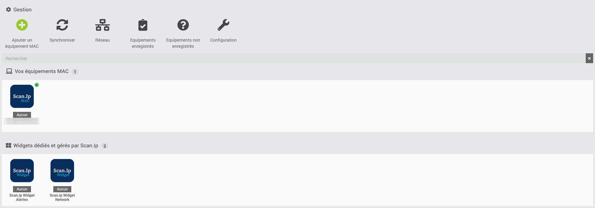

Descripción
===

Este plugin escanea su red y obtiene la lista de los dispositivos conectados junto con sus direcciones MAC.

Con esta información, el plugin permite:
- obtener la nueva IP de un dispositivo
- mostrar un widget con el estado de su red
- mostrar un widget con los dispositivos no registrados que acaban de conectarse a la red
- mostrar un widget por dispositivo registrado, con los comandos asociados a ese dispositivo
- crear alertas cuando un dispositivo desaparece, aparece o cambia de IP en la red
- automatizar cambios de IP en cascada en otros plugins mediante bridges
- encender un dispositivo a distancia (Wake-on-LAN)

Instalación y dependencias
===

- Jeedom 4.0 como mínimo, compatible con PHP 7 y PHP 8.
- Este plugin requiere imperativamente "arp-scan", "wakeonlan" y "etherwake" (instalados con las dependencias).
- Utiliza los archivos "oui.txt" e "iab.txt" proporcionados por "standards-oui.ieee.org".
- Utiliza las API proporcionadas por "macvendors.com" y "macvendors.co".

> **Jeedom en Docker**: el contenedor de Jeedom debe usar `network_mode: host`. De lo contrario solo ve la red interna de Docker (a menudo un `/16` de 65.534 direcciones): los escaneos duran varios minutos y solo encuentran los demás contenedores, no los dispositivos de su red.

# Configuración

Para facilitar su uso, el plugin adapta las opciones disponibles a tres modos: "normal", "avanzado" y "debug".

## Modo normal

El modo normal muestra los parámetros principales, que suelen adaptarse a las configuraciones estándar.

### Widget Red

Esta opción muestra u oculta el widget de la red.

> Puede ordenar las columnas con un simple clic en su encabezado.

> También puede configurar un orden por defecto en el dispositivo vinculado a este widget.

### Widget Alertas

Esta opción muestra u oculta el widget de alertas.

> Este widget solo muestra los dispositivos no registrados, ordenados por fecha de conexión y luego por fecha de primer registro. Un dispositivo totalmente nuevo aparece por tanto en primera posición.

### Frecuencia de actualización

Ajusta la frecuencia de actualización de la tarea programada.
Por defecto está fijada en 1 minuto.

> No todos los dispositivos responden en cada escaneo, porque algunos tardan demasiado en responder (por ejemplo los dispositivos Wi-Fi). Por eso se recomienda esperar al menos 3 escaneos antes de considerar que un dispositivo está realmente desconectado. Este parámetro puede ajustarse con más precisión en cada dispositivo.

### Archivos de fabricantes (oui.txt e iab.txt)

Estos archivos identifican al fabricante de un dispositivo a partir de su dirección MAC. Se actualizan automáticamente cada mes desde el sitio del IEEE; si falla, se conservan los archivos existentes y se vuelve a intentar al día siguiente.

Según el modo, esta sección muestra:
- **modo normal**: la frecuencia de actualización y la fecha de la última actualización
- **modo avanzado**: además, la posibilidad de elegir la frecuencia (cada mes, cada semana) o de desactivar la actualización automática
- **modo debug**: además, el estado de cada archivo y un botón «Actualizar ahora»

### Lista de plugins compatibles

Scan.Ip utiliza bridges para actualizar datos en ciertos plugins. Por defecto solo se muestran los plugins instalados en su Jeedom; marque «Mostrar también los plugins no instalados» para ver todos los plugins compatibles.

> En la práctica, los bridges trasladan automáticamente el cambio de IP de un dispositivo a los demás plugins (por ejemplo, cuando no es posible fijar su IP en el DHCP).

Así podrá asociar un dispositivo a uno o varios plugins.

## Modo avanzado

### Router

Añade el router a la lista de la red. Por defecto se retira.

### Jeedom

Añade el servidor Jeedom a la lista de la red. Por defecto se retira.

### Opción Reintentar

Ajusta el número de intentos durante los escaneos de la red. No todos los dispositivos responden al primer intento. Cuantos más intentos, más largo es el escaneo.

### Compatibilidad con el navegador Safari

En Safari, la ocultación de opciones en los menús de selección (que sirve para mostrar solo los bridges no utilizados) no funciona. Con esta opción activada, los elementos ya utilizados se desactivan en lugar de ocultarse. Active esta opción solo si tiene el problema en Safari.

### Especificar los rangos de red a escanear

Si tiene varias tarjetas de red o subredes, marque la subred o subredes a escanear. Solo se proponen las interfaces que tienen una dirección IPv4 (las interfaces virtuales de Docker o las tarjetas no conectadas no aparecen).

> Es posible que una subred no permita obtener las direcciones MAC que contiene (bloqueo del router u otro). En ese caso deberá instalar otro Jeedom en esa subred, con un Scan.Ip dedicado.

> La duración de un escaneo depende del tamaño de la subred: unos segundos para un `/24` (254 direcciones), varios minutos para un `/16` (65.534 direcciones).

## Modo debug

### Verificación de la versión

Comprueba que los datos guardados por el plugin tienen el formato de la versión instalada. Cada línea muestra «Actualizado» en verde si todo es correcto, o «No actualizado» en rojo en caso contrario. Si los datos no son compatibles, un botón permite lanzar su corrección.

### Dependencias

Muestra de un vistazo las dependencias que han fallado.

# Gestión de los dispositivos

> Los dispositivos se dividen en dos partes: "Sus dispositivos MAC" y los "Widgets dedicados y gestionados por Scan.Ip". No elimine estos últimos salvo en caso de error. Para eliminarlos, active el modo debug para que aparezca el botón "Eliminar".

## Iconos de acceso

En modo debug aparece un icono Debug. Aparece o desaparece en cuanto cambia de modo, sin recargar la página.

### Añadir un dispositivo MAC

Añade un dispositivo cuando conoce la dirección MAC del aparato que quiere añadir.

> Es más sencillo pasar por "Dispositivos no registrados" o por "Red", que permiten añadir al vuelo uno o varios dispositivos presentes en su red.

### Sincronizar

Lanza un nuevo escaneo y actualiza los dispositivos. Una barra de progreso muestra el paso en curso, el porcentaje, el tiempo transcurrido y una estimación del tiempo restante; la página se recarga al terminar el escaneo.

> Si ya hay un escaneo automático en curso, la barra de progreso sigue ese escaneo en lugar de lanzar un segundo.

### Red

En la parte superior de la ventana, dos tarjetas resumen su Jeedom (IP, dirección MAC, fecha de instalación, nombre de host) y su router (nombre, IP, dirección MAC).

La barra de herramientas ofrece:
- un filtro para buscar por dirección MAC, IP, nombre o comentario
- contadores (dispositivos, en línea, desconectados, registrados, no registrados): un clic en un contador filtra la tabla, un segundo clic quita el filtro; los contadores a cero no se muestran
- la fecha del último escaneo y un botón "Escanear" para lanzar un nuevo escaneo, con su barra de progreso

La tabla muestra toda la red:

- La 1.ª columna indica si el dispositivo está "En línea" o "Desconectado"
- La 2.ª columna indica si el dispositivo está "registrado", "registrado pero desactivado" o "no registrado"
- La 3.ª columna indica la dirección MAC del dispositivo
- La 4.ª columna indica la IP del dispositivo
- La 5.ª columna indica el nombre del dispositivo si está registrado, o el nombre del fabricante precedido de "|"
- La 6.ª columna permite asociar un comentario a un dispositivo (se guarda automáticamente al escribir; vacíe el campo para eliminar un comentario)
- La 7.ª columna indica la última fecha en que se vio el dispositivo
- La última columna ofrece "Registrar" para un dispositivo no registrado (el dispositivo se crea y se abre su ficha para nombrarlo y activarlo), o "Abrir" para ir a la ficha de un dispositivo ya registrado

> Si ve "|..." en el nombre de un dispositivo, es que no se ha reconocido su fabricante.

### Dispositivos registrados

La barra de herramientas ofrece un filtro y contadores en los que se puede hacer clic (registrados, en línea, desconectados, cambios de IP).

- La 1.ª columna indica el estado del dispositivo: "En línea", "Desconectado" o "Cambio de IP"
- La 2.ª columna indica el nombre del dispositivo
- La 3.ª columna indica la dirección MAC del dispositivo
- La 4.ª columna indica la IP del dispositivo
- La 5.ª columna indica la IP utilizada en la última conexión (en naranja si difiere de la IP actual)
- La 6.ª columna indica la fecha de la última actualización del dispositivo
- La 7.ª columna indica todos los bridges asociados al dispositivo. Al hacer clic en ellos, irá al dispositivo del plugin asociado.

### Dispositivos no registrados

La barra de herramientas ofrece un filtro y contadores en los que se puede hacer clic (no registrados, en línea, desconectados).

- La 1.ª columna permite seleccionar el dispositivo* (para añadirlo al vuelo a sus dispositivos o eliminarlo del archivo de la red); la casilla del encabezado selecciona todas las líneas mostradas
- La 2.ª columna indica si el dispositivo está "En línea" o "Desconectado"
- La 3.ª columna indica el nombre del dispositivo
- La 4.ª columna permite introducir un comentario para el dispositivo, que se guarda automáticamente
- La 5.ª columna indica la dirección MAC del dispositivo
- La 6.ª columna indica la IP utilizada por el dispositivo
- La 7.ª columna indica la fecha del primer registro en su red
- La 8.ª columna indica la última fecha en que se vio el dispositivo
- La última columna ofrece "Registrar" para crear directamente el dispositivo y abrir su ficha

> \* Al seleccionar uno o varios elementos, aparecen botones de acción.

### Debug (solo en modo debug)

Esta ventana sirve para ayudar a entender posibles errores.

#### # ip a

Resultado del comando "ip a", que muestra la lista de todas las redes accesibles desde su Jeedom.

#### # ip route show default

Muestra la IP del router asociado a su Jeedom.

#### # sudo arp-scan -r 3 --interface=eth0 --localnet --ouifile=ieee-oui.txt

> Aquí está seleccionada la red "eth0", pero esto depende de su red.

Resultado del comando "sudo arp-scan -r 3 --interface=eth0 --localnet --ouifile=ieee-oui.txt", que muestra la lista de dispositivos que responden al escaneo.

> Como se ha indicado antes, es posible que no todos sus dispositivos conectados aparezcan en un solo escaneo. Por eso son necesarios varios escaneos para tener una imagen más precisa de los dispositivos conectados.

#### # Equipements

Muestra los datos del JSON de dispositivos. Es el historial de todos los dispositivos que se han conectado a su red.

#### # Mappings

Muestra los datos del JSON de mapping. Es el último estado de su red, con la versión de "arp-scan" utilizada.

### Configuración

Este punto ya se ha tratado al principio.

## Sus dispositivos

### En modo normal

#### Buscar una dirección MAC

Este menú de selección le permite buscar directamente un elemento de su red y obtener su dirección MAC.

> Solo se proponen las direcciones MAC no asociadas, para evitar duplicados.

#### Dirección MAC asociada

Este campo se rellena:
- automáticamente con el menú "Buscar una dirección MAC"
- o manualmente si quiere anticipar la llegada de un dispositivo a su red

#### Fabricante

Si se ha identificado el fabricante, aparece aquí.

#### Wake-on-LAN

Añade un comando de acción WoL que enciende el dispositivo a distancia.

> Compruebe que su dispositivo es compatible y que la opción está activada en él para que funcione.

#### Asociación

Como se vio en la parte de configuración, aquí es donde se asocian los plugins a Scan.Ip mediante los bridges.

> En el menú de selección, la información se presenta así: [nombre del plugin][IP guardada en el plugin :: subnombre de configuración (si existe)] nombre del dispositivo del plugin de destino.

> Atención: esta opción modifica otros plugins. Úsela con conocimiento de causa. El autor del plugin de destino no es en ningún caso responsable de los fallos que esto pueda provocar en su plugin.

> Mientras no asocie un plugin, Scan.Ip no le hará ninguna modificación.

> Si es desarrollador y desea proponer un bridge adicional, es totalmente posible: directamente en GitHub (https://ynats.github.io/jeedom-plugin-scan.ip/) o a través del foro.

### En modo avanzado

#### Recordatorio "Configuración"

Le recuerda la frecuencia de actualización guardada en la configuración del plugin.

#### Considerado desconectado tras

4 minutos por defecto: si lo ha dejado todo por defecto, son 1 escaneo por minuto y 4 pasadas para determinar si el dispositivo está realmente desconectado.
Recuerde que no todos los dispositivos aparecen en cada escaneo.

> Si ha ajustado la frecuencia de actualización a 3 minutos, ajuste este parámetro a 15 minutos como mínimo.

> Este parámetro puede reducirse para dispositivos con cable muy reactivos, por ejemplo a 2 minutos con una frecuencia de 1 minuto. Eso equivale a 2 pasadas para determinar el estado.

### En modo debug

#### MAC Id

En modo debug, el campo «MAC Id» muestra el identificador interno del dispositivo: los tres últimos bytes de su dirección MAC. Es de solo lectura y sirve para diagnosticar una asociación MAC que no funciona.

### Comandos asociados

- IpV4 (IP del dispositivo en formato v4)
- Wol (el comando de acción para encender el dispositivo a distancia; solo presente si el Wake-on-LAN está activado en el dispositivo)
- Last Date (fecha en formato DD/MM/AAAA HH:MM:SS de la última vuelta a la conexión o del último cambio de IP del dispositivo)
- Last IpV4 (última IP utilizada por el dispositivo)
- Last Time (misma fecha que "Last Date", en formato timestamp)
- mac (dirección MAC del dispositivo)
- Online (estado del dispositivo)

### Widgets asociados

El widget muestra la dirección MAC del dispositivo, su IP, su estado, su última IP conocida (en naranja si difiere de la IP actual) y la fecha de su última vuelta a la conexión o cambio de IP. El botón WoL aparece si el Wake-on-LAN está activado en el dispositivo.

# Widgets dedicados y gestionados por Scan.Ip

Por defecto, esta parte contiene 2 widgets (pueden renombrarse):
- Scan.Ip Widget Alertes
- Scan.Ip Widget Network

Estos dispositivos los gestiona directamente el plugin y reflejan lo que ha configurado en él.

> Recuerde que su visualización se gestiona en la configuración del plugin.

## El widget Red

## El widget Alertas

#### Comandos asociados

Se crean 10 grupos de comandos. Corresponden a los 10 últimos dispositivos no registrados que se han conectado. El orden cronológico empieza en cero (el más reciente) y termina en nueve (el más antiguo).

Cada elemento tiene 6 subcomandos:

- Connexion 0 Création (timestamp del primer registro)
- Connexion 0 Date (fecha en formato DD/MM/AAAA HH:MM:SS de la última vez que se vio)
- Connexion 0 Time (timestamp de la última vez que se vio)
- Connexion 0 Equipement (nombre del fabricante si se conoce)
- Connexion 0 IpV4 (IP en formato v4 asignada)
- Connexion 0 MAC (dirección MAC del dispositivo)

## Subredes y Scan.Ip

#### Si desea gestionar varias redes (por ejemplo, tiene un hub conectado a su router)

Scan.Ip puede gestionar varias redes al mismo tiempo.
Para ello, su Jeedom debe estar conectado a las distintas redes.
Puede, por ejemplo, conectar el Wi-Fi de su equipo Jeedom a una red y el cable de red a la otra, o simplemente conectar adaptadores "USB/Ethernet" o "USB/Wi-Fi" a su Jeedom.
Scan.Ip le mostrará las subredes, que podrá activar después en la configuración del plugin (en modo avanzado).

# Ejemplos de escenarios

Los comandos del plugin pueden usarse como disparadores en los escenarios de Jeedom. En los ejemplos siguientes, sustituya `[Aucun]` por el objeto padre de sus dispositivos, y el comando de envío por el de su plugin de notificación (SMS, Telegram, Jeedom Connect…).

## Recibir un SMS cuando se conecta un dispositivo nuevo

El widget Alertas mantiene en la posición 0 el dispositivo desconocido más reciente. Este escenario se dispara cuando cambia esa posición y comprueba que el dispositivo acaba de detectarse por primera vez.

- **Modo**: Provocado
- **Disparador**: `#[Aucun][Scan.Ip Widget Alertes][Connexion 0 Création]#`
- **SI**: `#[Aucun][Scan.Ip Widget Alertes][Connexion 0 Création]# > #timestamp# - 180`
- **ENTONCES**: comando de envío de SMS con el mensaje
  `Nuevo dispositivo en la red: #[Aucun][Scan.Ip Widget Alertes][Connexion 0 MAC]# (#[Aucun][Scan.Ip Widget Alertes][Connexion 0 IpV4]#, #[Aucun][Scan.Ip Widget Alertes][Connexion 0 Equipement]#)`

> La condición solo deja pasar los dispositivos detectados por primera vez hace menos de 3 minutos: un simple cambio de orden de la lista no dispara ninguna alerta.

> El widget Alertas debe estar activado en la configuración del plugin. Si llegan varios dispositivos nuevos durante el mismo escaneo, solo se envía una alerta.

## Recibir un aviso cuando un dispositivo registrado abandona la red

Para un dispositivo MAC registrado (por ejemplo "Aspirateur robot"), el comando **Online** pasa a 0 cuando el dispositivo se considera desconectado.

- **Modo**: Provocado
- **Disparador**: `#[Aucun][Aspirateur robot][Online]#`
- **SI**: `#[Aucun][Aspirateur robot][Online]# == 0`
- **ENTONCES**: comando de notificación con el mensaje
  `El robot aspirador ya no está conectado a la red`

> El tiempo antes de considerar el dispositivo desconectado se ajusta en el dispositivo («Considerado desconectado tras», en modo avanzado).

> Variante: con el disparador `#[Aucun][Aspirateur robot][IpV4]#` y la condición `#[Aucun][Aspirateur robot][IpV4]# != ""`, recibirá un aviso en cada cambio de IP del dispositivo.
