# Plugin Scan.Ip

Este plugin escanea su red y obtiene la lista de los dispositivos conectados junto con sus direcciones MAC.

Con esta información, el plugin permite:
- obtener la nueva IP de un dispositivo
- mostrar un widget con el estado de su red
- mostrar un widget con los dispositivos no registrados que acaban de conectarse a la red
- mostrar un widget por dispositivo registrado, con los comandos asociados a ese dispositivo
- crear alertas cuando un dispositivo desaparece, aparece o cambia de IP en la red
- automatizar cambios de IP en cascada en otros plugins mediante bridges
- encender un dispositivo a distancia (Wake-on-LAN)

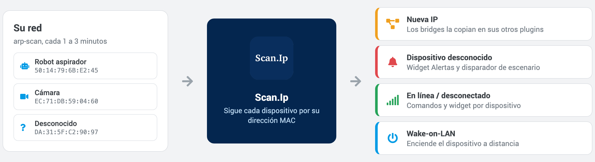

## Instalación

- Jeedom 4.0 como mínimo, compatible con PHP 7 y PHP 8.
- Este plugin requiere imperativamente "arp-scan", "wakeonlan" y "etherwake" (instalados con las dependencias).
- Utiliza los archivos "oui.txt" e "iab.txt" proporcionados por "standards-oui.ieee.org".
- Utiliza las API proporcionadas por "macvendors.com" y "macvendors.co".

> **Jeedom en Docker**: el contenedor de Jeedom debe usar `network_mode: host`. De lo contrario solo ve la red interna de Docker (a menudo un `/16` de 65.534 direcciones): los escaneos duran varios minutos y solo encuentran los demás contenedores, no los dispositivos de su red.

## Primeros pasos

1. **Instale y active el plugin**, y espere a que termine la instalación de las dependencias.
2. Abra la página del plugin y haga clic en **Sincronizar**: el primer escaneo muestra los dispositivos de la red.
3. Abra **Red** y haga clic en **Registrar** junto a cada dispositivo que quiera seguir. Se abre su ficha: póngale nombre, actívelo y guarde.
4. Si otro plugin utiliza la IP de este dispositivo, elija el elemento correspondiente en **Asociación**: Scan.Ip copiará allí cada cambio de IP.
5. Espere algunos escaneos antes de fiarse del estado «Desconectado»: algunos dispositivos Wi-Fi no responden siempre.

## Gestión de los dispositivos

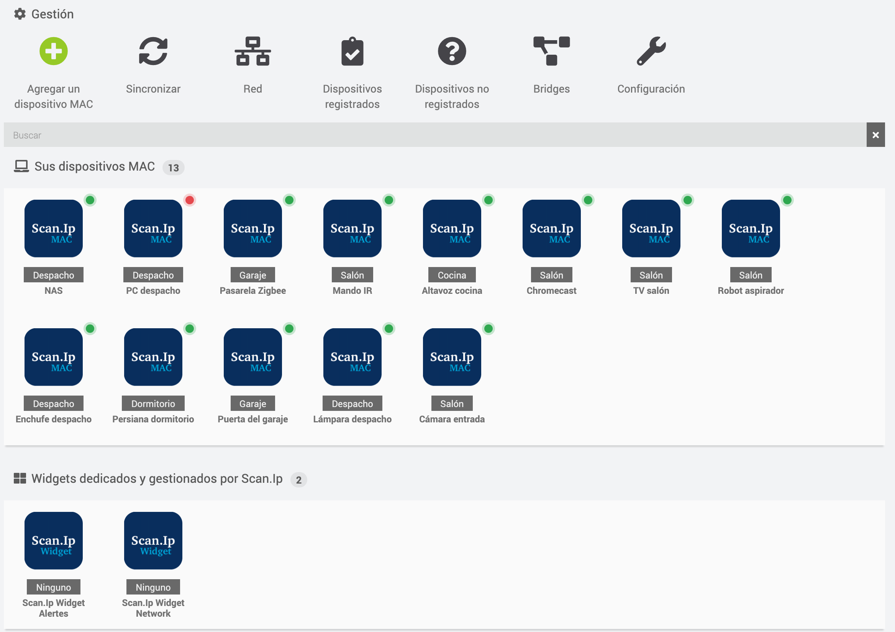

> Los dispositivos se dividen en dos partes: "Sus dispositivos MAC" y los "Widgets dedicados y gestionados por Scan.Ip". No elimine estos últimos salvo en caso de error. Para eliminarlos, active el modo debug para que aparezca el botón "Eliminar".

### Iconos de acceso

La barra «Gestión» agrupa los accesos del plugin: Añadir un dispositivo MAC, Sincronizar, Red, Dispositivos registrados, Dispositivos no registrados, Bridges, Debug (solo en modo debug) y Configuración.

En modo debug aparece un icono Debug. Aparece o desaparece en cuanto cambia de modo, sin recargar la página.

### Añadir un dispositivo MAC

Añade un dispositivo cuando conoce la dirección MAC del aparato que quiere añadir.

> Es más sencillo pasar por "Dispositivos no registrados" o por "Red", que permiten añadir al vuelo uno o varios dispositivos presentes en su red.

### Sincronizar

Lanza un nuevo escaneo y actualiza los dispositivos. Una barra de progreso muestra el paso en curso, el porcentaje, el tiempo transcurrido y una estimación del tiempo restante; la página se recarga al terminar el escaneo.

> Si ya hay un escaneo automático en curso, la barra de progreso sigue ese escaneo en lugar de lanzar un segundo.

### Red

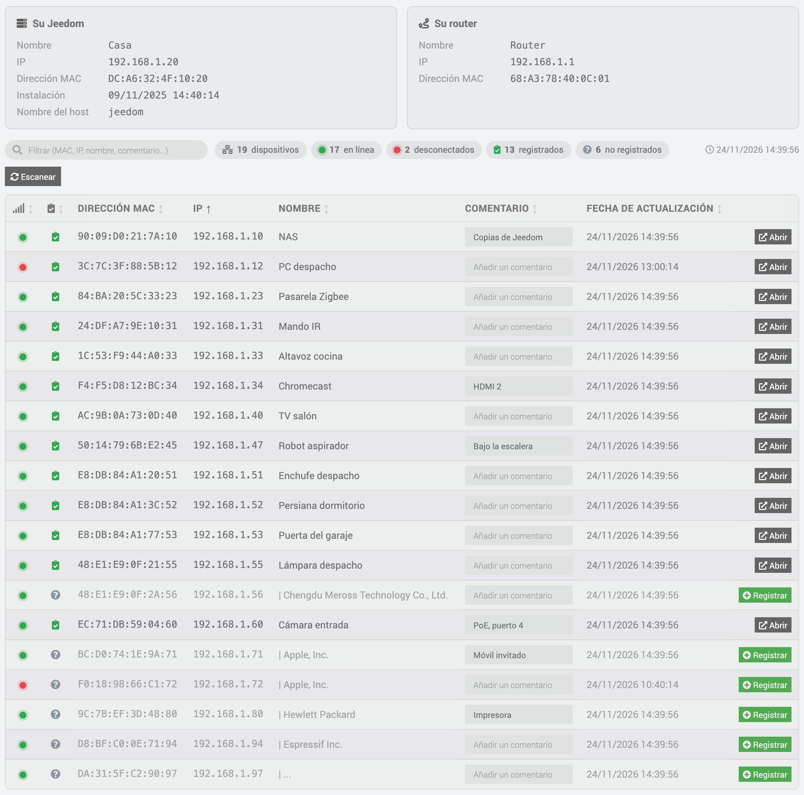

En la parte superior de la ventana, dos tarjetas resumen su Jeedom (IP, dirección MAC, fecha de instalación, nombre de host) y su router (nombre, IP, dirección MAC).

La barra de herramientas ofrece:
- un filtro para buscar por dirección MAC, IP, nombre o comentario
- contadores (dispositivos, en línea, desconectados, registrados, no registrados): un clic en un contador filtra la tabla, un segundo clic quita el filtro; los contadores a cero no se muestran
- la fecha del último escaneo y un botón "Escanear" para lanzar un nuevo escaneo, con su barra de progreso

La tabla muestra toda la red:

- La 1.ª columna indica si el dispositivo está "En línea" o "Desconectado"
- La 2.ª columna indica si el dispositivo está "registrado", "registrado pero desactivado" o "no registrado"
- La 3.ª columna indica la dirección MAC del dispositivo
- La 4.ª columna indica la IP del dispositivo
- La 5.ª columna indica el nombre del dispositivo si está registrado, o el nombre del fabricante precedido de "|"
- La 6.ª columna permite asociar un comentario a un dispositivo (se guarda automáticamente al escribir; vacíe el campo para eliminar un comentario)
- La 7.ª columna indica la última fecha en que se vio el dispositivo
- La última columna ofrece "Registrar" para un dispositivo no registrado (el dispositivo se crea y se abre su ficha para nombrarlo y activarlo), o "Abrir" para ir a la ficha de un dispositivo ya registrado

> Si ve "|..." en el nombre de un dispositivo, es que no se ha reconocido su fabricante.

### Dispositivos registrados

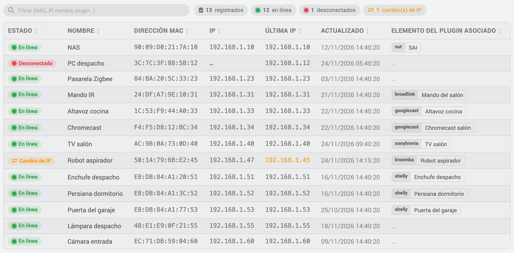

La barra de herramientas ofrece un filtro y contadores en los que se puede hacer clic (registrados, en línea, desconectados, cambios de IP).

- La 1.ª columna indica el estado del dispositivo: "En línea", "Desconectado" o "Cambio de IP"
- La 2.ª columna indica el nombre del dispositivo
- La 3.ª columna indica la dirección MAC del dispositivo
- La 4.ª columna indica la IP del dispositivo
- La 5.ª columna indica la IP utilizada en la última conexión (en naranja si difiere de la IP actual)
- La 6.ª columna indica la fecha de la última actualización del dispositivo
- La 7.ª columna indica todos los bridges asociados al dispositivo. Al hacer clic en ellos, irá al dispositivo del plugin asociado.

### Dispositivos no registrados

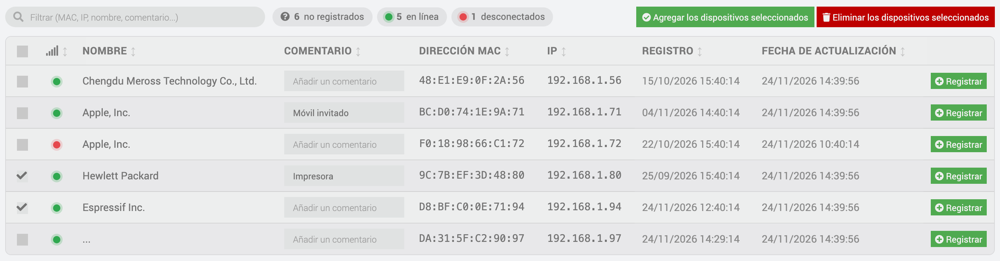

La barra de herramientas ofrece un filtro y contadores en los que se puede hacer clic (no registrados, en línea, desconectados).

- La 1.ª columna permite seleccionar el dispositivo* (para añadirlo al vuelo a sus dispositivos o eliminarlo del archivo de la red); la casilla del encabezado selecciona todas las líneas mostradas
- La 2.ª columna indica si el dispositivo está "En línea" o "Desconectado"
- La 3.ª columna indica el nombre del dispositivo
- La 4.ª columna permite introducir un comentario para el dispositivo, que se guarda automáticamente
- La 5.ª columna indica la dirección MAC del dispositivo
- La 6.ª columna indica la IP utilizada por el dispositivo
- La 7.ª columna indica la fecha del primer registro en su red
- La 8.ª columna indica la última fecha en que se vio el dispositivo
- La última columna ofrece "Registrar" para crear directamente el dispositivo y abrir su ficha

> \* Al seleccionar uno o varios elementos, aparecen botones de acción.

## Sus dispositivos

### En modo normal

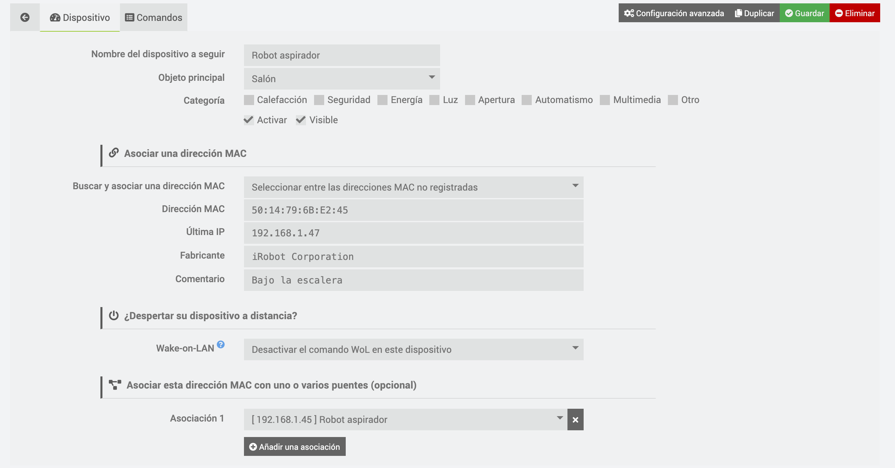

#### Buscar una dirección MAC

Este menú de selección le permite buscar directamente un elemento de su red y obtener su dirección MAC.

> Solo se proponen las direcciones MAC no asociadas, para evitar duplicados.

#### Dirección MAC asociada

Este campo se rellena:
- automáticamente con el menú "Buscar una dirección MAC"
- o manualmente si quiere anticipar la llegada de un dispositivo a su red

#### Fabricante

Si se ha identificado el fabricante, aparece aquí.

#### Wake-on-LAN

Añade un comando de acción WoL que enciende el dispositivo a distancia.

> Compruebe que su dispositivo es compatible y que la opción está activada en él para que funcione.

#### Asociación

Aquí es donde se asocia la dirección MAC del dispositivo a uno o varios elementos de los bridges (10 como máximo). En cada escaneo, cada elemento asociado recibe la IP actual del dispositivo.

- El menú de selección agrupa los elementos por plugin; cada elemento se presenta así: `[IP registrada en el plugin] nombre del elemento`. Un elemento cuyo bridge está desactivado se marca como «bridge desactivado».
- Un elemento ya asociado a otro dispositivo Scan.Ip no se propone.
- «Añadir una asociación» abre una fila adicional, la cruz elimina una asociación.

> Atención, esta opción modifica otros plugins. Utilícela con conocimiento de causa. El autor del plugin de destino no es en absoluto responsable de los fallos que esto pueda provocar en su plugin.

> Mientras no asocie un plugin, Scan.Ip no le hará ninguna modificación.

> Una asociación que ningún bridge reconoce (bridge eliminado, elemento no encontrado…) sigue mostrándose y se conserva, pero ya no se actualiza.

> Para proponer un bridge adicional, utilice el botón «Proponer» de la ventana Bridges (véase «Proponer un bridge para el catálogo»).

### En modo avanzado

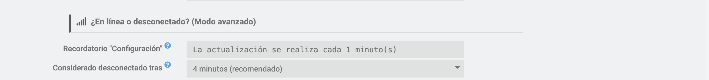

#### Recordatorio "Configuración"

Le recuerda la frecuencia de actualización guardada en la configuración del plugin.

#### Considerado desconectado tras

4 minutos por defecto: si lo ha dejado todo por defecto, son 1 escaneo por minuto y 4 pasadas para determinar si el dispositivo está realmente desconectado.
Recuerde que no todos los dispositivos aparecen en cada escaneo.

> Si ha ajustado la frecuencia de actualización a 3 minutos, ajuste este parámetro a 15 minutos como mínimo.

> Este parámetro puede reducirse para dispositivos con cable muy reactivos, por ejemplo a 2 minutos con una frecuencia de 1 minuto. Eso equivale a 2 pasadas para determinar el estado.

### En modo debug

En modo debug, el campo «MAC Id» muestra el identificador interno del dispositivo: los tres últimos bytes de su dirección MAC. Es de solo lectura y sirve para diagnosticar una asociación MAC que no funciona.

### Comandos asociados

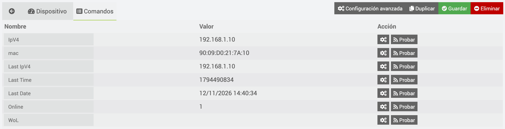

| Comando | Descripción |
|---|---|
| IpV4 | IP del dispositivo en formato v4 |
| Wol | el comando de acción para encender el dispositivo a distancia; solo presente si el Wake-on-LAN está activado en el dispositivo |
| Last Date | fecha en formato DD/MM/AAAA HH:MM:SS de la última vuelta a la conexión o del último cambio de IP del dispositivo |
| Last IpV4 | última IP utilizada por el dispositivo |
| Last Time | misma fecha que "Last Date", en formato timestamp |
| mac | dirección MAC del dispositivo |
| Online | estado del dispositivo |

### Widgets asociados

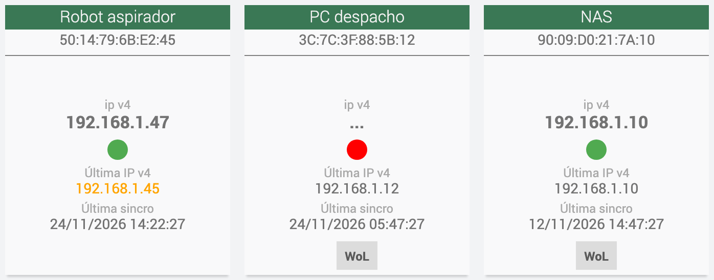

El widget muestra la dirección MAC del dispositivo, su IP, su estado, su última IP conocida (en naranja si difiere de la IP actual) y la fecha de su última vuelta a la conexión o cambio de IP. El botón WoL aparece si el Wake-on-LAN está activado en el dispositivo.

## Bridges

Scan.Ip utiliza bridges (puentes) para actualizar datos en otros plugins.

> En concreto, los bridges trasladan automáticamente el cambio de IP de un dispositivo a los demás plugins (por ejemplo, cuando no es posible fijar su IP en el DHCP).

La configuración muestra el número de bridges activos. El botón «Gestionar los bridges», o el icono «Bridges» de la página del plugin, abre su gestión.

Un bridge designa **un campo que contiene una IP** en un plugin:

- la configuración de sus dispositivos (por ejemplo `addr` para Shelly);
- el identificador lógico (logicalId) de sus dispositivos;
- la configuración de sus comandos (por ejemplo un comando de script que contiene una IP);
- la configuración del propio plugin (por ejemplo la dirección de una pasarela). `{n}` sustituye a un número cuando el plugin gestiona varias pasarelas (`wifizigate_{n}`).

El tipo de actualización se detecta automáticamente en cada cambio de IP: un campo vacío o que solo contiene la IP se sustituye por completo, en un campo que contiene la IP dentro de un valor (URL, `host:puerto`…) solo se sustituye la IP, y un campo sin IP (nombre de host…) no se modifica. En la vista normal siempre se aplica esta detección automática; en la vista avanzada puede imponer uno u otro comportamiento.

Se incluyen más de 60 bridges (catálogo): los de los plugins instalados están activos por defecto, pero solo modifican un plugin para los elementos que usted haya asociado a un dispositivo Scan.Ip. La tabla indica para cada uno el número de elementos encontrados y el número de elementos asociados a una dirección MAC, así como su origen: «Catálogo» (incluido con Scan.Ip), «Catálogo modificado» (incluido y luego modificado por usted) o «Personal» (creado por usted). Puede:

- **activar o desactivar** un bridge con el interruptor de la primera columna. Un bridge desactivado ya no actualiza nada, pero sus asociaciones se conservan;
- **probar** un bridge (botón «Probar»): por defecto, solo se prueban los elementos asociados a una dirección MAC, cada uno con la IP actual de su dispositivo, exactamente lo que hará el próximo escaneo. También puede elegir un elemento y aplicarle la IP que desee. No se guarda nada;
- **modificar** un bridge del catálogo (aparece entonces como «catálogo modificado») y volver en cualquier momento a su versión original;
- **crear** sus propios bridges.

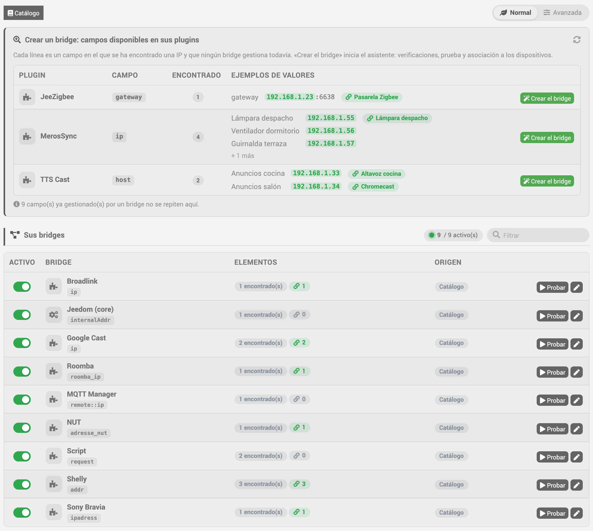

El botón «Catálogo» muestra en solo lectura la configuración original de todos los bridges incluidos (ubicación, campo, tipo de actualización, condiciones, opciones), incluso para los plugins que no tiene instalados, para inspirarse al crear un bridge.

La lista muestra los bridges que encuentran elementos en sus plugins, así como los que usted ha creado o modificado. Los demás bridges incluidos (campo vacío en su instalación, plugin no instalado) se consultan en el catálogo; aparecen por sí solos en cuanto se rellena el campo correspondiente.

La ventana ofrece dos vistas, como la configuración del plugin (la vista por defecto sigue el modo elegido en la configuración, la última elección se recuerda). Ambas listan los mismos bridges:

- **vista normal**: lo esencial. La búsqueda solo muestra las IP que aún no gestiona ningún bridge, el formulario muestra el plugin, la ubicación y el campo sin permitir modificarlos y se limita a la prueba (el tipo de actualización se detecta automáticamente). Las condiciones existentes se muestran y se siguen aplicando;
- **vista avanzada**: detalles y ajustes adicionales: ubicación y condiciones en la lista; condiciones, tipo de actualización, demonio y precisión en el formulario; creación manual de un bridge.

El mismo bridge en la vista normal y luego en la vista avanzada:

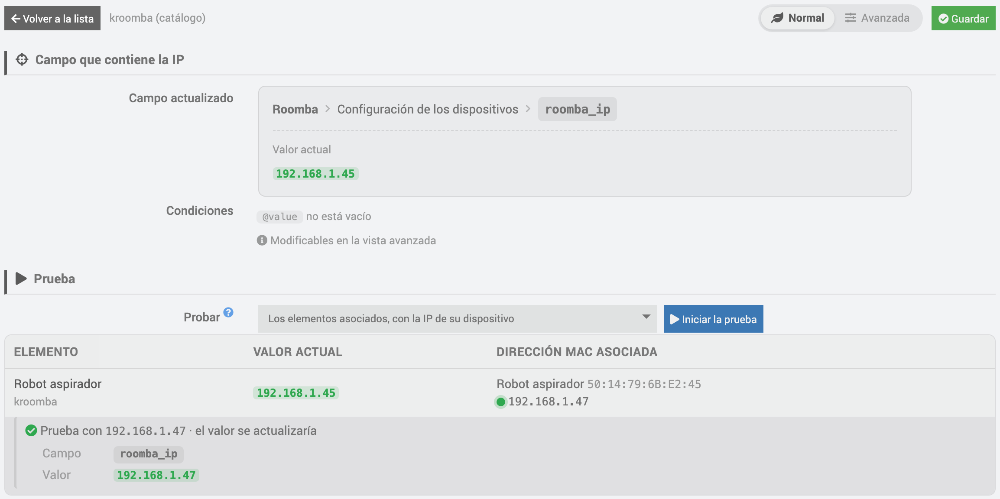

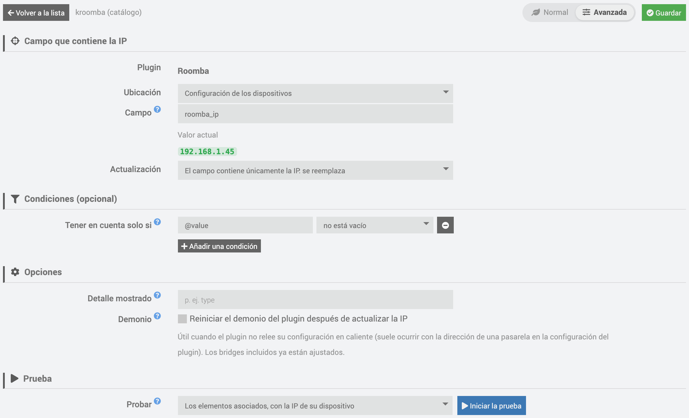

El plugin de un bridge existente no se puede modificar: cree un nuevo bridge para otro plugin.

### Crear un bridge

Al abrir la ventana Bridges, Scan.Ip busca las IP presentes en la configuración de sus plugins (dispositivos, comandos, configuración de los plugins) y lista los campos que ningún bridge gestiona todavía, con ejemplos de valores. Si ningún plugin se presta a ello, la ventana lo indica. El icono de actualización relanza la búsqueda.

El botón «Crear el bridge» de una fila lanza el asistente (pasos Campo, Comprobaciones, Terminado), que comprueba la configuración antes de crear nada:

- los elementos encontrados y el tipo de actualización (todo el campo o solo la IP que contiene);
- los valores que contienen varias IP;
- una prueba de escritura en blanco sobre cada elemento (no se modifica nada);
- la necesidad de reiniciar el demonio del plugin: Jeedom avisa al plugin cuando se guarda uno de sus parámetros (`postConfig_…`) o uno de sus dispositivos (`postSave`). Si el plugin tiene un demonio y no reacciona a este campo, el reinicio se activa automáticamente; el asistente simplemente lo indica, y el ajuste sigue siendo modificable después en el formulario del bridge en la vista avanzada.

Para cada elemento, puede probar el valor que escribiría el bridge con la IP que elija, y asociarlo a un dispositivo Scan.Ip vinculado al plugin (misma IP, o ya asociado a otro elemento del plugin). La asociación es opcional: puede hacerse más tarde desde la ficha del dispositivo Scan.Ip. El bridge no puede crearse si el plugin no tiene ningún elemento para este campo.

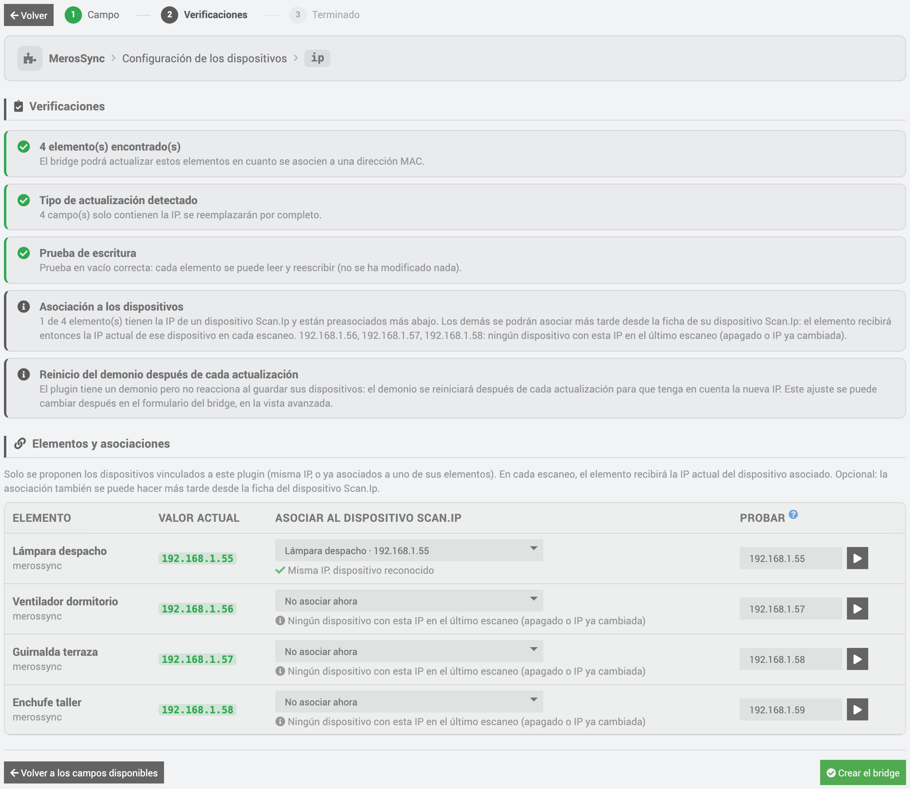

Al final, el botón «Probar el bridge» abre la simulación, y «Terminar» vuelve a la lista.

Los campos ya gestionados por un bridge no se repiten en la búsqueda, sea cual sea la vista: están en la lista de bridges. En la vista avanzada, el lápiz de una fila abre el formulario precompletado, y «Creación manual» crea un bridge desde cero.

### Condiciones

Un bridge puede aplicarse solo a ciertos elementos. Todas las condiciones deben cumplirse. Una condición se refiere a otro campo del mismo dispositivo (o del mismo comando, o de la configuración del plugin): es igual a, es distinto de, es uno de los valores (lista separada por comas), contiene, está vacío, no está vacío, coincide con una expresión regular…

Campos especiales: `@value` (el valor del campo de la IP), `@name` (nombre del elemento), `@eqName` (nombre del dispositivo), `@isEnable` (dispositivo activo) y `@logicalId`.

Ejemplo: el bridge VMware solo tiene en cuenta los dispositivos cuyo campo `type` es igual a `ESXi`.

La opción «Reiniciar el demonio del plugin» (vista avanzada) reinicia el demonio del plugin tras una actualización de la IP, para los plugins que no releen su configuración en caliente. Los bridges incluidos ya están ajustados; para un bridge creado desde la búsqueda, se activa automáticamente cuando el campo está en la configuración de un plugin que tiene su propio demonio.

Después podrá asociar un dispositivo a uno o varios elementos de estos bridges.

### Proponer un bridge para el catálogo

Un bridge que haya creado o modificado puede proponerse para el catálogo con el botón «Proponer». La regla se muestra antes del envío, en el formato del catálogo: solo se transmite la regla (plugin, ubicación, campo, condiciones, opciones), nunca las IP, valores o nombres de dispositivos de su instalación. Basta con comprobar que los valores de las condiciones no contienen nada personal.

- **GitHub**: abre una issue precompletada en el repositorio del plugin (se necesita una cuenta de GitHub);
- **Foro de Jeedom**: copia la propuesta en el portapapeles y abre el tema del plugin en community.jeedom.com ([Plugin Scan.Ip - MAJ](https://community.jeedom.com/t/plugin-scan-ip-maj/48722)): haga clic en «Responder» y péguela.

## Widgets dedicados y gestionados por Scan.Ip

Por defecto, esta parte contiene 2 widgets (pueden renombrarse):
- Scan.Ip Widget Alertes
- Scan.Ip Widget Network

Estos dispositivos los gestiona directamente el plugin y reflejan lo que ha configurado en él.

> Recuerde que su visualización se gestiona en la configuración del plugin.

### El widget Red

Esta opción muestra u oculta el widget de la red.

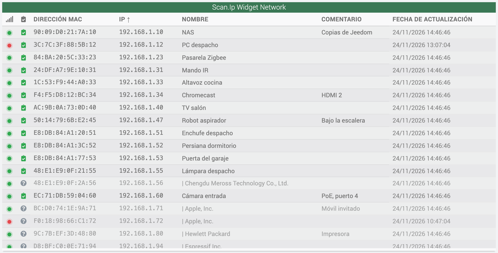

> Puede ordenar las columnas con un simple clic en su encabezado.

> También puede configurar un orden por defecto en el dispositivo vinculado a este widget.

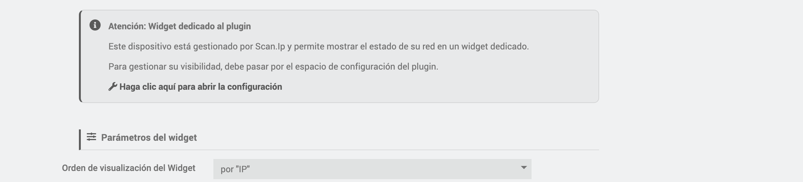

### El widget Alertas

Esta opción muestra u oculta el widget de alertas.

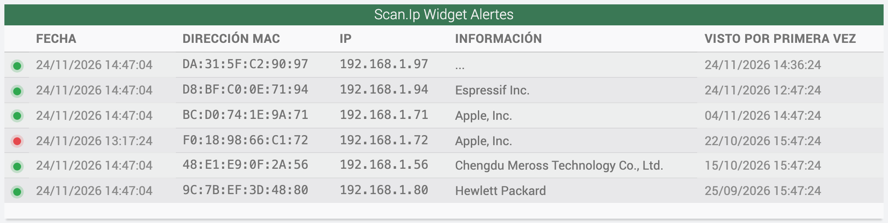

> Este widget solo muestra los dispositivos no registrados, ordenados por fecha de conexión y luego por fecha de primer registro. Un dispositivo totalmente nuevo aparece por tanto en primera posición.

#### Comandos asociados

Se crean 10 grupos de comandos. Corresponden a los 10 últimos dispositivos no registrados que se han conectado. El orden cronológico empieza en cero (el más reciente) y termina en nueve (el más antiguo).

Cada elemento tiene 6 subcomandos:

| Comando | Descripción |
|---|---|
| Connexion 0 Création | timestamp del primer registro |
| Connexion 0 Date | fecha en formato DD/MM/AAAA HH:MM:SS de la última vez que se vio |
| Connexion 0 Time | timestamp de la última vez que se vio |
| Connexion 0 Equipement | nombre del fabricante si se conoce |
| Connexion 0 IpV4 | IP en formato v4 asignada |
| Connexion 0 MAC | dirección MAC del dispositivo |

## Configuración

Para facilitar su uso, el plugin adapta las opciones disponibles a tres modos: "normal", "avanzado" y "debug".

El modo se elige con el selector «Modo de visualización» situado en la parte superior de la configuración, que recuerda lo que muestra cada modo. Las secciones propias de los modos avanzado y debug llevan una insignia «Avanzado» o «Depuración» a la derecha de su título, y las opciones sí / no se ajustan con interruptores.

### Modo normal

El modo normal muestra los parámetros principales, que suelen adaptarse a las configuraciones estándar: widgets, frecuencia de actualización, archivos de fabricantes y puentes (bridges).

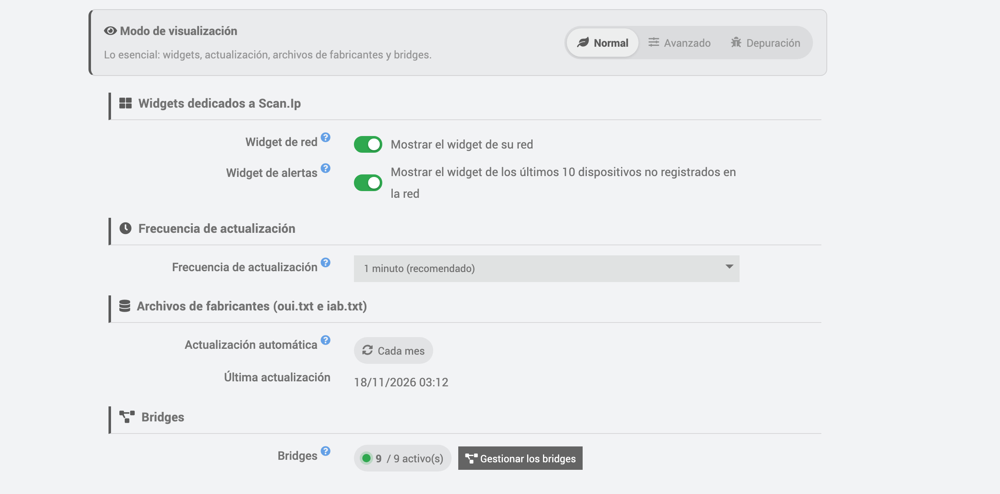

#### Frecuencia de actualización

Ajusta la frecuencia de actualización de la tarea programada.
Por defecto está fijada en 1 minuto.

> No todos los dispositivos responden en cada escaneo, porque algunos tardan demasiado en responder (por ejemplo los dispositivos Wi-Fi). Por eso se recomienda esperar al menos 3 escaneos antes de considerar que un dispositivo está realmente desconectado. Este parámetro puede ajustarse con más precisión en cada dispositivo.

#### Archivos de fabricantes (oui.txt e iab.txt)

Estos archivos identifican al fabricante de un dispositivo a partir de su dirección MAC. Se actualizan automáticamente cada mes desde el sitio del IEEE; si falla, se conservan los archivos existentes y se vuelve a intentar al día siguiente.

Según el modo, esta sección muestra:
- **modo normal**: la frecuencia de actualización y la fecha de la última actualización
- **modo avanzado**: además, la posibilidad de elegir la frecuencia (cada mes, cada semana) o de desactivar la actualización automática
- **modo debug**: además, el estado de cada archivo y un botón «Actualizar ahora»

### Modo avanzado

El modo avanzado añade secciones, marcadas con la insignia «Avanzado», y ajustes adicionales en las secciones existentes (por ejemplo la frecuencia de actualización de los archivos de fabricantes).

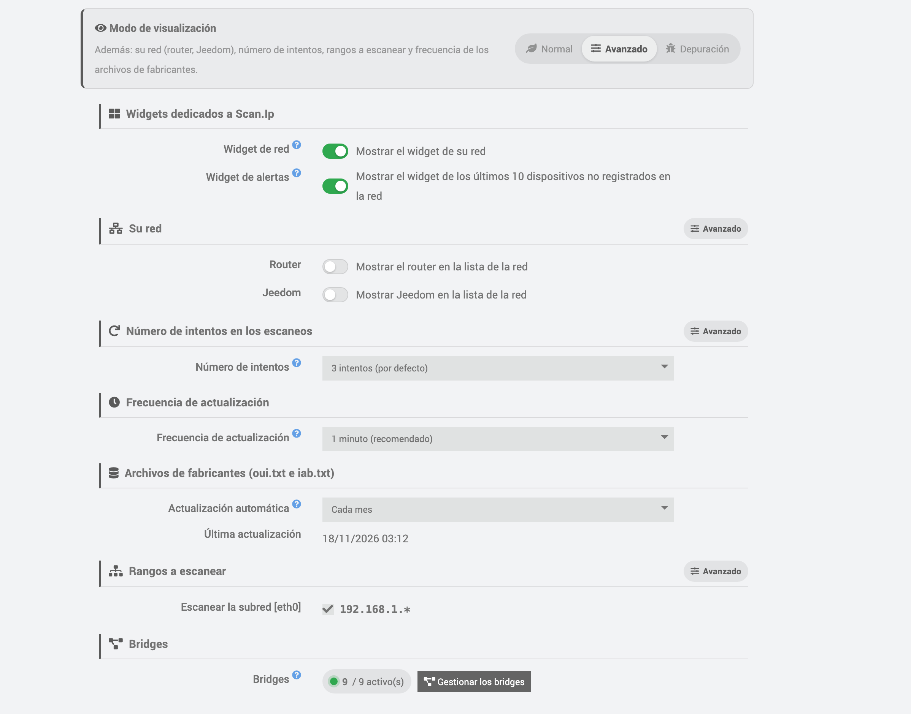

#### Su red

- **Router**: muestra el router en la lista de la red. Por defecto, está retirado.
- **Jeedom**: muestra el servidor Jeedom en la lista de la red. Por defecto, está retirado.

#### Número de intentos en los escaneos

Ajusta el número de intentos durante los escaneos de la red. No todos los dispositivos responden al primer intento. Cuantos más intentos, más largo es el escaneo.

#### Rangos a escanear

Cuando tiene varias tarjetas de red o subredes, marque la o las subredes que desea escanear. Solo se proponen las interfaces que tienen una dirección IPv4 (las interfaces virtuales de Docker o las tarjetas no conectadas no aparecen).

> Es posible que una subred no permita recuperar las direcciones MAC que contiene (bloqueo en el router u otro motivo). En ese caso, tendrá que instalar otro Jeedom en esa subred, con un Scan.Ip dedicado.

> La duración de un escaneo depende del tamaño de la subred: unos segundos para un `/24` (254 direcciones), varios minutos para un `/16` (65 534 direcciones).

### Modo debug

Las secciones reservadas al modo debug llevan la insignia «Depuración».

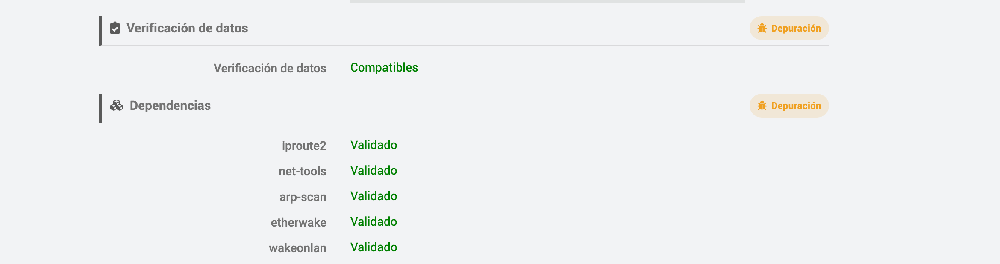

#### Verificación de datos

Comprueba que los datos guardados por el plugin tienen el formato de la versión instalada. Si todo es correcto, se muestra «Compatibles» en verde; si no, un botón rojo «Datos no compatibles (Haga clic aquí para corregir el problema)» lanza su corrección.

#### Dependencias

Muestra el estado de cada dependencia (iproute2, net-tools, arp-scan, etherwake, wakeonlan): «Validado» en verde si está instalada. Muestra de un vistazo las dependencias que han fallado.

## Subredes y Scan.Ip

Scan.Ip puede gestionar varias redes al mismo tiempo.
Para ello, su Jeedom debe estar conectado a las distintas redes.
Puede, por ejemplo, conectar el Wi-Fi de su equipo Jeedom a una red y el cable de red a la otra, o simplemente conectar adaptadores "USB/Ethernet" o "USB/Wi-Fi" a su Jeedom.
Scan.Ip le mostrará las subredes, que podrá activar después en la configuración del plugin (en modo avanzado).

## Debug (solo en modo debug)

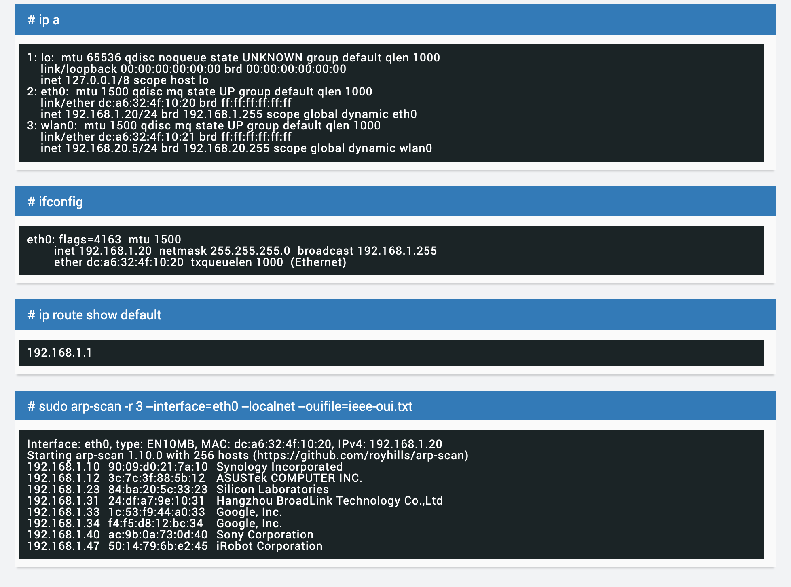

Esta ventana sirve para ayudar a entender posibles errores.

#### ip a

Resultado del comando `ip a`, que muestra la lista de todas las redes accesibles desde su Jeedom.

#### ip route

Muestra la IP del router asociado a su Jeedom.

#### arp-scan

> Aquí está seleccionada la red "eth0", pero esto depende de su red.

Resultado del comando `sudo arp-scan -r 3 --interface=eth0 --localnet --ouifile=ieee-oui.txt`, que muestra la lista de dispositivos que responden al escaneo.

> Como se ha indicado antes, es posible que no todos sus dispositivos conectados aparezcan en un solo escaneo. Por eso son necesarios varios escaneos para tener una imagen más precisa de los dispositivos conectados.

#### Equipements

Muestra los datos del JSON de dispositivos. Es el historial de todos los dispositivos que se han conectado a su red.

#### Mappings

Muestra los datos del JSON de mapping. Es el último estado de su red, con la versión de "arp-scan" utilizada.

## Ejemplos de escenarios

Los comandos del plugin pueden usarse como disparadores en los escenarios de Jeedom. En los ejemplos siguientes, sustituya `[Aucun]` por el objeto padre de sus dispositivos, y el comando de envío por el de su plugin de notificación (SMS, Telegram, Jeedom Connect…).

### Recibir un SMS cuando se conecta un dispositivo nuevo

El widget Alertas mantiene en la posición 0 el dispositivo desconocido más reciente. Este escenario se dispara cuando cambia esa posición y comprueba que el dispositivo acaba de detectarse por primera vez.

- **Modo**: Provocado
- **Disparador**: `#[Aucun][Scan.Ip Widget Alertes][Connexion 0 Création]#`
- **SI**: `#[Aucun][Scan.Ip Widget Alertes][Connexion 0 Création]# > #timestamp# - 180`
- **ENTONCES**: comando de envío de SMS con el mensaje
  `Nuevo dispositivo en la red: #[Aucun][Scan.Ip Widget Alertes][Connexion 0 MAC]# (#[Aucun][Scan.Ip Widget Alertes][Connexion 0 IpV4]#, #[Aucun][Scan.Ip Widget Alertes][Connexion 0 Equipement]#)`

> La condición solo deja pasar los dispositivos detectados por primera vez hace menos de 3 minutos: un simple cambio de orden de la lista no dispara ninguna alerta.

> El widget Alertas debe estar activado en la configuración del plugin. Si llegan varios dispositivos nuevos durante el mismo escaneo, solo se envía una alerta.

### Recibir un aviso cuando un dispositivo registrado abandona la red

Para un dispositivo MAC registrado (por ejemplo "Aspirateur robot"), el comando **Online** pasa a 0 cuando el dispositivo se considera desconectado.

- **Modo**: Provocado
- **Disparador**: `#[Aucun][Aspirateur robot][Online]#`
- **SI**: `#[Aucun][Aspirateur robot][Online]# == 0`
- **ENTONCES**: comando de notificación con el mensaje
  `El robot aspirador ya no está conectado a la red`

> El tiempo antes de considerar el dispositivo desconectado se ajusta en el dispositivo («Considerado desconectado tras», en modo avanzado).

> Variante: con el disparador `#[Aucun][Aspirateur robot][IpV4]#` y la condición `#[Aucun][Aspirateur robot][IpV4]# != ""`, recibirá un aviso en cada cambio de IP del dispositivo.

## Preguntas frecuentes

**¿Scan.Ip modifica mis otros plugins?**
Solo los elementos que haya asociado a un dispositivo Scan.Ip, y únicamente el campo que contiene la IP. Sin asociación no se modifica nada.

**Un dispositivo encendido aparece desconectado**
Algunos dispositivos, sobre todo por Wi-Fi, no responden a todos los escaneos. Aumente «Considerado desconectado tras» en el dispositivo o el número de intentos (modo avanzado).

**El fabricante aparece como «...»**
El prefijo de la dirección MAC no está en los archivos de fabricantes. También ocurre con los teléfonos que usan una dirección MAC privada (aleatoria): puede cambiar, desactive esa opción en el teléfono para seguirlo.

**Solo se encuentran contenedores**
Jeedom se ejecuta en Docker sin `network_mode: host`, consulte «Instalación».

**¿Sigue siendo necesario fijar las IP en el DHCP?**
No es obligatorio con los bridges, pero sigue siendo la solución más sencilla si su router lo permite.
