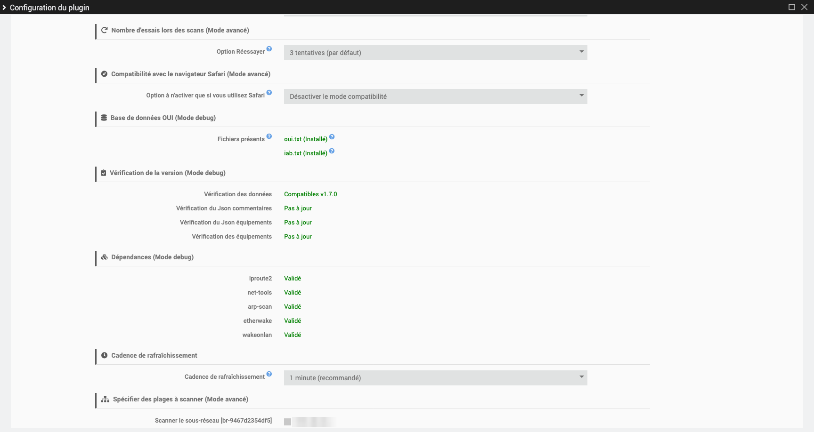
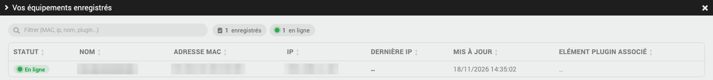
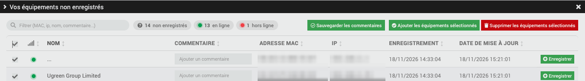
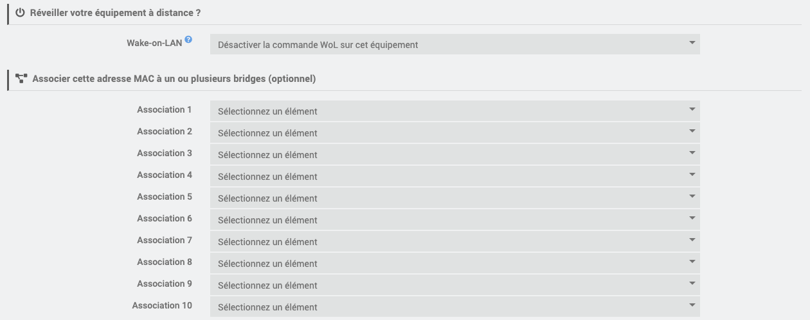
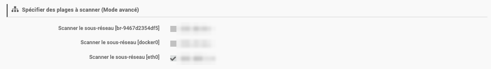

Description
===

Ce plugin sert à scanner votre réseau et à récupérer la liste des équipements qui y sont connectés ainsi que leurs adresses MAC.

Avec ces informations, le plugin permet :
- de récupérer la nouvelle IP d'un équipement
- d'afficher un widget qui référence l'état de votre réseau
- d'afficher un widget qui référence les équipements, non enregistrés, qui viennent de se connecter au réseau
- d'afficher un widget par équipement enregistré et de mettre à disposition les commandes associées à cet équipement
- de créer des alertes quand un appareil disparaît, apparaît ou change d'IP sur le réseau
- d'automatiser des changements d'IP en cascade sur d'autres plugins par le biais de bridges
- d'allumer un équipement à distance (Wake-on-LAN)

Installation et dépendances
===

- Jeedom 4.0 minimum, compatible PHP 7 et PHP 8.
- Ce plugin nécessite impérativement "arp-scan", "wakeonlan" et "etherwake" (installés avec les dépendances).
- Il utilise les fichiers "oui.txt" et "iab.txt" proposés par "standards-oui.ieee.org".
- Il utilise les API proposées par "macvendors.com" et "macvendors.co".

> **Jeedom sous Docker** : le conteneur Jeedom doit être en `network_mode: host`. Sinon, il ne voit que le réseau interne de Docker (souvent un `/16` de 65 534 adresses) : les scans durent plusieurs minutes et ne trouvent que les autres conteneurs, pas les appareils de votre réseau.

# Configuration

Afin de faciliter l'utilisation de ce plugin, celui-ci adapte les options proposées selon trois modes : "normal", "avancé" et "debug".

## Mode normal

Le mode normal affiche les paramètres principaux, qui conviennent généralement aux configurations standards.

### Widget Network

Cette option permet d'afficher ou non le widget d'affichage du réseau.

> Vous pouvez trier les colonnes d'un simple clic sur leur en-tête.

> Vous pouvez aussi configurer un tri par défaut dans l'équipement lié à ce widget.

### Widget Alertes

Cette option permet d'afficher ou non le widget d'affichage des alertes.

> Ce widget n'affiche que les équipements non enregistrés, triés par date de connexion puis par date de premier référencement. Un équipement tout nouveau apparaît donc en première position.

### Cadence de rafraîchissement

Sert à régler la cadence de rafraîchissement de la tâche planifiée.
Par défaut, celle-ci est réglée à 1 minute.

> À chaque scan du réseau, tous les périphériques ne répondent pas forcément, car certains mettent trop de temps à répondre (par exemple les périphériques Wi-Fi). Il est donc conseillé d'attendre au moins 3 scans avant de considérer qu'un périphérique est vraiment hors ligne. Ce paramètre peut être réglé plus finement au niveau de chaque équipement.

### Liste des Plugins pris en compte

Scan.Ip utilise des bridges pour mettre à jour des données dans certains plugins. Par défaut, seuls les plugins installés sur votre Jeedom sont affichés ; cochez « Afficher aussi les plugins non installés » pour voir l'ensemble des plugins pris en compte.

> Concrètement, les bridges permettent de reporter automatiquement le changement d'IP d'un appareil dans les autres plugins (par exemple quand il est impossible de fixer son IP dans le DHCP).

Vous pourrez ainsi associer un équipement à un ou plusieurs plugins.

## Mode avancé

### Routeur

Permet d'ajouter le routeur dans la liste du réseau. Par défaut, celui-ci est retiré.

### Jeedom

Permet d'ajouter le serveur Jeedom dans la liste du réseau. Par défaut, celui-ci est retiré.

### Option Réessayer

Règle le nombre de tentatives lors des scans du réseau. Tous les équipements ne répondent pas dès la première tentative. Plus il y a de tentatives, plus le scan est long.

### Compatibilité avec le navigateur Safari

Sur Safari, le masquage des options dans les menus de sélection (qui sert à n'afficher que les bridges non utilisés) ne fonctionne pas. En activant cette option, les éléments déjà utilisés sont désactivés au lieu d'être masqués. N'activez cette option que si vous rencontrez le problème sous Safari.

### Mise à jour automatique des fichiers constructeurs

Les fichiers oui.txt et iab.txt permettent d'identifier le constructeur d'un appareil à partir de son adresse MAC. Cette option les met à jour automatiquement depuis le site de l'IEEE, toutes les semaines ou tous les mois (désactivée par défaut). En cas d'échec, les fichiers existants sont conservés et une nouvelle tentative a lieu le lendemain. La date de la dernière mise à jour est affichée juste en dessous.

> Une mise à jour manuelle reste possible à tout moment depuis le mode debug (bouton « Mettre à jour oui.txt et iab.txt »).

### Spécifier des plages réseau à scanner

Lorsque vous avez plusieurs cartes réseau ou des sous-réseaux, cochez le ou les sous-réseaux à scanner. Seules les interfaces qui possèdent une adresse IPv4 sont proposées (les interfaces virtuelles Docker ou les cartes non connectées ne sont pas listées).

> Un sous-réseau peut ne pas permettre de récupérer les adresses MAC qui s'y trouvent (blocage au niveau du routeur ou autre). Dans ce cas, il vous faudra installer un autre Jeedom dans ce sous-réseau, avec un Scan.Ip dédié.

> Le temps d'un scan dépend de la taille du sous-réseau : quelques secondes pour un `/24` (254 adresses), plusieurs minutes pour un `/16` (65 534 adresses).

## Mode debug

### Fichiers présents

Vérifie la présence des fichiers oui.txt et iab.txt ainsi que leurs dates de mise à jour.

> Ces deux fichiers font le lien entre une adresse MAC et un constructeur.

Le bouton « Mettre à jour oui.txt et iab.txt » télécharge la dernière version des registres sur le site de l'IEEE et régénère les deux fichiers. En cas d'échec (pas d'accès à Internet, fichier reçu incomplet), les fichiers existants sont conservés.

### Vérification de la version

Vérifie que les données enregistrées par le plugin sont au format de la version installée. Chaque ligne affiche « À jour » en vert si tout est correct, ou « Pas à jour » en rouge sinon. Si les données ne sont pas compatibles, un bouton permet de lancer leur correction.

### Dépendances

Permet de voir facilement les dépendances qui sont en échec.

# Gestion des équipements

> Les équipements sont séparés en deux parties : "Vos équipements MAC" et les "Widgets dédiés et gérés par Scan.Ip". Il ne faut pas supprimer ces derniers, sauf en cas de bug. Pour les supprimer, activez le mode debug pour faire apparaître le bouton "Supprimer".

## Icônes d'accès

En mode debug, une icône Debug apparaît. Elle apparaît ou disparaît dès que vous changez de mode, sans recharger la page.

### Ajouter un équipement MAC

Permet d'ajouter un équipement quand vous connaissez l'adresse MAC du périphérique à ajouter.

> Il est plus simple de passer par "Équipements non enregistrés" ou par "Réseau", qui permettent d'ajouter à la volée un ou plusieurs équipements présents sur votre réseau.

### Synchroniser

Lance un nouveau scan et la mise à jour des équipements. Une barre de progression affiche l'étape en cours, le pourcentage, le temps écoulé et une estimation du temps restant ; la page se recharge à la fin du scan.

> Si un scan automatique est déjà en cours, la barre de progression suit ce scan au lieu d'en lancer un second.

### Réseau

En haut de la fenêtre, deux cartes résument votre Jeedom (IP, adresse MAC, date d'installation, nom d'hôte) et votre routeur (nom, IP, adresse MAC).

La barre d'outils propose :
- un filtre pour rechercher par adresse MAC, IP, nom ou commentaire
- des compteurs (appareils, en ligne, hors ligne, enregistrés, non enregistrés) : un clic sur un compteur filtre le tableau, un second clic retire le filtre ; les compteurs à zéro ne sont pas affichés
- la date du dernier scan et un bouton "Scanner" pour relancer un scan, avec sa barre de progression

Le tableau affiche l'ensemble du réseau :

- La 1re colonne indique si le périphérique est "En ligne" ou "Hors ligne"
- La 2e colonne indique si l'équipement est "enregistré", "enregistré mais désactivé" ou "non enregistré"
- La 3e colonne indique l'adresse MAC de l'équipement
- La 4e colonne indique l'IP de l'équipement
- La 5e colonne indique le nom de l'équipement s'il est enregistré, ou bien le nom du constructeur précédé d'un "|"
- La 6e colonne permet d'associer un commentaire à un équipement (il est enregistré automatiquement pendant la saisie ; videz le champ pour supprimer un commentaire)
- La 7e colonne indique la dernière date d'apparition de l'équipement
- La dernière colonne propose "Enregistrer" pour un appareil non enregistré (l'équipement est créé puis sa fiche s'ouvre pour le nommer et l'activer), ou "Ouvrir" pour accéder à la fiche d'un équipement déjà enregistré

> Si vous voyez "|..." dans le nom d'un équipement, c'est que son constructeur n'a pas été reconnu.

### Équipements enregistrés

La barre d'outils propose un filtre et des compteurs cliquables (enregistrés, en ligne, hors ligne, changements d'IP).

- La 1re colonne indique l'état de l'équipement : "En ligne", "Hors ligne" ou "Changement d'IP"
- La 2e colonne indique le nom de l'équipement
- La 3e colonne indique l'adresse MAC de l'équipement
- La 4e colonne indique l'IP de l'équipement
- La 5e colonne indique l'IP utilisée lors de la dernière connexion (en orange si elle diffère de l'IP actuelle)
- La 6e colonne indique la dernière date de mise à jour de l'équipement
- La 7e colonne indique tous les bridges associés à l'équipement. En cliquant dessus, vous serez dirigé vers l'équipement du plugin associé.

### Équipements non enregistrés

La barre d'outils propose un filtre et des compteurs cliquables (non enregistrés, en ligne, hors ligne).

- La 1re colonne permet de sélectionner l'équipement* (pour l'ajouter à la volée parmi vos équipements ou le supprimer des archives du réseau) ; la case de l'en-tête sélectionne toutes les lignes affichées
- La 2e colonne indique si le périphérique est "En ligne" ou "Hors ligne"
- La 3e colonne indique le nom de l'équipement
- La 4e colonne permet de saisir un commentaire associé à l'équipement, enregistré automatiquement
- La 5e colonne indique l'adresse MAC de l'équipement
- La 6e colonne indique l'IP utilisée par l'équipement
- La 7e colonne indique la date du premier enregistrement sur votre réseau
- La 8e colonne indique la dernière date d'apparition de l'équipement
- La dernière colonne propose "Enregistrer" pour créer directement l'équipement et ouvrir sa fiche

> \* Lorsque vous sélectionnez un ou plusieurs éléments, des boutons d'action apparaissent.

### Debug (uniquement en mode debug)

Cette fenêtre a pour but d'aider à comprendre les éventuels bugs.

#### # ip a

Résultat de la commande "ip a", qui affiche la liste de tous les réseaux accessibles depuis votre Jeedom.

#### # ip route show default

Affiche l'IP du routeur associé à votre Jeedom.

#### # sudo arp-scan -r 3 --interface=eth0 --localnet --ouifile=ieee-oui.txt

> Ici c'est le réseau "eth0" qui est sélectionné, mais cela dépend de votre réseau.

Résultat de la commande "sudo arp-scan -r 3 --interface=eth0 --localnet --ouifile=ieee-oui.txt", qui affiche la liste des équipements répondant au scan.

> Comme précisé plus haut, il se peut que tous vos appareils connectés ne s'affichent pas en un seul scan. C'est pour cela qu'il est important de faire plusieurs scans pour avoir une image plus juste des appareils connectés.

#### # Equipements

Affiche les données présentes dans le JSON des équipements. C'est l'historique de tous les équipements qui se sont connectés à votre réseau.

#### # Mappings

Affiche les données présentes dans le JSON mapping. C'est le dernier état de votre réseau, avec la version de "arp-scan" utilisée.

### Configuration

Ce point a déjà été traité au début.

## Vos équipements

### En mode normal

#### Rechercher une adresse MAC

Ce menu de sélection vous permet de rechercher directement un élément de votre réseau et de récupérer son adresse MAC.

> Seules les adresses MAC non associées sont proposées, pour éviter les doublons.

#### Adresse MAC associée

Ce champ est :
- soit rempli automatiquement avec le menu de sélection "Rechercher une adresse MAC"
- soit rempli manuellement si vous voulez anticiper l'arrivée d'un équipement sur votre réseau

#### Constructeur

Si le constructeur a été identifié, il est inscrit ici.

#### Wake-on-LAN

Permet d'ajouter une commande d'action WoL qui allume l'équipement à distance.

> Vérifiez que votre équipement est compatible et que l'option est bien activée sur celui-ci pour que cela fonctionne.

#### Association

Comme vu dans la partie configuration, c'est ici que l'on associe les plugins à Scan.Ip grâce aux bridges.

> Dans le menu de sélection, l'information est présentée ainsi : [nom du plugin][IP enregistrée dans le plugin :: sous-nom de configuration (si présent)] nom de l'équipement du plugin cible.

> Attention, cette option modifie les autres plugins. À utiliser en connaissance de cause. L'auteur du plugin cible n'est nullement responsable des dysfonctionnements que cela pourrait créer sur son plugin.

> Tant que vous ne faites pas d'association à un plugin, Scan.Ip ne fera aucune modification sur celui-ci.

> Si vous êtes développeur et souhaitez proposer un bridge complémentaire, c'est tout à fait possible : soit en proposant directement un ajout sur le GitHub (https://ynats.github.io/jeedom-plugin-scan.ip/), soit en passant par le forum.

### En mode avancé

#### Rappel "Configuration"

Vous rappelle la cadence de rafraîchissement enregistrée dans la configuration du plugin.

#### Présumé hors-ligne au bout de

Par défaut à 4 minutes : si vous avez tout laissé par défaut, cela fait 1 scan toutes les minutes et 4 passages pour déterminer si l'équipement est bien hors ligne.
Souvenez-vous que tous les équipements ne ressortent pas forcément à chaque scan.

> Si vous avez réglé la cadence de rafraîchissement à 3 minutes, il faut régler ce paramètre à au moins 15 minutes.

> Ce paramètre peut être abaissé pour des équipements en réseau filaire et très réactifs, par exemple à 2 minutes pour une cadence de 1 minute. Cela revient à 2 passages pour déterminer l'état.

### En mode debug

#### MAC Id

En mode debug, le champ « MAC Id » affiche l'identifiant interne de l'équipement : les trois derniers octets de son adresse MAC. Il est en lecture seule et sert à diagnostiquer une association MAC qui ne fonctionne pas.

### Commandes associées

- IpV4 (IP au format v4 de l'équipement)
- Wol (la commande d'action pour allumer l'équipement à distance, présente uniquement si le Wake-on-LAN est activé sur l'équipement)
- Last Date (date au format JJ/MM/AAAA HH:MM:SS du dernier retour en ligne ou du dernier changement d'IP de l'équipement)
- Last IpV4 (dernière IP utilisée par l'équipement)
- Last Time (même date que "Last Date", au format timestamp)
- mac (adresse MAC de l'équipement)
- Online (état de l'équipement)

### Widgets associés

Le widget affiche l'adresse MAC de l'équipement, son IP, son état, sa dernière IP connue (en orange si elle diffère de l'IP actuelle) et la date du dernier retour en ligne ou changement d'IP. Le bouton WoL apparaît si le Wake-on-LAN est activé sur l'équipement.

# Widgets dédiés et gérés par Scan.Ip

Par défaut, cette partie comprend 2 widgets (ils peuvent être renommés) :
- Scan.Ip Widget Alertes
- Scan.Ip Widget Network

Ces équipements sont directement gérés par le plugin et correspondent à ce que vous avez configuré dans le plugin.

> Pour rappel, leur affichage se gère dans l'espace de configuration du plugin.

## Le widget Network

## Le widget Alertes

#### Commandes associées

10 groupes de commandes sont créés. Ils correspondent aux 10 derniers équipements non enregistrés qui se sont connectés. L'ordre chronologique commence à zéro (le plus récent) et se termine à neuf (le plus ancien).

Chaque élément comporte 6 sous-commandes :

- Connexion 0 Création (date au format timestamp du premier référencement)
- Connexion 0 Date (date au format JJ/MM/AAAA HH:MM:SS de sa dernière apparition)
- Connexion 0 Time (date au format timestamp de sa dernière apparition)
- Connexion 0 Equipement (nom du constructeur s'il est référencé)
- Connexion 0 IpV4 (IP au format v4 qui lui est attribuée)
- Connexion 0 MAC (adresse MAC de l'équipement)

## Sous-réseaux et Scan.Ip

#### Si vous souhaitez gérer plusieurs réseaux (par exemple, vous possédez un hub connecté à votre routeur)

Scan.Ip est capable de gérer plusieurs réseaux en même temps.
Pour cela, votre Jeedom doit être connecté aux différents réseaux.
Vous pouvez par exemple connecter le Wi-Fi de votre machine Jeedom à un réseau et le câble réseau à l'autre, ou tout simplement brancher des adaptateurs "USB/Ethernet" ou "USB/Wi-Fi" à votre Jeedom.
Scan.Ip vous affichera les sous-réseaux, que vous pourrez ensuite activer dans la configuration du plugin (en mode avancé).

# Exemples de scénarios

Les commandes du plugin peuvent servir de déclencheurs dans les scénarios Jeedom. Dans les exemples ci-dessous, remplacez `[Aucun]` par l'objet parent de vos équipements, et la commande d'envoi par celle de votre plugin de notification (SMS, Telegram, Jeedom Connect…).

## Recevoir un SMS quand un nouvel appareil se connecte

Le widget Alertes garde en position 0 l'appareil inconnu le plus récent. Ce scénario se déclenche quand cette position change, et vérifie que l'appareil vient d'être détecté pour la première fois.

- **Mode** : Provoqué
- **Déclencheur** : `#[Aucun][Scan.Ip Widget Alertes][Connexion 0 Création]#`
- **SI** : `#[Aucun][Scan.Ip Widget Alertes][Connexion 0 Création]# > #timestamp# - 180`
- **ALORS** : commande d'envoi de SMS avec le message
  `Nouvel appareil sur le réseau : #[Aucun][Scan.Ip Widget Alertes][Connexion 0 MAC]# (#[Aucun][Scan.Ip Widget Alertes][Connexion 0 IpV4]#, #[Aucun][Scan.Ip Widget Alertes][Connexion 0 Equipement]#)`

> La condition ne laisse passer que les appareils détectés pour la première fois depuis moins de 3 minutes : un simple changement d'ordre de la liste ne déclenche pas d'alerte.

> Le widget Alertes doit être activé dans la configuration du plugin. Si plusieurs nouveaux appareils arrivent pendant le même scan, une seule alerte est envoyée.

## Être prévenu quand un appareil enregistré quitte le réseau

Pour un équipement MAC enregistré (par exemple "Aspirateur robot"), la commande **Online** passe à 0 quand l'appareil est considéré hors ligne.

- **Mode** : Provoqué
- **Déclencheur** : `#[Aucun][Aspirateur robot][Online]#`
- **SI** : `#[Aucun][Aspirateur robot][Online]# == 0`
- **ALORS** : commande de notification avec le message
  `L'aspirateur robot n'est plus connecté au réseau`

> Le délai avant que l'appareil soit considéré hors ligne se règle dans l'équipement (« Présumé hors-ligne au bout de », en mode avancé).

> Variante : avec le déclencheur `#[Aucun][Aspirateur robot][IpV4]#` et la condition `#[Aucun][Aspirateur robot][IpV4]# != ""`, vous êtes prévenu à chaque changement d'IP de l'appareil.
