# Plugin Scan.Ip

Ce plugin sert à scanner votre réseau et à récupérer la liste des équipements qui y sont connectés ainsi que leurs adresses MAC.

Avec ces informations, le plugin permet :
- de récupérer la nouvelle IP d'un équipement
- d'afficher un widget qui référence l'état de votre réseau
- d'afficher un widget qui référence les équipements, non enregistrés, qui viennent de se connecter au réseau
- d'afficher un widget par équipement enregistré et de mettre à disposition les commandes associées à cet équipement
- de créer des alertes quand un appareil disparaît, apparaît ou change d'IP sur le réseau
- d'automatiser des changements d'IP en cascade sur d'autres plugins par le biais de bridges
- d'allumer un équipement à distance (Wake-on-LAN)

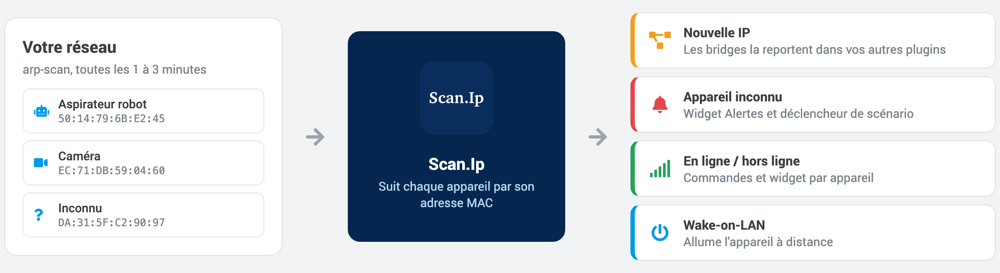

## Installation

- Jeedom 4.0 minimum, compatible PHP 7 et PHP 8.
- Ce plugin nécessite impérativement "arp-scan", "wakeonlan" et "etherwake" (installés avec les dépendances).
- Il utilise les fichiers "oui.txt" et "iab.txt" proposés par "standards-oui.ieee.org".
- Il utilise les API proposées par "macvendors.com" et "macvendors.co".

> **Jeedom sous Docker** : le conteneur Jeedom doit être en `network_mode: host`. Sinon, il ne voit que le réseau interne de Docker (souvent un `/16` de 65 534 adresses) : les scans durent plusieurs minutes et ne trouvent que les autres conteneurs, pas les appareils de votre réseau.

## Premiers pas

1. **Installez le plugin, activez-le** et attendez la fin de l'installation des dépendances.
2. Ouvrez la page du plugin et cliquez sur **Synchroniser** : le premier scan dresse la liste des appareils du réseau.
3. Ouvrez **Réseau** et cliquez sur **Enregistrer** devant chaque appareil à suivre. Sa fiche s'ouvre : nommez-le, cochez **Activer**, puis sauvegardez.
4. Si l'IP de cet appareil est utilisée par un autre plugin, choisissez l'élément concerné dans **Association** : Scan.Ip y reportera chaque changement d'IP.
5. Attendez quelques scans avant de vous fier à l'état « Hors ligne » : certains appareils Wi-Fi ne répondent pas à chaque fois.

## Gestion des équipements

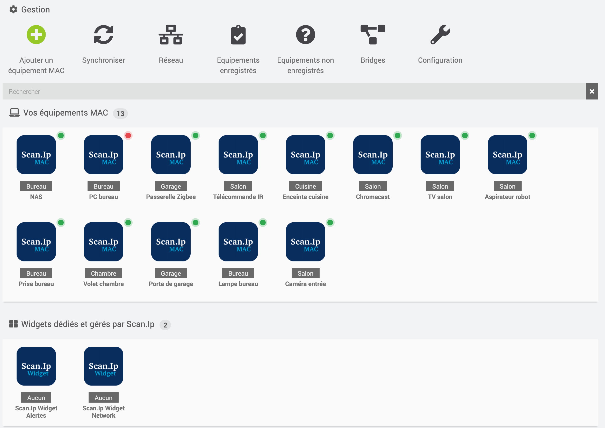

> Les équipements sont séparés en deux parties : "Vos équipements MAC" et les "Widgets dédiés et gérés par Scan.Ip". Il ne faut pas supprimer ces derniers, sauf en cas de bug. Pour les supprimer, activez le mode debug pour faire apparaître le bouton "Supprimer".

### Icônes d'accès

La barre « Gestion » regroupe les accès du plugin : Ajouter un équipement MAC, Synchroniser, Réseau, Équipements enregistrés, Équipements non enregistrés, Bridges, Debug (en mode debug uniquement) et Configuration.

En mode debug, une icône Debug apparaît. Elle apparaît ou disparaît dès que vous changez de mode, sans recharger la page.

### Ajouter un équipement MAC

Permet d'ajouter un équipement quand vous connaissez l'adresse MAC du périphérique à ajouter.

> Il est plus simple de passer par "Équipements non enregistrés" ou par "Réseau", qui permettent d'ajouter à la volée un ou plusieurs équipements présents sur votre réseau.

### Synchroniser

Lance un nouveau scan et la mise à jour des équipements. Une barre de progression affiche l'étape en cours, le pourcentage, le temps écoulé et une estimation du temps restant ; la page se recharge à la fin du scan.

> Si un scan automatique est déjà en cours, la barre de progression suit ce scan au lieu d'en lancer un second.

### Réseau

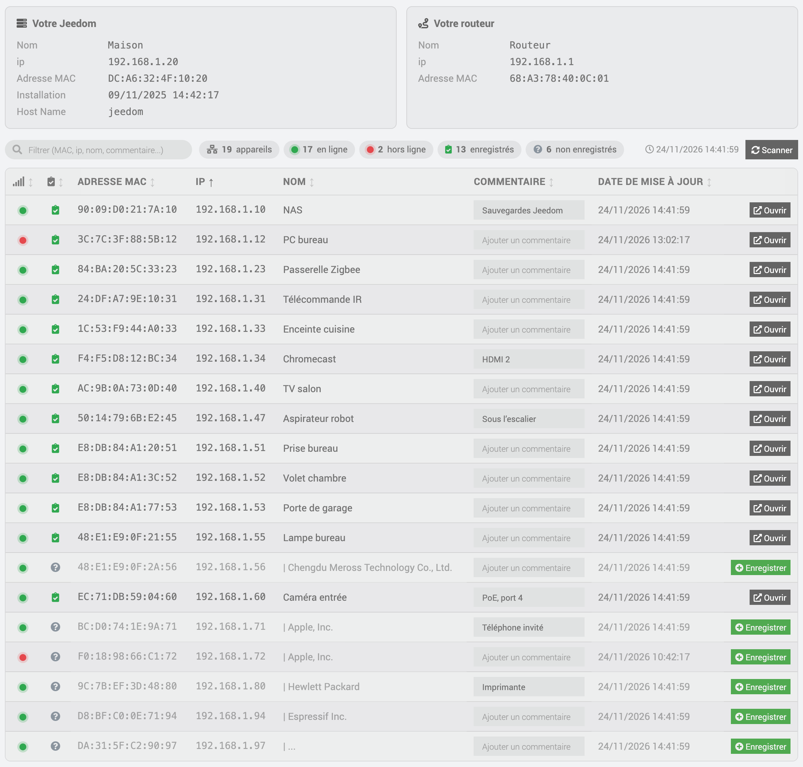

En haut de la fenêtre, deux cartes résument votre Jeedom (IP, adresse MAC, date d'installation, nom d'hôte) et votre routeur (nom, IP, adresse MAC).

La barre d'outils propose :
- un filtre pour rechercher par adresse MAC, IP, nom ou commentaire
- des compteurs (appareils, en ligne, hors ligne, enregistrés, non enregistrés) : un clic sur un compteur filtre le tableau, un second clic retire le filtre ; les compteurs à zéro ne sont pas affichés
- la date du dernier scan et un bouton "Scanner" pour relancer un scan, avec sa barre de progression

Le tableau affiche l'ensemble du réseau :

- La 1re colonne indique si le périphérique est "En ligne" ou "Hors ligne"
- La 2e colonne indique si l'équipement est "enregistré", "enregistré mais désactivé" ou "non enregistré"
- La 3e colonne indique l'adresse MAC de l'équipement
- La 4e colonne indique l'IP de l'équipement
- La 5e colonne indique le nom de l'équipement s'il est enregistré, ou bien le nom du constructeur précédé d'un "|"
- La 6e colonne permet d'associer un commentaire à un équipement (il est enregistré automatiquement pendant la saisie ; videz le champ pour supprimer un commentaire)
- La 7e colonne indique la dernière date d'apparition de l'équipement
- La dernière colonne propose "Enregistrer" pour un appareil non enregistré (l'équipement est créé puis sa fiche s'ouvre pour le nommer et l'activer), ou "Ouvrir" pour accéder à la fiche d'un équipement déjà enregistré

> Si vous voyez "|..." dans le nom d'un équipement, c'est que son constructeur n'a pas été reconnu.

### Équipements enregistrés

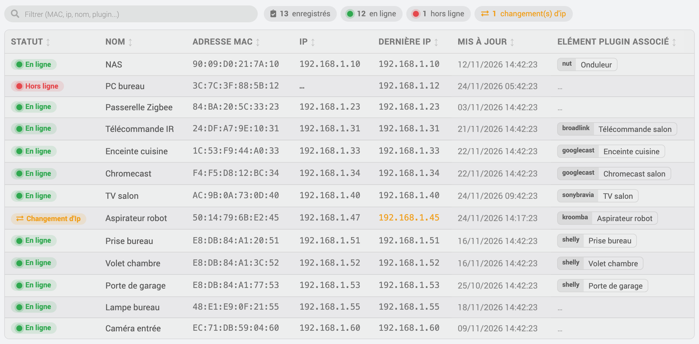

La barre d'outils propose un filtre et des compteurs cliquables (enregistrés, en ligne, hors ligne, changements d'IP).

- La 1re colonne indique l'état de l'équipement : "En ligne", "Hors ligne" ou "Changement d'IP"
- La 2e colonne indique le nom de l'équipement
- La 3e colonne indique l'adresse MAC de l'équipement
- La 4e colonne indique l'IP de l'équipement
- La 5e colonne indique l'IP utilisée lors de la dernière connexion (en orange si elle diffère de l'IP actuelle)
- La 6e colonne indique la dernière date de mise à jour de l'équipement
- La 7e colonne indique tous les bridges associés à l'équipement. En cliquant dessus, vous serez dirigé vers l'équipement du plugin associé.

### Équipements non enregistrés

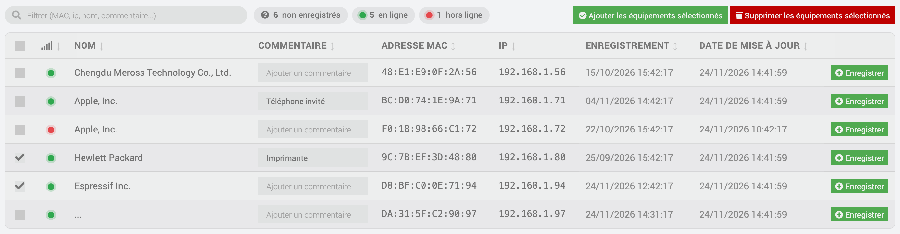

La barre d'outils propose un filtre et des compteurs cliquables (non enregistrés, en ligne, hors ligne).

- La 1re colonne permet de sélectionner l'équipement* (pour l'ajouter à la volée parmi vos équipements ou le supprimer des archives du réseau) ; la case de l'en-tête sélectionne toutes les lignes affichées
- La 2e colonne indique si le périphérique est "En ligne" ou "Hors ligne"
- La 3e colonne indique le nom de l'équipement
- La 4e colonne permet de saisir un commentaire associé à l'équipement, enregistré automatiquement
- La 5e colonne indique l'adresse MAC de l'équipement
- La 6e colonne indique l'IP utilisée par l'équipement
- La 7e colonne indique la date du premier enregistrement sur votre réseau
- La 8e colonne indique la dernière date d'apparition de l'équipement
- La dernière colonne propose "Enregistrer" pour créer directement l'équipement et ouvrir sa fiche

> \* Lorsque vous sélectionnez un ou plusieurs éléments, des boutons d'action apparaissent.

## Vos équipements

### En mode normal

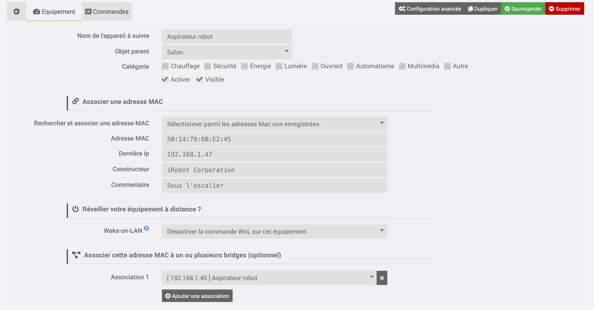

#### Rechercher une adresse MAC

Ce menu de sélection vous permet de rechercher directement un élément de votre réseau et de récupérer son adresse MAC.

> Seules les adresses MAC non associées sont proposées, pour éviter les doublons.

#### Adresse MAC associée

Ce champ est :
- soit rempli automatiquement avec le menu de sélection "Rechercher une adresse MAC"
- soit rempli manuellement si vous voulez anticiper l'arrivée d'un équipement sur votre réseau

#### Constructeur

Si le constructeur a été identifié, il est inscrit ici.

#### Wake-on-LAN

Permet d'ajouter une commande d'action WoL qui allume l'équipement à distance.

> Vérifiez que votre équipement est compatible et que l'option est bien activée sur celui-ci pour que cela fonctionne.

#### Association

C'est ici que l'on associe l'adresse MAC de l'équipement à un ou plusieurs éléments des bridges (10 au maximum). À chaque scan, chaque élément associé reçoit l'IP actuelle de l'appareil.

- Le menu de sélection regroupe les éléments par plugin ; chaque élément est présenté ainsi : `[IP enregistrée dans le plugin] nom de l'élément`. Un élément dont le bridge est désactivé est signalé « bridge désactivé ».
- Un élément déjà associé à un autre équipement Scan.Ip n'est pas proposé.
- « Ajouter une association » ouvre une ligne supplémentaire, la croix retire une association.

> Attention, cette option modifie les autres plugins. À utiliser en connaissance de cause. L'auteur du plugin cible n'est nullement responsable des dysfonctionnements que cela pourrait créer sur son plugin.

> Tant que vous ne faites pas d'association à un plugin, Scan.Ip ne fera aucune modification sur celui-ci.

> Une association qu'aucun bridge ne reconnaît (bridge supprimé, élément introuvable…) reste affichée et conservée, mais n'est plus mise à jour.

> Pour proposer un bridge complémentaire, utilisez le bouton « Proposer » de la fenêtre Bridges (voir « Proposer un bridge au catalogue »).

### En mode avancé

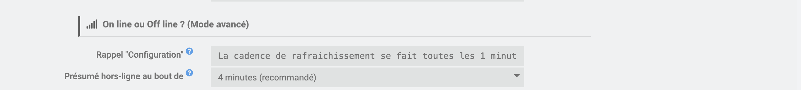

#### Rappel "Configuration"

Vous rappelle la cadence de rafraîchissement enregistrée dans la configuration du plugin.

#### Présumé hors-ligne au bout de

Par défaut à 4 minutes : si vous avez tout laissé par défaut, cela fait 1 scan toutes les minutes et 4 passages pour déterminer si l'équipement est bien hors ligne.
Souvenez-vous que tous les équipements ne ressortent pas forcément à chaque scan.

> Si vous avez réglé la cadence de rafraîchissement à 3 minutes, il faut régler ce paramètre à au moins 15 minutes.

> Ce paramètre peut être abaissé pour des équipements en réseau filaire et très réactifs, par exemple à 2 minutes pour une cadence de 1 minute. Cela revient à 2 passages pour déterminer l'état.

### En mode debug

En mode debug, le champ « MAC Id » affiche l'identifiant interne de l'équipement : les trois derniers octets de son adresse MAC. Il est en lecture seule et sert à diagnostiquer une association MAC qui ne fonctionne pas.

### Commandes associées

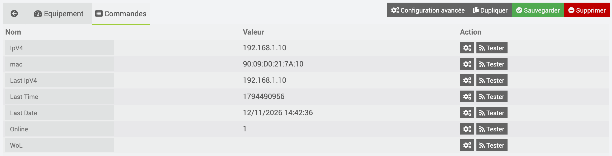

| Commande | Description |
|---|---|
| IpV4 | IP au format v4 de l'équipement |
| Wol | la commande d'action pour allumer l'équipement à distance, présente uniquement si le Wake-on-LAN est activé sur l'équipement |
| Last Date | date au format JJ/MM/AAAA HH:MM:SS du dernier retour en ligne ou du dernier changement d'IP de l'équipement |
| Last IpV4 | dernière IP utilisée par l'équipement |
| Last Time | même date que "Last Date", au format timestamp |
| mac | adresse MAC de l'équipement |
| Online | état de l'équipement |

### Widgets associés

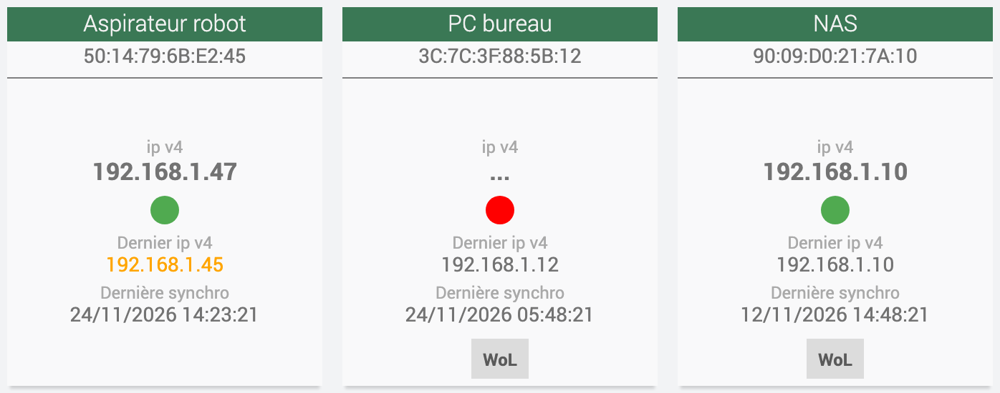

Le widget affiche l'adresse MAC de l'équipement, son IP, son état, sa dernière IP connue (en orange si elle diffère de l'IP actuelle) et la date du dernier retour en ligne ou changement d'IP. Le bouton WoL apparaît si le Wake-on-LAN est activé sur l'équipement.

## Bridges

Scan.Ip utilise des bridges pour mettre à jour des données dans d'autres plugins.

> Concrètement, les bridges permettent de reporter automatiquement le changement d'IP d'un appareil dans les autres plugins (par exemple quand il est impossible de fixer son IP dans le DHCP).

La configuration affiche le nombre de bridges actifs. Le bouton « Gérer les bridges » (ou l'icône « Bridges » de la page du plugin) ouvre leur gestion.

Un bridge désigne **un champ qui contient une IP** dans un plugin :

- la configuration de ses équipements (par exemple `addr` pour Shelly) ;
- l'identifiant logique (logicalId) de ses équipements ;
- la configuration de ses commandes (par exemple une commande de script qui contient une IP) ;
- la configuration du plugin lui-même (par exemple l'adresse d'une passerelle). `{n}` remplace un numéro quand le plugin gère plusieurs passerelles (`wifizigate_{n}`).

Le type de mise à jour est détecté automatiquement à chaque changement d'IP : un champ vide ou qui ne contient que l'IP est remplacé entièrement, un champ qui contient l'IP au milieu d'une valeur (URL, `hôte:port`…) ne voit que son IP remplacée, et un champ sans IP (nom d'hôte…) n'est pas modifié. En vue normale, c'est toujours cette détection automatique qui s'applique ; en vue avancée, vous pouvez imposer l'un ou l'autre comportement.

Plus de 60 bridges sont fournis (catalogue) : ceux des plugins installés sont actifs par défaut, mais ils ne modifient un plugin que pour les éléments que vous avez associés à un équipement Scan.Ip. Le tableau indique pour chacun le nombre d'éléments trouvés et le nombre d'éléments associés à une adresse MAC, ainsi que son origine : « Catalogue » (fourni avec Scan.Ip), « Catalogue modifié » (fourni puis modifié par vous) ou « Personnel » (créé par vous). Vous pouvez :

- **activer ou désactiver** un bridge avec l'interrupteur de la première colonne. Un bridge désactivé ne met plus rien à jour, mais ses associations sont conservées ;
- **tester** un bridge (bouton « Tester ») : par défaut, seuls les éléments associés à une adresse MAC sont testés, chacun avec l'IP actuelle de son appareil, ce que fera exactement le prochain scan. Vous pouvez aussi choisir un élément et lui appliquer l'IP de votre choix. Rien n'est enregistré ;
- **modifier** un bridge du catalogue (il apparaît alors comme « Catalogue modifié ») et revenir à tout moment à sa version d'origine ;
- **créer** vos propres bridges.

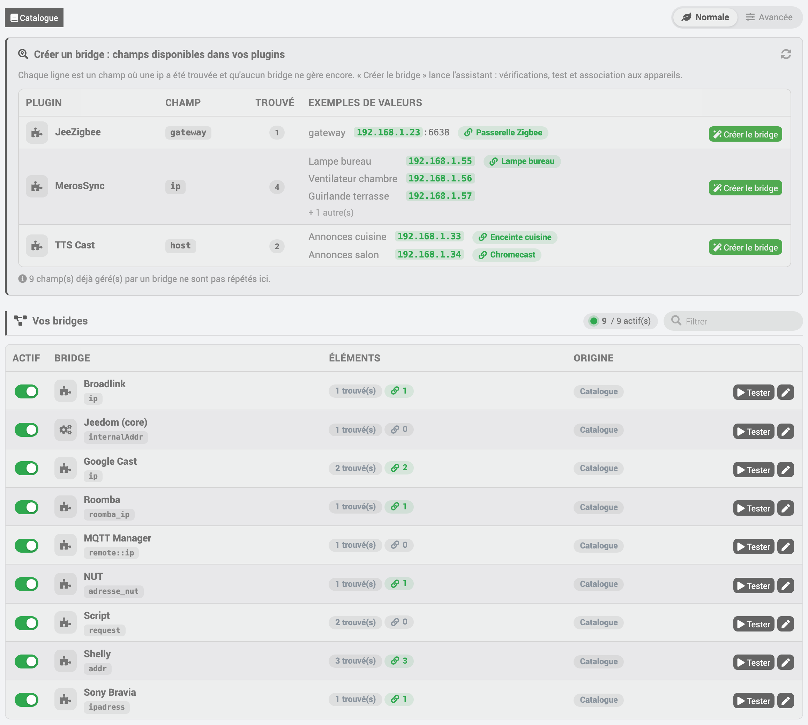

Le bouton « Catalogue » affiche en lecture seule la configuration d'origine de tous les bridges fournis (emplacement, champ, type de mise à jour, conditions, options), y compris pour les plugins que vous n'avez pas installés, pour s'en inspirer lors de la création d'un bridge.

La liste affiche les bridges qui trouvent des éléments dans vos plugins, ainsi que ceux que vous avez créés ou modifiés. Les autres bridges fournis (champ vide chez vous, plugin non installé) se consultent dans le catalogue ; ils apparaissent d'eux-mêmes dès que le champ concerné est renseigné.

La fenêtre propose deux vues, comme la configuration du plugin (la vue par défaut suit le mode choisi dans la configuration, le dernier choix est mémorisé). Elles listent les mêmes bridges :

- **vue normale** : l'essentiel. La recherche n'affiche que les IP qui ne sont pas encore gérées par un bridge, le formulaire affiche le plugin, l'emplacement et le champ sans permettre de les modifier et se limite au test (le type de mise à jour est détecté automatiquement). Les conditions existantes sont affichées et restent appliquées ;
- **vue avancée** : les détails et réglages en plus : emplacement et conditions dans la liste ; conditions, type de mise à jour, démon et précision dans le formulaire ; création manuelle d'un bridge.

Le même bridge en vue normale puis en vue avancée :

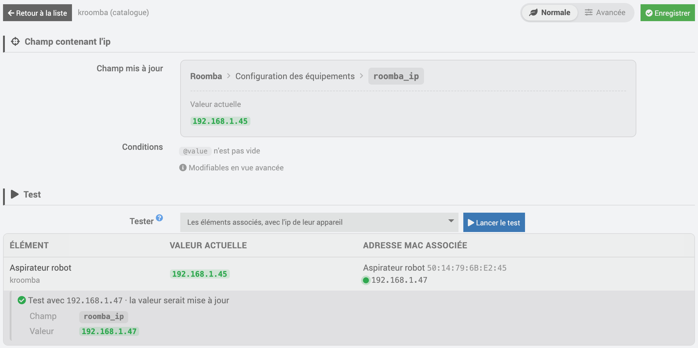

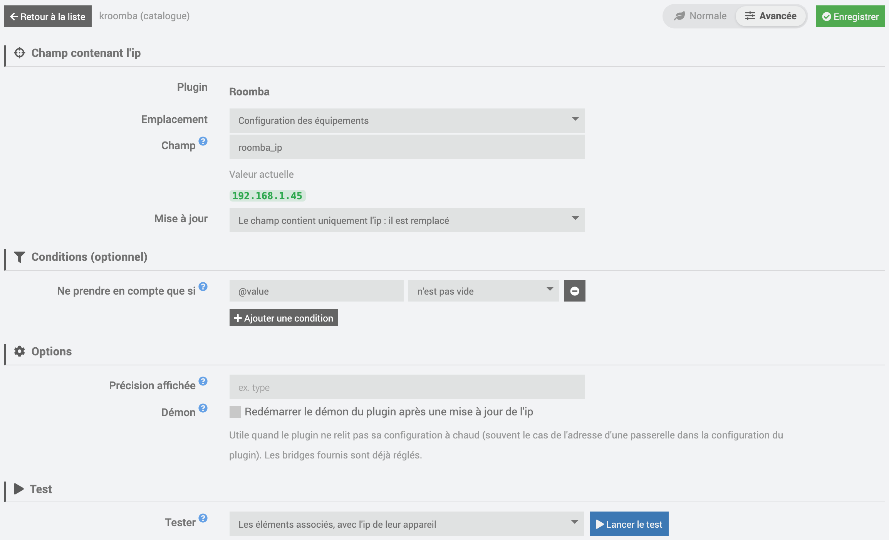

Le plugin d'un bridge existant ne peut pas être modifié : créez un nouveau bridge pour un autre plugin.

### Créer un bridge

À l'ouverture de la fenêtre Bridges, Scan.Ip recherche les IP présentes dans la configuration de vos plugins (équipements, commandes, configuration des plugins) et liste les champs qu'aucun bridge ne gère encore, avec des exemples de valeurs. Si aucun plugin ne s'y prête, la fenêtre l'indique. L'icône d'actualisation relance la recherche.

Le bouton « Créer le bridge » d'une ligne lance l'assistant (étapes Champ, Vérifications, Terminé), qui vérifie la configuration avant de créer quoi que ce soit :

- les éléments trouvés et le type de mise à jour (tout le champ ou seulement l'IP qu'il contient) ;
- les valeurs qui contiennent plusieurs IP ;
- un test d'écriture à blanc sur chaque élément (rien n'est modifié) ;
- la nécessité de redémarrer le démon du plugin : Jeedom prévient le plugin quand un de ses paramètres (`postConfig_…`) ou un de ses équipements (`postSave`) est enregistré. Si le plugin a un démon et ne réagit pas à ce champ, le redémarrage est activé automatiquement ; l'assistant l'indique simplement, le réglage reste modifiable ensuite dans le formulaire du bridge en vue avancée.

Pour chaque élément, vous pouvez tester la valeur que le bridge écrirait avec une IP de votre choix, et l'associer à un appareil Scan.Ip lié au plugin (même IP, ou déjà associé à un autre élément du plugin). L'association est facultative : elle peut se faire plus tard depuis la fiche de l'équipement Scan.Ip. Le bridge ne peut pas être créé si le plugin n'a aucun élément pour ce champ.

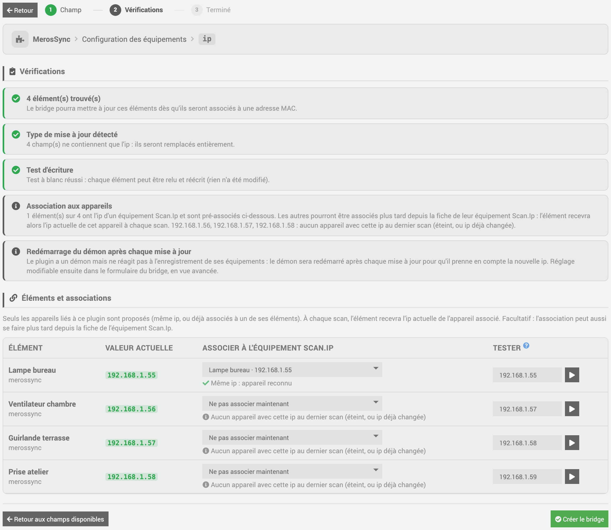

À la fin, le bouton « Tester le bridge » ouvre la simulation, et « Terminer » revient à la liste.

Les champs déjà gérés par un bridge ne sont pas répétés dans la recherche, quelle que soit la vue : ils sont dans la liste des bridges. En vue avancée, le crayon d'une ligne ouvre le formulaire pré-rempli, et « Création manuelle » crée un bridge de zéro.

### Conditions

Un bridge peut ne s'appliquer qu'à certains éléments. Toutes les conditions doivent être vraies. Une condition porte sur un autre champ du même équipement (ou de la même commande, ou de la configuration du plugin) : est égal à, est différent de, est l'une des valeurs (liste séparée par des virgules), contient, est vide, n'est pas vide, correspond à une expression régulière…

Champs particuliers : `@value` (la valeur du champ de l'IP), `@name` (nom de l'élément), `@eqName` (nom de l'équipement), `@isEnable` (équipement actif) et `@logicalId`.

Exemple : le bridge VMware ne prend que les équipements dont le champ `type` est égal à `ESXi`.

L'option « Redémarrer le démon du plugin » (vue avancée) redémarre le démon du plugin après une mise à jour de l'IP, pour les plugins qui ne relisent pas leur configuration à chaud. Les bridges fournis sont déjà réglés ; pour un bridge créé depuis la recherche, elle est activée automatiquement quand le champ est dans la configuration d'un plugin qui a son propre démon.

Vous pourrez ensuite associer un équipement à un ou plusieurs éléments de ces bridges.

### Proposer un bridge au catalogue

Un bridge que vous avez créé ou modifié peut être proposé pour être ajouté au catalogue avec le bouton « Proposer ». La règle est affichée avant l'envoi, au format du catalogue : seule la règle est transmise (plugin, emplacement, champ, conditions, options), jamais les IP, valeurs ou noms d'équipements de votre installation. Vérifiez simplement que les valeurs des conditions ne contiennent rien de personnel.

- **GitHub** : ouvre une issue pré-remplie sur le dépôt du plugin (compte GitHub nécessaire) ;
- **Forum Jeedom** : copie la proposition dans le presse-papiers et ouvre le sujet du plugin sur community.jeedom.com ([Plugin Scan.Ip - MAJ](https://community.jeedom.com/t/plugin-scan-ip-maj/48722)) : cliquez sur « Répondre » puis collez-la.

## Widgets dédiés et gérés par Scan.Ip

Par défaut, cette partie comprend 2 widgets (ils peuvent être renommés) :
- Scan.Ip Widget Alertes
- Scan.Ip Widget Network

Ces équipements sont directement gérés par le plugin et correspondent à ce que vous avez configuré dans le plugin.

> Pour rappel, leur affichage se gère dans l'espace de configuration du plugin.

### Le widget Network

Cette option permet d'afficher ou non le widget d'affichage du réseau.

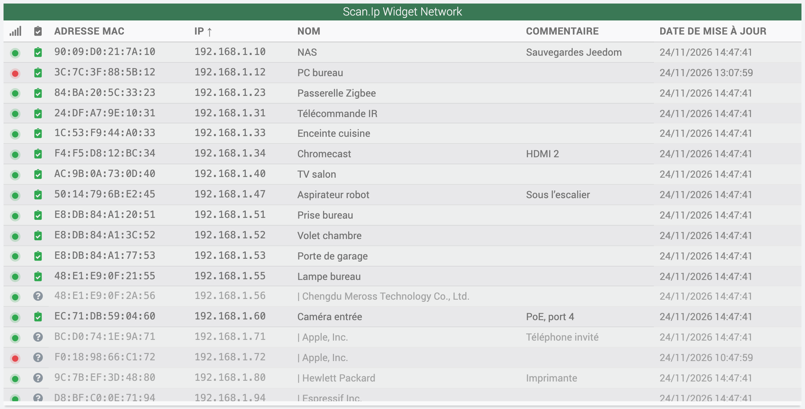

> Vous pouvez trier les colonnes d'un simple clic sur leur en-tête.

> Vous pouvez aussi configurer un tri par défaut dans l'équipement lié à ce widget.

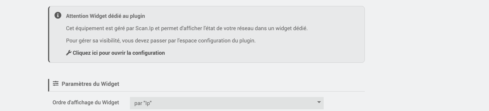

### Le widget Alertes

Cette option permet d'afficher ou non le widget d'affichage des alertes.

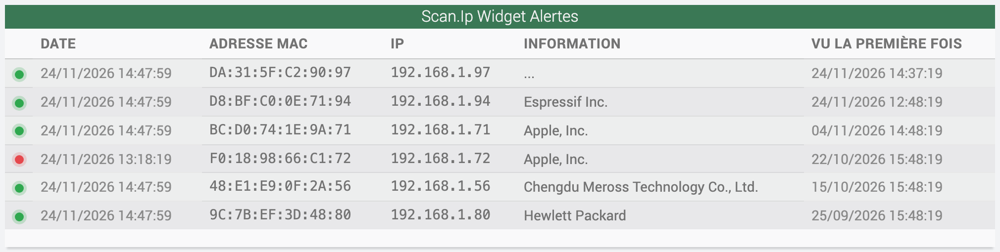

> Ce widget n'affiche que les équipements non enregistrés, triés par date de connexion puis par date de premier référencement. Un équipement tout nouveau apparaît donc en première position.

#### Commandes associées

10 groupes de commandes sont créés. Ils correspondent aux 10 derniers équipements non enregistrés qui se sont connectés. L'ordre chronologique commence à zéro (le plus récent) et se termine à neuf (le plus ancien).

Chaque élément comporte 6 sous-commandes :

| Commande | Description |
|---|---|
| Connexion 0 Création | date au format timestamp du premier référencement |
| Connexion 0 Date | date au format JJ/MM/AAAA HH:MM:SS de sa dernière apparition |
| Connexion 0 Time | date au format timestamp de sa dernière apparition |
| Connexion 0 Equipement | nom du constructeur s'il est référencé |
| Connexion 0 IpV4 | IP au format v4 qui lui est attribuée |
| Connexion 0 MAC | adresse MAC de l'équipement |

## Configuration

Afin de faciliter l'utilisation de ce plugin, celui-ci adapte les options proposées selon trois modes : "normal", "avancé" et "debug".

Le mode se choisit avec le sélecteur « Mode d'affichage » en haut de la configuration, qui rappelle ce que chaque mode affiche. Les sections propres aux modes avancé et debug portent un badge « Avancé » ou « Debug » à droite de leur titre, et les options oui / non se règlent avec des interrupteurs.

### Mode normal

Le mode normal affiche les paramètres principaux, qui conviennent généralement aux configurations standards : widgets, cadence de rafraîchissement, fichiers constructeurs et bridges.

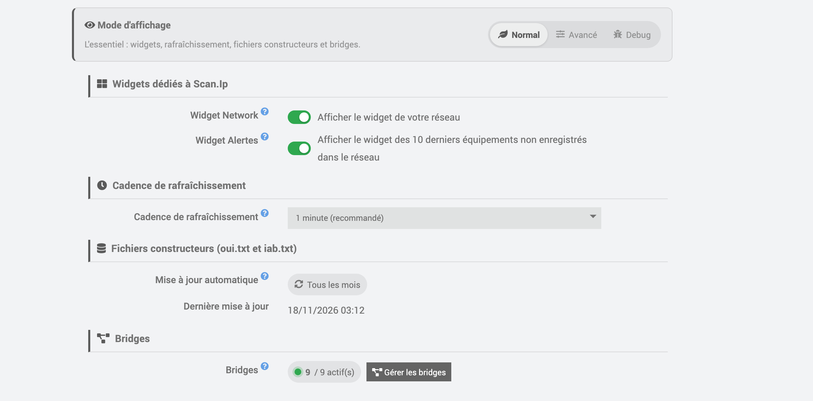

#### Cadence de rafraîchissement

Sert à régler la cadence de rafraîchissement de la tâche planifiée.
Par défaut, celle-ci est réglée à 1 minute.

> À chaque scan du réseau, tous les périphériques ne répondent pas forcément, car certains mettent trop de temps à répondre (par exemple les périphériques Wi-Fi). Il est donc conseillé d'attendre au moins 3 scans avant de considérer qu'un périphérique est vraiment hors ligne. Ce paramètre peut être réglé plus finement au niveau de chaque équipement.

#### Fichiers constructeurs (oui.txt et iab.txt)

Ces fichiers permettent d'identifier le constructeur d'un appareil à partir de son adresse MAC. Ils sont mis à jour automatiquement tous les mois depuis le site de l'IEEE ; en cas d'échec, les fichiers existants sont conservés et une nouvelle tentative a lieu le lendemain.

Selon le mode, cette section affiche :
- **mode normal** : la fréquence de mise à jour et la date de la dernière mise à jour
- **mode avancé** : en plus, la possibilité de choisir la fréquence (tous les mois, toutes les semaines) ou de désactiver la mise à jour automatique
- **mode debug** : en plus, l'état de chaque fichier et un bouton « Mettre à jour maintenant »

### Mode avancé

Le mode avancé ajoute des sections, repérées par le badge « Avancé », et des réglages supplémentaires dans les sections existantes (par exemple la fréquence de mise à jour des fichiers constructeurs).

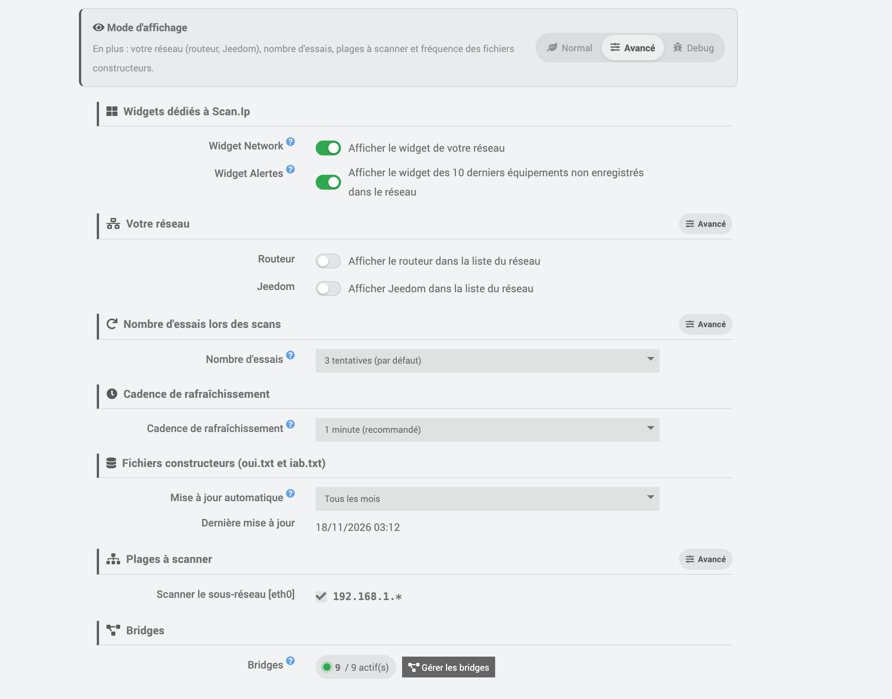

#### Votre réseau

- **Routeur** : affiche le routeur dans la liste du réseau. Par défaut, celui-ci est retiré.
- **Jeedom** : affiche le serveur Jeedom dans la liste du réseau. Par défaut, celui-ci est retiré.

#### Nombre d'essais lors des scans

Règle le nombre de tentatives lors des scans du réseau. Tous les équipements ne répondent pas dès la première tentative. Plus il y a de tentatives, plus le scan est long.

#### Plages à scanner

Lorsque vous avez plusieurs cartes réseau ou des sous-réseaux, cochez le ou les sous-réseaux à scanner. Seules les interfaces qui possèdent une adresse IPv4 sont proposées (les interfaces virtuelles Docker ou les cartes non connectées ne sont pas listées).

> Un sous-réseau peut ne pas permettre de récupérer les adresses MAC qui s'y trouvent (blocage au niveau du routeur ou autre). Dans ce cas, il vous faudra installer un autre Jeedom dans ce sous-réseau, avec un Scan.Ip dédié.

> Le temps d'un scan dépend de la taille du sous-réseau : quelques secondes pour un `/24` (254 adresses), plusieurs minutes pour un `/16` (65 534 adresses).

### Mode debug

Les sections réservées au mode debug portent le badge « Debug ».

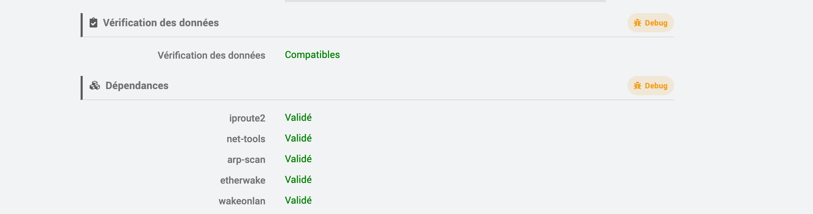

#### Vérification des données

Vérifie que les données enregistrées par le plugin sont au format de la version installée. « Compatibles » s'affiche en vert si tout est correct ; sinon, un bouton rouge « Données non compatibles (Cliquez-ici pour corriger le problème) » lance leur correction.

#### Dépendances

Affiche l'état de chaque dépendance (iproute2, net-tools, arp-scan, etherwake, wakeonlan) : « Validé » en vert si elle est installée. Permet de voir facilement les dépendances qui sont en échec.

## Sous-réseaux et Scan.Ip

Scan.Ip est capable de gérer plusieurs réseaux en même temps.
Pour cela, votre Jeedom doit être connecté aux différents réseaux.
Vous pouvez par exemple connecter le Wi-Fi de votre machine Jeedom à un réseau et le câble réseau à l'autre, ou tout simplement brancher des adaptateurs "USB/Ethernet" ou "USB/Wi-Fi" à votre Jeedom.
Scan.Ip vous affichera les sous-réseaux, que vous pourrez ensuite activer dans la configuration du plugin (en mode avancé).

## Debug (uniquement en mode debug)

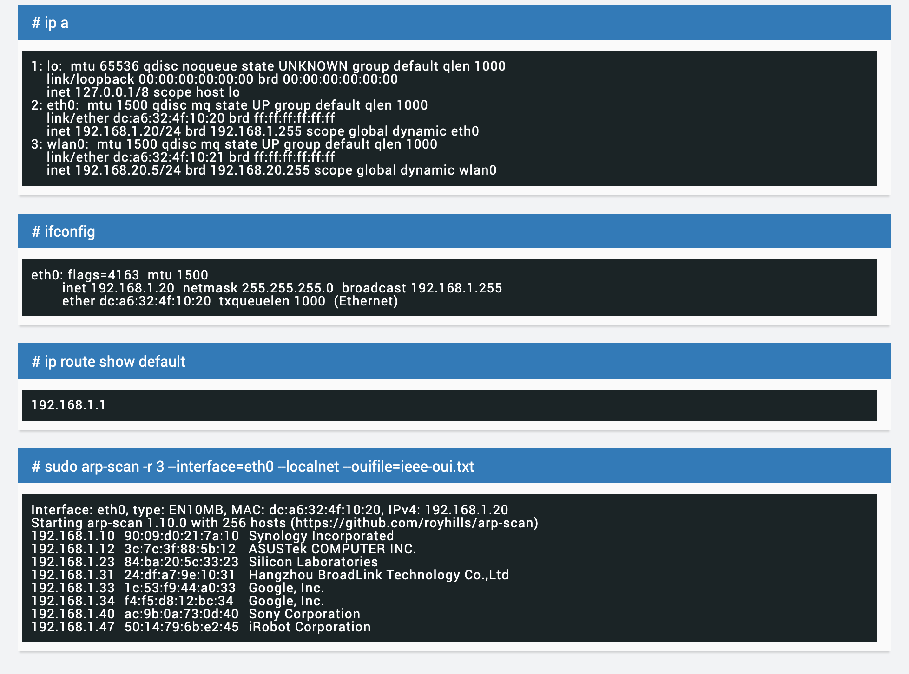

Cette fenêtre a pour but d'aider à comprendre les éventuels bugs.

#### ip a

Résultat de la commande `ip a`, qui affiche la liste de tous les réseaux accessibles depuis votre Jeedom.

#### ip route

Affiche l'IP du routeur associé à votre Jeedom.

#### arp-scan

> Ici c'est le réseau "eth0" qui est sélectionné, mais cela dépend de votre réseau.

Résultat de la commande `sudo arp-scan -r 3 --interface=eth0 --localnet --ouifile=ieee-oui.txt`, qui affiche la liste des équipements répondant au scan.

> Comme précisé plus haut, il se peut que tous vos appareils connectés ne s'affichent pas en un seul scan. C'est pour cela qu'il est important de faire plusieurs scans pour avoir une image plus juste des appareils connectés.

#### Equipements

Affiche les données présentes dans le JSON des équipements. C'est l'historique de tous les équipements qui se sont connectés à votre réseau.

#### Mappings

Affiche les données présentes dans le JSON mapping. C'est le dernier état de votre réseau, avec la version de "arp-scan" utilisée.

## Exemples de scénarios

Les commandes du plugin peuvent servir de déclencheurs dans les scénarios Jeedom. Dans les exemples ci-dessous, remplacez `[Aucun]` par l'objet parent de vos équipements, et la commande d'envoi par celle de votre plugin de notification (SMS, Telegram, Jeedom Connect…).

### Recevoir un SMS quand un nouvel appareil se connecte

Le widget Alertes garde en position 0 l'appareil inconnu le plus récent. Ce scénario se déclenche quand cette position change, et vérifie que l'appareil vient d'être détecté pour la première fois.

- **Mode** : Provoqué
- **Déclencheur** : `#[Aucun][Scan.Ip Widget Alertes][Connexion 0 Création]#`
- **SI** : `#[Aucun][Scan.Ip Widget Alertes][Connexion 0 Création]# > #timestamp# - 180`
- **ALORS** : commande d'envoi de SMS avec le message
  `Nouvel appareil sur le réseau : #[Aucun][Scan.Ip Widget Alertes][Connexion 0 MAC]# (#[Aucun][Scan.Ip Widget Alertes][Connexion 0 IpV4]#, #[Aucun][Scan.Ip Widget Alertes][Connexion 0 Equipement]#)`

> La condition ne laisse passer que les appareils détectés pour la première fois depuis moins de 3 minutes : un simple changement d'ordre de la liste ne déclenche pas d'alerte.

> Le widget Alertes doit être activé dans la configuration du plugin. Si plusieurs nouveaux appareils arrivent pendant le même scan, une seule alerte est envoyée.

### Être prévenu quand un appareil enregistré quitte le réseau

Pour un équipement MAC enregistré (par exemple "Aspirateur robot"), la commande **Online** passe à 0 quand l'appareil est considéré hors ligne.

- **Mode** : Provoqué
- **Déclencheur** : `#[Aucun][Aspirateur robot][Online]#`
- **SI** : `#[Aucun][Aspirateur robot][Online]# == 0`
- **ALORS** : commande de notification avec le message
  `L'aspirateur robot n'est plus connecté au réseau`

> Le délai avant que l'appareil soit considéré hors ligne se règle dans l'équipement (« Présumé hors-ligne au bout de », en mode avancé).

> Variante : avec le déclencheur `#[Aucun][Aspirateur robot][IpV4]#` et la condition `#[Aucun][Aspirateur robot][IpV4]# != ""`, vous êtes prévenu à chaque changement d'IP de l'appareil.

## FAQ

**Scan.Ip modifie-t-il mes autres plugins ?**
Seulement pour les éléments que vous avez associés à un équipement Scan.Ip, et uniquement le champ qui contient l'IP. Sans association, rien n'est modifié.

**Un appareil allumé apparaît hors ligne**
Certains appareils, surtout en Wi-Fi, ne répondent pas à chaque scan. Augmentez le « Présumé hors-ligne au bout de » de l'équipement ou le nombre d'essais (mode avancé).

**Le constructeur affiché est « ... »**
Le préfixe de l'adresse MAC n'est pas dans les fichiers constructeurs. C'est aussi le cas des téléphones qui utilisent une adresse MAC privée (aléatoire) : elle peut changer, désactivez cette option sur le téléphone pour le suivre.

**Seuls des conteneurs sont trouvés**
Jeedom tourne sous Docker sans `network_mode: host`, voir « Installation ».

**Faut-il encore fixer les IP dans le DHCP ?**
Ce n'est pas obligatoire avec les bridges, mais cela reste la solution la plus simple quand votre routeur le permet.
