# Plugin Scan.Ip

Questo plugin scansiona la tua rete e recupera l'elenco dei dispositivi connessi con i relativi indirizzi MAC.

Con queste informazioni, il plugin permette di:
- recuperare il nuovo IP di un dispositivo
- visualizzare un widget con lo stato della tua rete
- visualizzare un widget con i dispositivi non registrati che si sono appena connessi alla rete
- visualizzare un widget per ogni dispositivo registrato, con i comandi associati a quel dispositivo
- creare avvisi quando un dispositivo scompare, compare o cambia IP sulla rete
- automatizzare i cambi di IP a cascata in altri plugin tramite i bridge
- accendere un dispositivo da remoto (Wake-on-LAN)

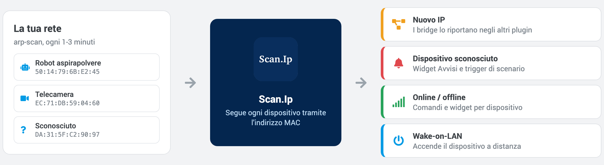

## Installazione

- Jeedom 4.0 minimo, compatibile con PHP 7 e PHP 8.
- Questo plugin richiede obbligatoriamente "arp-scan", "wakeonlan" ed "etherwake" (installati con le dipendenze).
- Utilizza i file "oui.txt" e "iab.txt" forniti da "standards-oui.ieee.org".
- Utilizza le API fornite da "macvendors.com" e "macvendors.co".

> **Jeedom su Docker**: il container di Jeedom deve usare `network_mode: host`. Altrimenti vede solo la rete interna di Docker (spesso un `/16` di 65.534 indirizzi): le scansioni durano diversi minuti e trovano solo gli altri container, non i dispositivi della tua rete.

## Primi passi

1. **Installa e attiva il plugin**, poi attendi la fine dell'installazione delle dipendenze.
2. Apri la pagina del plugin e fai clic su **Sincronizzare**: la prima scansione elenca i dispositivi della rete.
3. Apri **Rete** e fai clic su **Registra** accanto a ogni dispositivo da seguire. Si apre la sua scheda: assegnagli un nome, attivalo e salva.
4. Se un altro plugin usa l'IP di questo dispositivo, scegli l'elemento corrispondente in **Associazione**: Scan.Ip vi riporterà ogni cambio di IP.
5. Attendi alcune scansioni prima di fidarti dello stato «Offline»: alcuni dispositivi Wi-Fi non rispondono ogni volta.

## Gestione dei dispositivi

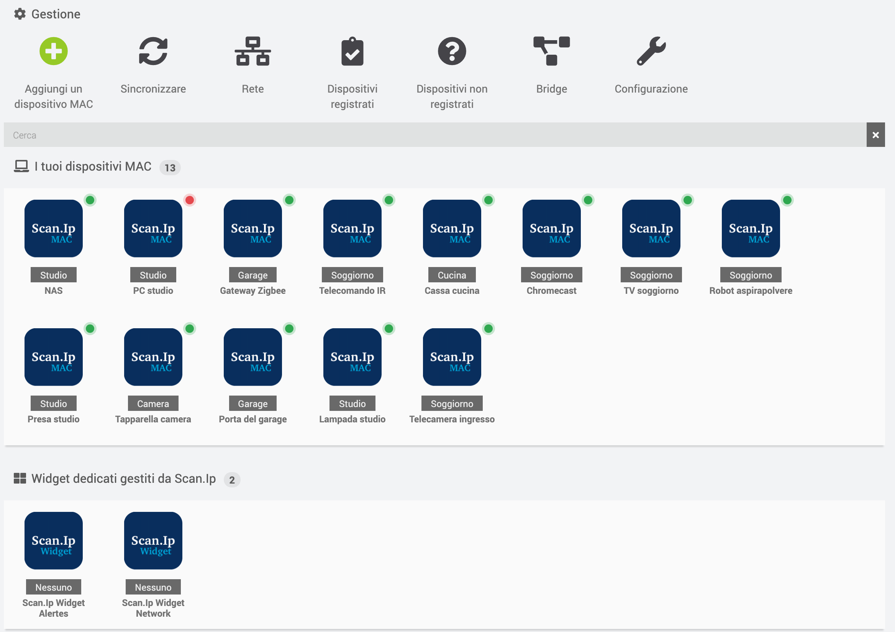

> I dispositivi sono divisi in due parti: "I tuoi dispositivi MAC" e i "Widget dedicati e gestiti da Scan.Ip". Non eliminare questi ultimi, salvo in caso di bug. Per eliminarli, attiva la modalità debug per far comparire il pulsante "Elimina".

### Icone di accesso

La barra «Gestione» raggruppa gli accessi del plugin: Aggiungi un dispositivo MAC, Sincronizza, Rete, Dispositivi registrati, Dispositivi non registrati, Bridges, Debug (solo in modalità debug) e Configurazione.

In modalità debug compare un'icona Debug. Compare o scompare non appena cambi modalità, senza ricaricare la pagina.

### Aggiungere un dispositivo MAC

Aggiunge un dispositivo quando conosci l'indirizzo MAC dell'apparecchio da aggiungere.

> È più semplice passare da "Dispositivi non registrati" o da "Rete", che permettono di aggiungere al volo uno o più dispositivi presenti sulla tua rete.

### Sincronizza

Avvia una nuova scansione e aggiorna i dispositivi. Una barra di avanzamento mostra il passo in corso, la percentuale, il tempo trascorso e una stima del tempo rimanente; la pagina si ricarica al termine della scansione.

> Se è già in corso una scansione automatica, la barra di avanzamento segue quella scansione invece di avviarne una seconda.

### Rete

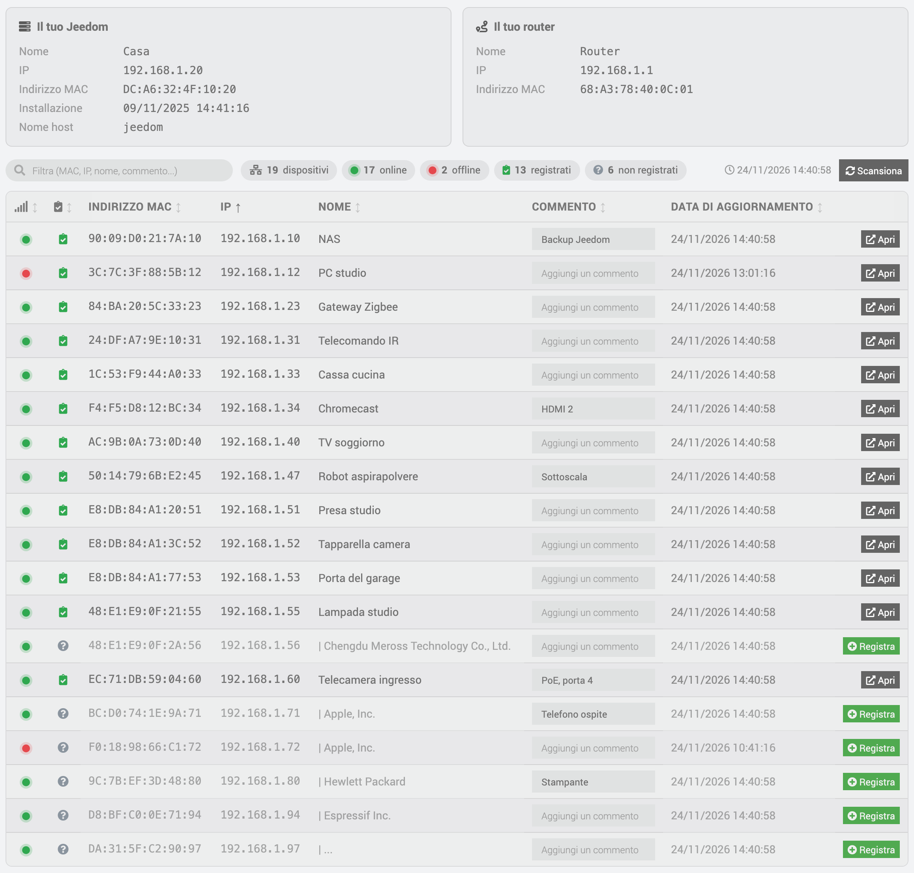

In alto nella finestra, due schede riassumono il tuo Jeedom (IP, indirizzo MAC, data di installazione, nome host) e il tuo router (nome, IP, indirizzo MAC).

La barra degli strumenti offre:
- un filtro per cercare per indirizzo MAC, IP, nome o commento
- contatori (dispositivi, online, offline, registrati, non registrati): un clic su un contatore filtra la tabella, un secondo clic rimuove il filtro; i contatori a zero non sono mostrati
- la data dell'ultima scansione e un pulsante "Scansiona" per avviarne una nuova, con la relativa barra di avanzamento

La tabella mostra tutta la rete:

- La 1ª colonna indica se il dispositivo è "Online" o "Offline"
- La 2ª colonna indica se il dispositivo è "registrato", "registrato ma disattivato" o "non registrato"
- La 3ª colonna indica l'indirizzo MAC del dispositivo
- La 4ª colonna indica l'IP del dispositivo
- La 5ª colonna indica il nome del dispositivo se è registrato, altrimenti il nome del produttore preceduto da "|"
- La 6ª colonna permette di associare un commento a un dispositivo (viene salvato automaticamente durante la digitazione; svuota il campo per eliminare un commento)
- La 7ª colonna indica l'ultima data in cui il dispositivo è stato visto
- L'ultima colonna propone "Registra" per un dispositivo non registrato (il dispositivo viene creato e la sua scheda si apre per nominarlo e attivarlo), oppure "Apri" per accedere alla scheda di un dispositivo già registrato

> Se vedi "|..." nel nome di un dispositivo, il suo produttore non è stato riconosciuto.

### Dispositivi registrati

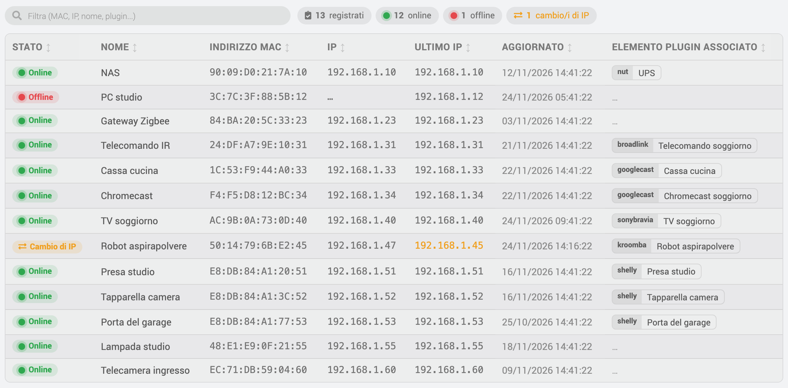

La barra degli strumenti offre un filtro e contatori cliccabili (registrati, online, offline, cambi di IP).

- La 1ª colonna indica lo stato del dispositivo: "Online", "Offline" o "Cambio di IP"
- La 2ª colonna indica il nome del dispositivo
- La 3ª colonna indica l'indirizzo MAC del dispositivo
- La 4ª colonna indica l'IP del dispositivo
- La 5ª colonna indica l'IP usato durante l'ultima connessione (in arancione se diverso dall'IP attuale)
- La 6ª colonna indica la data dell'ultimo aggiornamento del dispositivo
- La 7ª colonna indica tutti i bridge associati al dispositivo. Cliccandoci sopra, verrai indirizzato al dispositivo del plugin associato.

### Dispositivi non registrati

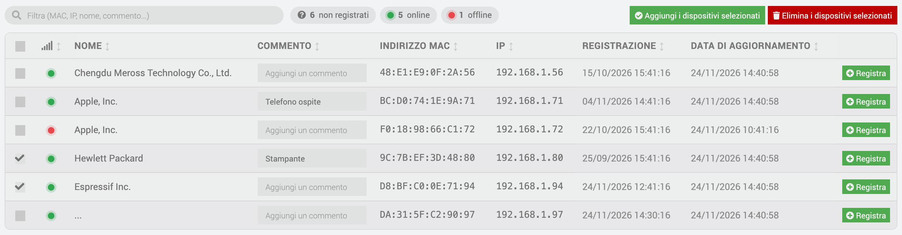

La barra degli strumenti offre un filtro e contatori cliccabili (non registrati, online, offline).

- La 1ª colonna permette di selezionare il dispositivo* (per aggiungerlo al volo ai tuoi dispositivi o eliminarlo dall'archivio della rete); la casella dell'intestazione seleziona tutte le righe visualizzate
- La 2ª colonna indica se il dispositivo è "Online" o "Offline"
- La 3ª colonna indica il nome del dispositivo
- La 4ª colonna permette di inserire un commento per il dispositivo, salvato automaticamente
- La 5ª colonna indica l'indirizzo MAC del dispositivo
- La 6ª colonna indica l'IP usato dal dispositivo
- La 7ª colonna indica la data della prima registrazione sulla tua rete
- L'8ª colonna indica l'ultima data in cui il dispositivo è stato visto
- L'ultima colonna propone "Registra" per creare direttamente il dispositivo e aprire la sua scheda

> \* Quando selezioni uno o più elementi, compaiono dei pulsanti di azione.

## I tuoi dispositivi

### In modalità normale

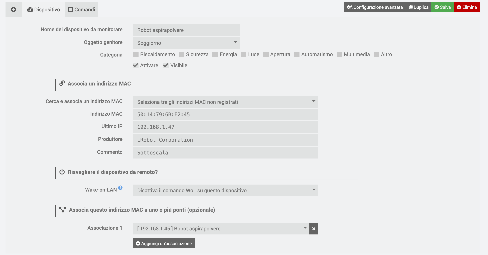

#### Cerca un indirizzo MAC

Questo menu di selezione ti permette di cercare direttamente un elemento della tua rete e recuperarne l'indirizzo MAC.

> Sono proposti solo gli indirizzi MAC non ancora associati, per evitare duplicati.

#### Indirizzo MAC associato

Questo campo viene:
- compilato automaticamente con il menu "Cerca un indirizzo MAC"
- oppure compilato manualmente se vuoi anticipare l'arrivo di un dispositivo sulla tua rete

#### Produttore

Se il produttore è stato identificato, viene indicato qui.

#### Wake-on-LAN

Aggiunge un comando di azione WoL che accende il dispositivo da remoto.

> Verifica che il tuo dispositivo sia compatibile e che l'opzione sia attivata su di esso perché funzioni.

#### Associazione

È qui che si associa l'indirizzo MAC del dispositivo a uno o più elementi dei bridge (10 al massimo). A ogni scansione, ogni elemento associato riceve l'IP attuale del dispositivo.

- Il menu di selezione raggruppa gli elementi per plugin; ogni elemento è presentato così: `[IP registrato nel plugin] nome dell'elemento`. Un elemento il cui bridge è disattivato è segnalato con «bridge disattivato».
- Un elemento già associato a un altro dispositivo Scan.Ip non viene proposto.
- «Aggiungi un'associazione» apre una riga supplementare, la croce rimuove un'associazione.

> Attenzione, questa opzione modifica altri plugin. Usatela con cognizione di causa. L'autore del plugin di destinazione non è in alcun modo responsabile dei malfunzionamenti che ciò potrebbe causare al suo plugin.

> Finché non associate un plugin, Scan.Ip non vi apporta alcuna modifica.

> Un'associazione che nessun bridge riconosce (bridge eliminato, elemento non trovato…) resta visualizzata e conservata, ma non viene più aggiornata.

> Per proporre un bridge aggiuntivo, usate il pulsante «Proponi» della finestra Bridges (vedi «Proporre un bridge per il catalogo»).

### In modalità avanzata

#### Promemoria "Configurazione"

Ti ricorda la frequenza di aggiornamento salvata nella configurazione del plugin.

#### Considerato offline dopo

4 minuti per impostazione predefinita: se hai lasciato tutto ai valori predefiniti, sono 1 scansione al minuto e 4 passaggi per stabilire se il dispositivo è davvero offline.
Ricorda che non tutti i dispositivi compaiono a ogni scansione.

> Se hai impostato la frequenza di aggiornamento a 3 minuti, imposta questo parametro ad almeno 15 minuti.

> Questo parametro può essere abbassato per dispositivi cablati molto reattivi, ad esempio a 2 minuti con una frequenza di 1 minuto. Ciò equivale a 2 passaggi per stabilire lo stato.

### In modalità debug

In modalità debug, il campo «MAC Id» mostra l'identificativo interno del dispositivo: gli ultimi tre byte del suo indirizzo MAC. È di sola lettura e serve a diagnosticare un'associazione MAC che non funziona.

### Comandi associati

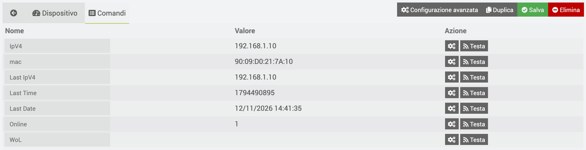

| Comando | Descrizione |
|---|---|
| IpV4 | IP del dispositivo in formato v4 |
| Wol | il comando di azione per accendere il dispositivo da remoto; presente solo se il Wake-on-LAN è attivato sul dispositivo |
| Last Date | data in formato GG/MM/AAAA HH:MM:SS dell'ultimo ritorno online o dell'ultimo cambio di IP del dispositivo |
| Last IpV4 | ultimo IP usato dal dispositivo |
| Last Time | stessa data di "Last Date", in formato timestamp |
| mac | indirizzo MAC del dispositivo |
| Online | stato del dispositivo |

### Widget associati

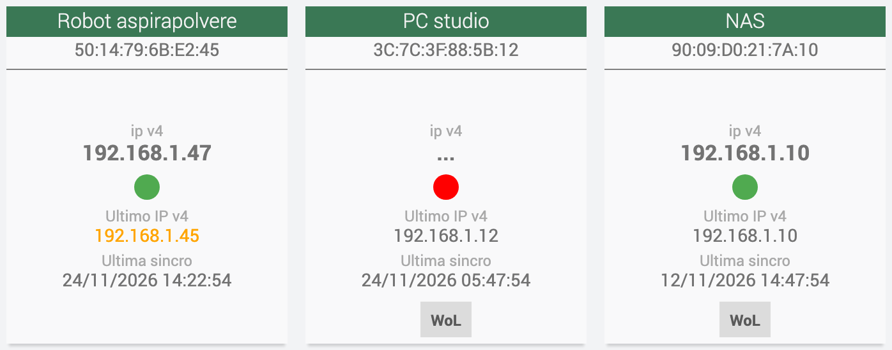

Il widget mostra l'indirizzo MAC del dispositivo, il suo IP, il suo stato, il suo ultimo IP noto (in arancione se diverso dall'IP attuale) e la data dell'ultimo ritorno online o cambio di IP. Il pulsante WoL compare se il Wake-on-LAN è attivato sul dispositivo.

## Bridge

Scan.Ip utilizza dei bridge per aggiornare dati in altri plugin.

> In concreto, i bridge riportano automaticamente il cambio di IP di un dispositivo negli altri plugin (ad esempio quando non è possibile fissarne l'IP nel DHCP).

La configurazione mostra il numero di bridge attivi. Il pulsante «Gestisci i bridge», oppure l'icona «Bridge» della pagina del plugin, ne apre la gestione.

Un bridge indica **un campo che contiene un IP** in un plugin:

- la configurazione dei suoi dispositivi (ad esempio `addr` per Shelly);
- l'identificativo logico (logicalId) dei suoi dispositivi;
- la configurazione dei suoi comandi (ad esempio un comando di script che contiene un IP);
- la configurazione del plugin stesso (ad esempio l'indirizzo di un gateway). `{n}` sostituisce un numero quando il plugin gestisce più gateway (`wifizigate_{n}`).

Il tipo di aggiornamento viene rilevato automaticamente a ogni cambio di IP: un campo vuoto o che contiene solo l'IP viene sostituito interamente, in un campo che contiene l'IP all'interno di un valore (URL, `host:porta`…) viene sostituito solo l'IP, e un campo senza IP (nome host…) non viene modificato. Nella vista normale si applica sempre questo rilevamento automatico; nella vista avanzata è possibile imporre l'uno o l'altro comportamento.

Sono forniti più di 60 bridge (catalogo): quelli dei plugin installati sono attivi per impostazione predefinita, ma modificano un plugin solo per gli elementi che avete associato a un dispositivo Scan.Ip. La tabella indica per ciascuno il numero di elementi trovati e il numero di elementi associati a un indirizzo MAC, oltre alla sua origine: «Catalogo» (fornito con Scan.Ip), «Catalogo modificato» (fornito e poi modificato da voi) o «Personale» (creato da voi). È possibile:

- **attivare o disattivare** un bridge con l'interruttore della prima colonna. Un bridge disattivato non aggiorna più nulla, ma le sue associazioni vengono conservate;
- **testare** un bridge (pulsante «Testa»): per impostazione predefinita vengono testati solo gli elementi associati a un indirizzo MAC, ciascuno con l'IP attuale del suo dispositivo, esattamente ciò che farà la prossima scansione. È anche possibile scegliere un elemento e applicargli l'IP desiderato. Non viene salvato nulla;
- **modificare** un bridge del catalogo (appare allora come «catalogo modificato») e tornare in qualsiasi momento alla sua versione originale;
- **creare** i propri bridge.

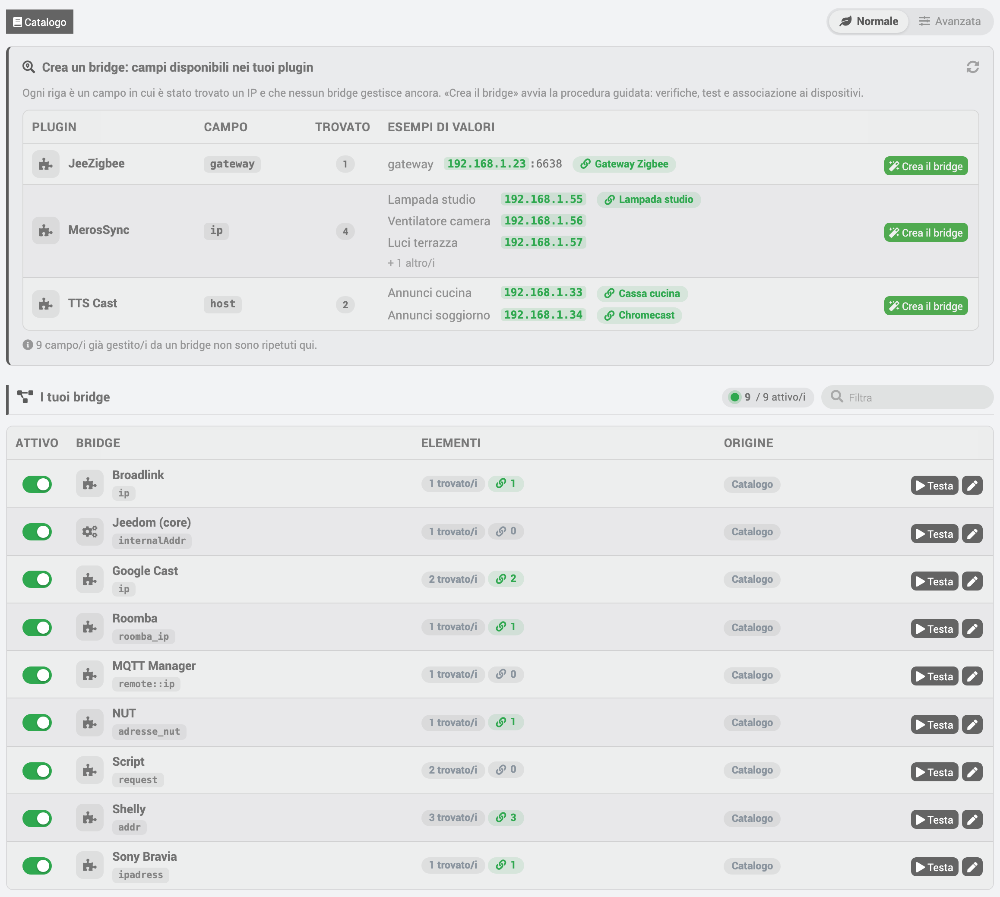

Il pulsante «Catalogo» mostra in sola lettura la configurazione originale di tutti i bridge forniti (posizione, campo, tipo di aggiornamento, condizioni, opzioni), anche per i plugin non installati, come ispirazione per creare un bridge.

L'elenco mostra i bridge che trovano elementi nei vostri plugin, oltre a quelli che avete creato o modificato. Gli altri bridge forniti (campo vuoto nella vostra installazione, plugin non installato) si consultano nel catalogo; compaiono da soli non appena il campo interessato viene compilato.

La finestra offre due viste, come la configurazione del plugin (la vista predefinita segue la modalità scelta nella configurazione, l'ultima scelta viene memorizzata). Elencano gli stessi bridge:

- **vista normale**: l'essenziale. La ricerca mostra solo gli IP non ancora gestiti da un bridge, il modulo mostra il plugin, la posizione e il campo senza permetterne la modifica e si limita al test (il tipo di aggiornamento viene rilevato automaticamente). Le condizioni esistenti sono mostrate e restano applicate;
- **vista avanzata**: dettagli e impostazioni in più: posizione e condizioni nell'elenco; condizioni, tipo di aggiornamento, demone e precisazione nel modulo; creazione manuale di un bridge.

Lo stesso bridge nella vista normale e poi nella vista avanzata:

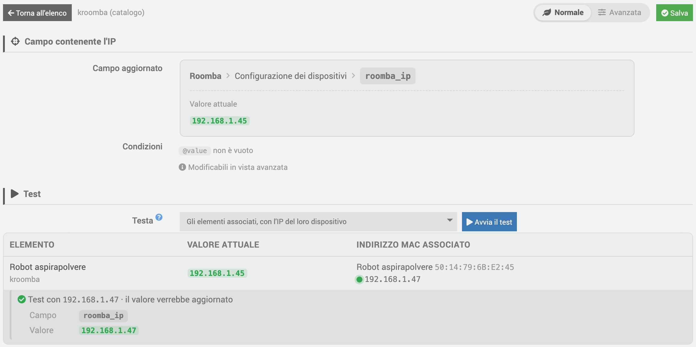

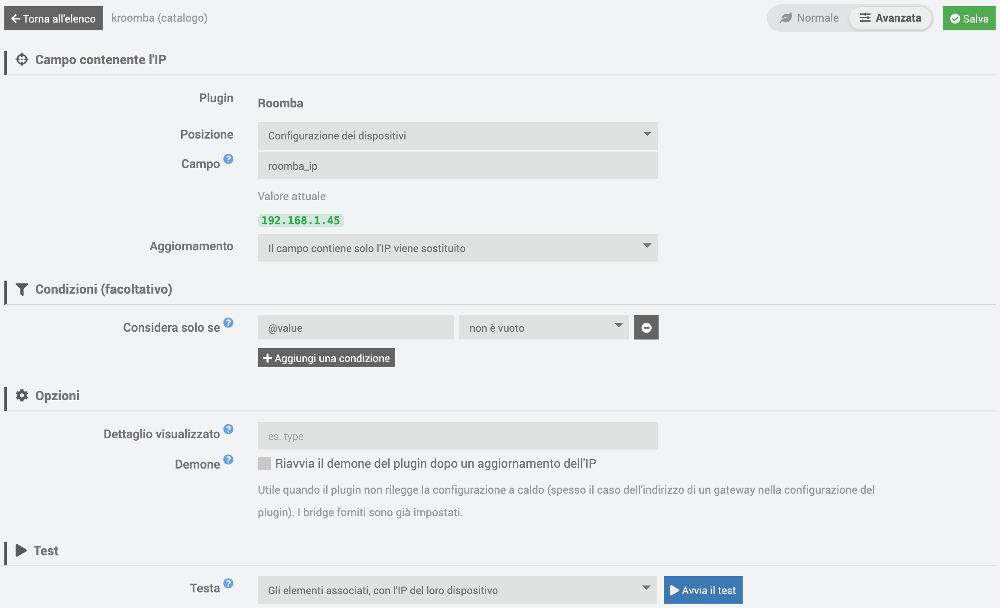

Il plugin di un bridge esistente non può essere modificato: create un nuovo bridge per un altro plugin.

### Creare un bridge

All'apertura della finestra Bridges, Scan.Ip cerca gli IP presenti nella configurazione dei vostri plugin (dispositivi, comandi, configurazione dei plugin) ed elenca i campi che nessun bridge gestisce ancora, con esempi di valori. Se nessun plugin si presta, la finestra lo indica. L'icona di aggiornamento rilancia la ricerca.

Il pulsante «Crea il bridge» di una riga avvia la procedura guidata (passi Campo, Verifiche, Terminato), che verifica la configurazione prima di creare qualsiasi cosa:

- gli elementi trovati e il tipo di aggiornamento (tutto il campo o solo l'IP che contiene);
- i valori che contengono più IP;
- un test di scrittura a vuoto su ogni elemento (non viene modificato nulla);
- la necessità di riavviare il demone del plugin: Jeedom avvisa il plugin quando viene salvato uno dei suoi parametri (`postConfig_…`) o uno dei suoi dispositivi (`postSave`). Se il plugin ha un demone e non reagisce a questo campo, il riavvio viene attivato automaticamente; la procedura guidata si limita a segnalarlo, e l'impostazione resta modificabile in seguito nel modulo del bridge nella vista avanzata.

Per ogni elemento è possibile testare il valore che il bridge scriverebbe con un IP a scelta, e associarlo a un dispositivo Scan.Ip legato al plugin (stesso IP, o già associato a un altro elemento del plugin). L'associazione è facoltativa: può essere fatta più tardi dalla scheda del dispositivo Scan.Ip. Il bridge non può essere creato se il plugin non ha alcun elemento per questo campo.

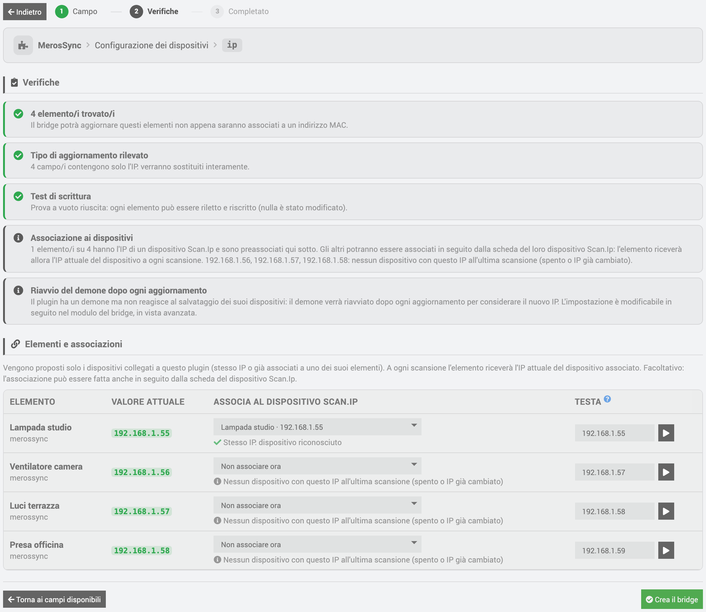

Alla fine, il pulsante «Testa il bridge» apre la simulazione, e «Termina» torna all'elenco.

I campi già gestiti da un bridge non vengono ripetuti nella ricerca, qualunque sia la vista: si trovano nell'elenco dei bridge. Nella vista avanzata, la matita di una riga apre il modulo precompilato, e «Creazione manuale» crea un bridge da zero.

### Condizioni

Un bridge può applicarsi solo ad alcuni elementi. Tutte le condizioni devono essere vere. Una condizione riguarda un altro campo dello stesso dispositivo (o dello stesso comando, o della configurazione del plugin): è uguale a, è diverso da, è uno dei valori (elenco separato da virgole), contiene, è vuoto, non è vuoto, corrisponde a un'espressione regolare…

Campi speciali: `@value` (il valore del campo dell'IP), `@name` (nome dell'elemento), `@eqName` (nome del dispositivo), `@isEnable` (dispositivo attivo) e `@logicalId`.

Esempio: il bridge VMware considera solo i dispositivi il cui campo `type` è uguale a `ESXi`.

L'opzione «Riavvia il demone del plugin» (vista avanzata) riavvia il demone del plugin dopo un aggiornamento dell'IP, per i plugin che non rileggono la configurazione a caldo. I bridge forniti sono già impostati; per un bridge creato dalla ricerca, viene attivata automaticamente quando il campo si trova nella configurazione di un plugin che ha un proprio demone.

Potrete poi associare un dispositivo a uno o più elementi di questi bridge.

### Proporre un bridge per il catalogo

Un bridge che avete creato o modificato può essere proposto per il catalogo con il pulsante «Proponi». La regola viene mostrata prima dell'invio, nel formato del catalogo: viene trasmessa solo la regola (plugin, posizione, campo, condizioni, opzioni), mai gli IP, i valori o i nomi dei dispositivi della vostra installazione. Verificate semplicemente che i valori delle condizioni non contengano nulla di personale.

- **GitHub**: apre una issue precompilata sul repository del plugin (account GitHub necessario);
- **Forum Jeedom**: copia la proposta negli appunti e apre la discussione del plugin su community.jeedom.com ([Plugin Scan.Ip - MAJ](https://community.jeedom.com/t/plugin-scan-ip-maj/48722)): cliccate su «Rispondi» e incollatela.

## Widget dedicati e gestiti da Scan.Ip

Per impostazione predefinita, questa parte contiene 2 widget (possono essere rinominati):
- Scan.Ip Widget Alertes
- Scan.Ip Widget Network

Questi dispositivi sono gestiti direttamente dal plugin e riflettono ciò che hai configurato nel plugin.

> Ricorda che la loro visualizzazione si gestisce nella configurazione del plugin.

### Il widget Rete

Questa opzione mostra o nasconde il widget della rete.

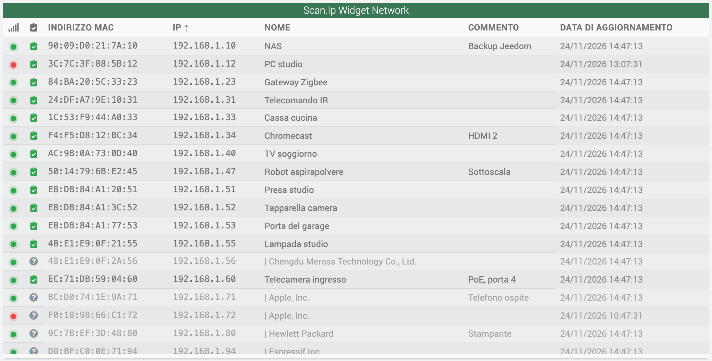

> Puoi ordinare le colonne con un semplice clic sulla loro intestazione.

> Puoi anche impostare un ordinamento predefinito nel dispositivo collegato a questo widget.

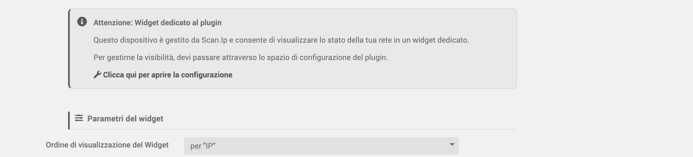

### Il widget Avvisi

Questa opzione mostra o nasconde il widget degli avvisi.

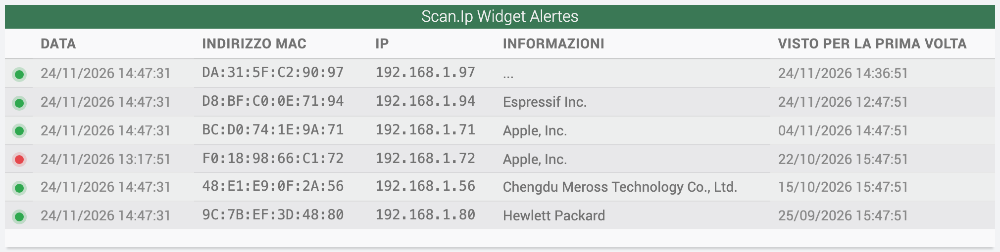

> Questo widget mostra solo i dispositivi non registrati, ordinati per data di connessione e poi per data di primo rilevamento. Un dispositivo nuovissimo compare quindi in prima posizione.

#### Comandi associati

Vengono creati 10 gruppi di comandi. Corrispondono agli ultimi 10 dispositivi non registrati che si sono connessi. L'ordine cronologico inizia da zero (il più recente) e termina a nove (il più vecchio).

Ogni elemento comprende 6 sottocomandi:

| Comando | Descrizione |
|---|---|
| Connexion 0 Création | timestamp del primo rilevamento |
| Connexion 0 Date | data in formato GG/MM/AAAA HH:MM:SS dell'ultima volta in cui è stato visto |
| Connexion 0 Time | timestamp dell'ultima volta in cui è stato visto |
| Connexion 0 Equipement | nome del produttore, se noto |
| Connexion 0 IpV4 | IP in formato v4 assegnato |
| Connexion 0 MAC | indirizzo MAC del dispositivo |

## Configurazione

Per facilitarne l'uso, il plugin adatta le opzioni disponibili a tre modalità: "normale", "avanzata" e "debug".

La modalità si sceglie con il selettore «Modalità di visualizzazione» in cima alla configurazione, che ricorda cosa mostra ciascuna modalità. Le sezioni proprie delle modalità avanzata e debug hanno un badge «Avanzato» o «Debug» a destra del titolo, e le opzioni sì / no si impostano con degli interruttori.

### Modalità normale

La modalità normale mostra i parametri principali, che in genere si adattano alle configurazioni standard: widget, frequenza di aggiornamento, file dei produttori e bridge.

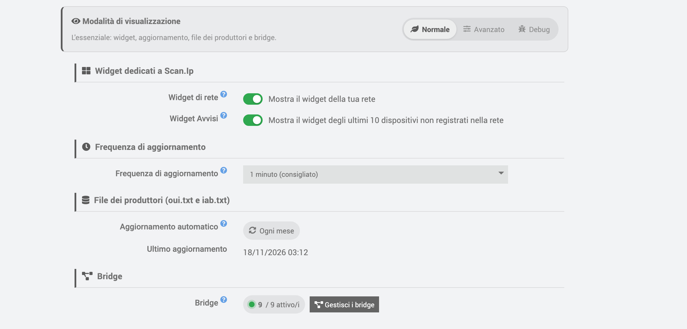

#### Frequenza di aggiornamento

Imposta la frequenza di aggiornamento dell'attività pianificata.
Per impostazione predefinita è di 1 minuto.

> Non tutti i dispositivi rispondono a ogni scansione, perché alcuni impiegano troppo tempo a rispondere (ad esempio i dispositivi Wi-Fi). Si consiglia quindi di attendere almeno 3 scansioni prima di considerare un dispositivo davvero offline. Questo parametro può essere regolato con più precisione su ogni dispositivo.

#### File dei produttori (oui.txt e iab.txt)

Questi file identificano il produttore di un dispositivo a partire dal suo indirizzo MAC. Vengono aggiornati automaticamente ogni mese dal sito dell'IEEE; in caso di errore, i file esistenti vengono conservati e si riprova il giorno successivo.

A seconda della modalità, questa sezione mostra:
- **modalità normale**: la frequenza di aggiornamento e la data dell'ultimo aggiornamento
- **modalità avanzata**: in più, la possibilità di scegliere la frequenza (ogni mese, ogni settimana) o di disattivare l'aggiornamento automatico
- **modalità debug**: in più, lo stato di ogni file e un pulsante «Aggiorna ora»

### Modalità avanzata

La modalità avanzata aggiunge delle sezioni, contrassegnate dal badge «Avanzato», e impostazioni supplementari nelle sezioni esistenti (ad esempio la frequenza di aggiornamento dei file dei produttori).

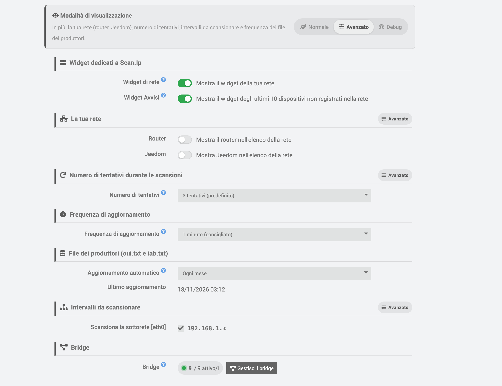

#### La vostra rete

- **Router**: mostra il router nell'elenco della rete. Per impostazione predefinita è escluso.
- **Jeedom**: mostra il server Jeedom nell'elenco della rete. Per impostazione predefinita è escluso.

#### Numero di tentativi durante le scansioni

Imposta il numero di tentativi durante le scansioni della rete. Non tutti i dispositivi rispondono al primo tentativo. Più tentativi ci sono, più la scansione è lunga.

#### Intervalli da scansionare

Quando avete più schede di rete o sottoreti, selezionate la o le sottoreti da scansionare. Vengono proposte solo le interfacce che hanno un indirizzo IPv4 (le interfacce virtuali Docker o le schede non collegate non sono elencate).

> Una sottorete potrebbe non permettere di recuperare gli indirizzi MAC che contiene (blocco a livello del router o altro). In tal caso, sarà necessario installare un altro Jeedom in quella sottorete, con uno Scan.Ip dedicato.

> La durata di una scansione dipende dalla dimensione della sottorete: pochi secondi per un `/24` (254 indirizzi), diversi minuti per un `/16` (65.534 indirizzi).

### Modalità debug

Le sezioni riservate alla modalità debug hanno il badge «Debug».

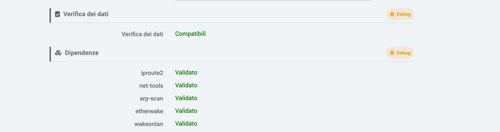

#### Verifica dei dati

Verifica che i dati salvati dal plugin siano nel formato della versione installata. Se tutto è corretto viene mostrato «Compatibili» in verde; altrimenti, un pulsante rosso «Dati non compatibili (Clicca qui per correggere il problema)» ne avvia la correzione.

#### Dipendenze

Mostra lo stato di ogni dipendenza (iproute2, net-tools, arp-scan, etherwake, wakeonlan): «Validato» in verde se è installata. Mostra a colpo d'occhio le dipendenze non riuscite.

## Sottoreti e Scan.Ip

Scan.Ip è in grado di gestire più reti contemporaneamente.
Per farlo, il tuo Jeedom deve essere connesso alle diverse reti.
Puoi ad esempio collegare il Wi-Fi della macchina Jeedom a una rete e il cavo di rete all'altra, oppure semplicemente collegare adattatori "USB/Ethernet" o "USB/Wi-Fi" al tuo Jeedom.
Scan.Ip ti mostrerà le sottoreti, che potrai poi attivare nella configurazione del plugin (in modalità avanzata).

## Debug (solo in modalità debug)

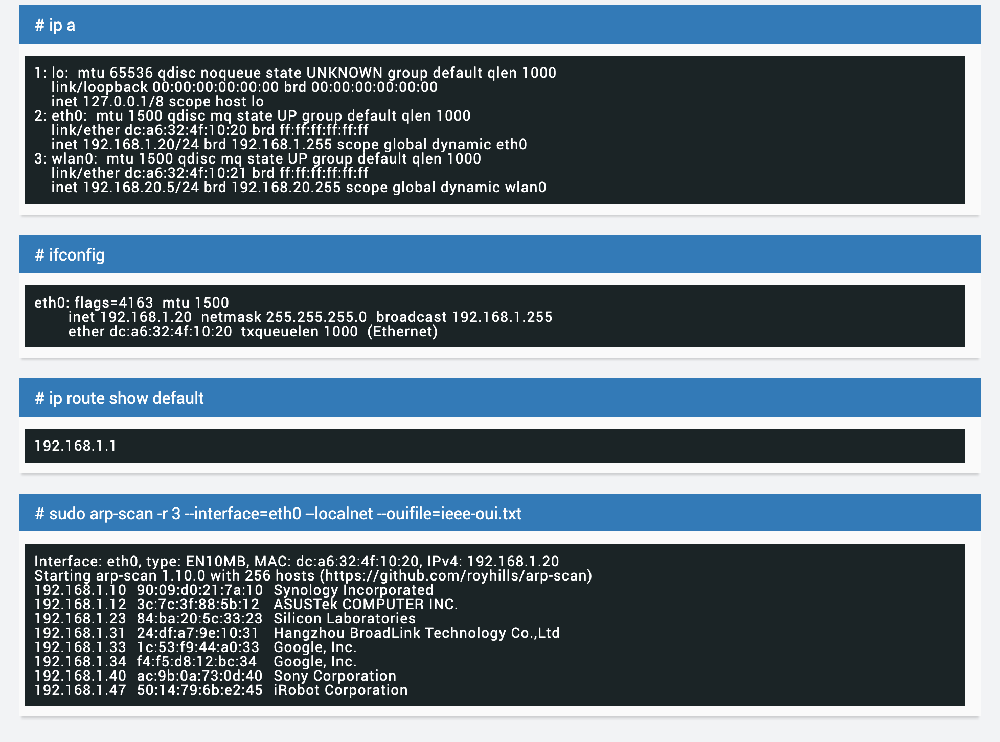

Questa finestra aiuta a capire eventuali bug.

#### ip a

Risultato del comando `ip a`, che mostra l'elenco di tutte le reti accessibili dal tuo Jeedom.

#### ip route

Mostra l'IP del router associato al tuo Jeedom.

#### arp-scan

> Qui è selezionata la rete "eth0", ma questo dipende dalla tua rete.

Risultato del comando `sudo arp-scan -r 3 --interface=eth0 --localnet --ouifile=ieee-oui.txt`, che mostra l'elenco dei dispositivi che rispondono alla scansione.

> Come indicato sopra, è possibile che non tutti i dispositivi connessi compaiano in una sola scansione. Per questo servono più scansioni per avere un quadro più preciso dei dispositivi connessi.

#### Equipements

Mostra i dati del JSON dei dispositivi. È lo storico di tutti i dispositivi che si sono connessi alla tua rete.

#### Mappings

Mostra i dati del JSON di mapping. È l'ultimo stato della tua rete, con la versione di "arp-scan" utilizzata.

## Esempi di scenari

I comandi del plugin possono essere usati come trigger negli scenari Jeedom. Negli esempi seguenti, sostituisci `[Aucun]` con l'oggetto padre dei tuoi dispositivi e il comando di invio con quello del tuo plugin di notifica (SMS, Telegram, Jeedom Connect…).

### Ricevere un SMS quando si connette un nuovo dispositivo

Il widget Avvisi mantiene in posizione 0 il dispositivo sconosciuto più recente. Questo scenario si attiva quando cambia questa posizione e verifica che il dispositivo sia appena stato rilevato per la prima volta.

- **Modalità**: Provocato
- **Trigger**: `#[Aucun][Scan.Ip Widget Alertes][Connexion 0 Création]#`
- **SE**: `#[Aucun][Scan.Ip Widget Alertes][Connexion 0 Création]# > #timestamp# - 180`
- **ALLORA**: comando di invio SMS con il messaggio
  `Nuovo dispositivo sulla rete: #[Aucun][Scan.Ip Widget Alertes][Connexion 0 MAC]# (#[Aucun][Scan.Ip Widget Alertes][Connexion 0 IpV4]#, #[Aucun][Scan.Ip Widget Alertes][Connexion 0 Equipement]#)`

> La condizione lascia passare solo i dispositivi rilevati per la prima volta meno di 3 minuti fa: un semplice cambio di ordine dell'elenco non attiva alcun avviso.

> Il widget Avvisi deve essere attivato nella configurazione del plugin. Se più dispositivi nuovi arrivano durante la stessa scansione, viene inviato un solo avviso.

### Essere avvisati quando un dispositivo registrato lascia la rete

Per un dispositivo MAC registrato (ad esempio "Aspirateur robot"), il comando **Online** passa a 0 quando il dispositivo è considerato offline.

- **Modalità**: Provocato
- **Trigger**: `#[Aucun][Aspirateur robot][Online]#`
- **SE**: `#[Aucun][Aspirateur robot][Online]# == 0`
- **ALLORA**: comando di notifica con il messaggio
  `Il robot aspirapolvere non è più connesso alla rete`

> Il tempo prima che il dispositivo sia considerato offline si regola nel dispositivo («Considerato offline dopo», in modalità avanzata).

> Variante: con il trigger `#[Aucun][Aspirateur robot][IpV4]#` e la condizione `#[Aucun][Aspirateur robot][IpV4]# != ""`, vieni avvisato a ogni cambio di IP del dispositivo.

## FAQ

**Scan.Ip modifica gli altri plugin?**
Solo gli elementi che hai associato a un dispositivo Scan.Ip, e soltanto il campo che contiene l'IP. Senza associazione non viene modificato nulla.

**Un dispositivo acceso risulta offline**
Alcuni dispositivi, soprattutto in Wi-Fi, non rispondono a ogni scansione. Aumenta «Considerato offline dopo» nel dispositivo o il numero di tentativi (modalità avanzata).

**Il produttore è indicato come «...»**
Il prefisso dell'indirizzo MAC non è nei file dei produttori. Vale anche per i telefoni con indirizzo MAC privato (casuale): può cambiare, disattiva l'opzione sul telefono per seguirlo.

**Vengono trovati solo container**
Jeedom è in Docker senza `network_mode: host`, vedi «Installazione».

**Servono ancora IP fissi nel DHCP?**
Non è obbligatorio con i bridge, ma resta la soluzione più semplice se il router lo permette.
