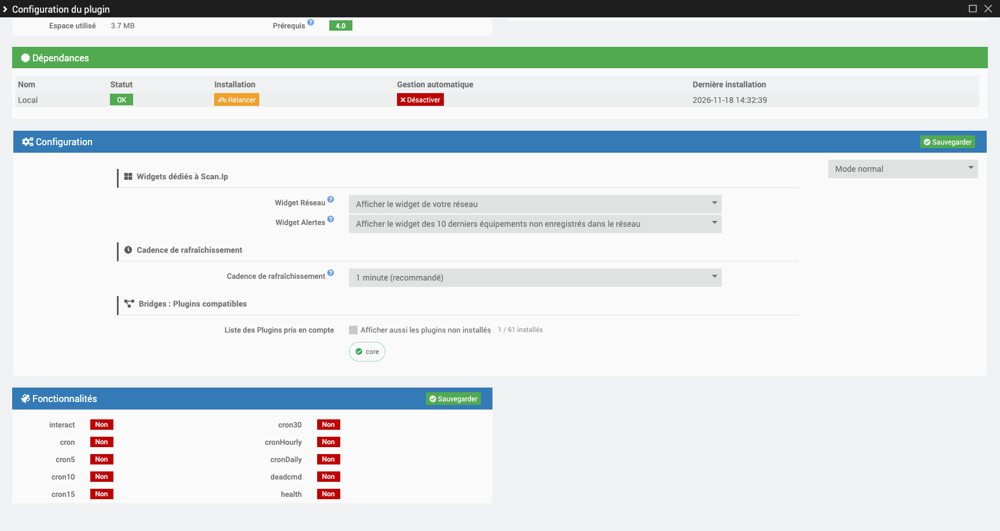
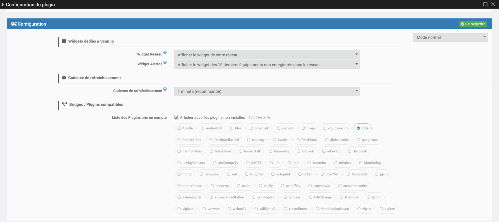
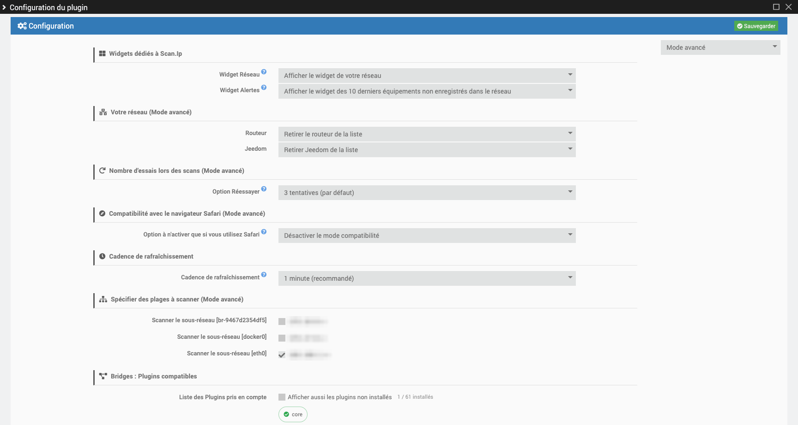
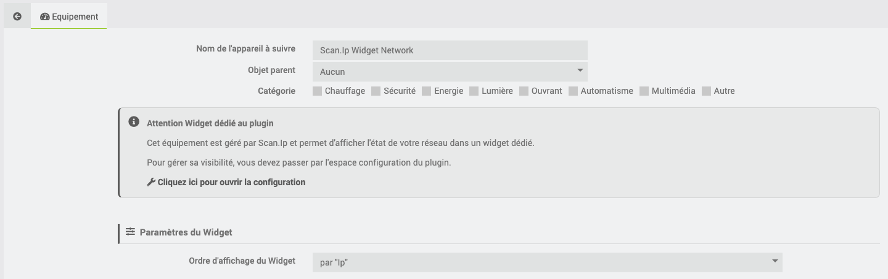
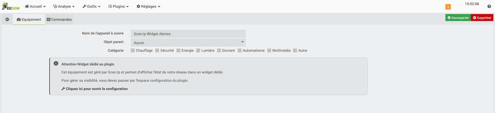

Descrizione
===

Questo plugin scansiona la tua rete e recupera l'elenco dei dispositivi connessi con i relativi indirizzi MAC.

Con queste informazioni, il plugin permette di:
- recuperare il nuovo IP di un dispositivo
- visualizzare un widget con lo stato della tua rete
- visualizzare un widget con i dispositivi non registrati che si sono appena connessi alla rete
- visualizzare un widget per ogni dispositivo registrato, con i comandi associati a quel dispositivo
- creare avvisi quando un dispositivo scompare, compare o cambia IP sulla rete
- automatizzare i cambi di IP a cascata in altri plugin tramite i bridge
- accendere un dispositivo da remoto (Wake-on-LAN)

Installazione e dipendenze
===

- Jeedom 4.0 minimo, compatibile con PHP 7 e PHP 8.
- Questo plugin richiede obbligatoriamente "arp-scan", "wakeonlan" ed "etherwake" (installati con le dipendenze).
- Utilizza i file "oui.txt" e "iab.txt" forniti da "standards-oui.ieee.org".
- Utilizza le API fornite da "macvendors.com" e "macvendors.co".

> **Jeedom su Docker**: il container di Jeedom deve usare `network_mode: host`. Altrimenti vede solo la rete interna di Docker (spesso un `/16` di 65.534 indirizzi): le scansioni durano diversi minuti e trovano solo gli altri container, non i dispositivi della tua rete.

# Configurazione

Per facilitarne l'uso, il plugin adatta le opzioni disponibili a tre modalità: "normale", "avanzata" e "debug".

## Modalità normale

La modalità normale mostra i parametri principali, che in genere si adattano alle configurazioni standard.

### Widget Rete

Questa opzione mostra o nasconde il widget della rete.

> Puoi ordinare le colonne con un semplice clic sulla loro intestazione.

> Puoi anche impostare un ordinamento predefinito nel dispositivo collegato a questo widget.

### Widget Avvisi

Questa opzione mostra o nasconde il widget degli avvisi.

> Questo widget mostra solo i dispositivi non registrati, ordinati per data di connessione e poi per data di primo rilevamento. Un dispositivo nuovissimo compare quindi in prima posizione.

### Frequenza di aggiornamento

Imposta la frequenza di aggiornamento dell'attività pianificata.
Per impostazione predefinita è di 1 minuto.

> Non tutti i dispositivi rispondono a ogni scansione, perché alcuni impiegano troppo tempo a rispondere (ad esempio i dispositivi Wi-Fi). Si consiglia quindi di attendere almeno 3 scansioni prima di considerare un dispositivo davvero offline. Questo parametro può essere regolato con più precisione su ogni dispositivo.

### Elenco dei plugin supportati

Scan.Ip utilizza i bridge per aggiornare i dati in alcuni plugin. Per impostazione predefinita sono mostrati solo i plugin installati nel tuo Jeedom; spunta «Mostra anche i plugin non installati» per vedere tutti i plugin supportati.

> In pratica, i bridge riportano automaticamente il cambio di IP di un dispositivo negli altri plugin (ad esempio quando non è possibile fissarne l'IP nel DHCP).

Potrai così associare un dispositivo a uno o più plugin.

## Modalità avanzata

### Router

Aggiunge il router all'elenco della rete. Per impostazione predefinita è rimosso.

### Jeedom

Aggiunge il server Jeedom all'elenco della rete. Per impostazione predefinita è rimosso.

### Opzione Riprova

Imposta il numero di tentativi durante le scansioni della rete. Non tutti i dispositivi rispondono al primo tentativo. Più tentativi ci sono, più la scansione è lunga.

### Compatibilità con il browser Safari

Su Safari, il mascheramento delle opzioni nei menu di selezione (che serve a mostrare solo i bridge non utilizzati) non funziona. Con questa opzione attivata, gli elementi già utilizzati vengono disattivati invece di essere nascosti. Attiva questa opzione solo se riscontri il problema su Safari.

### Specificare gli intervalli di rete da scansionare

Se hai più schede di rete o sottoreti, spunta la sottorete o le sottoreti da scansionare. Sono proposte solo le interfacce che hanno un indirizzo IPv4 (le interfacce virtuali Docker o le schede non collegate non sono elencate).

> Una sottorete potrebbe non permettere di recuperare gli indirizzi MAC che contiene (blocco del router o altro). In questo caso dovrai installare un altro Jeedom in quella sottorete, con uno Scan.Ip dedicato.

> La durata di una scansione dipende dalla dimensione della sottorete: pochi secondi per un `/24` (254 indirizzi), diversi minuti per un `/16` (65.534 indirizzi).

## Modalità debug

### File presenti

Verifica la presenza dei file oui.txt e iab.txt e la loro data di aggiornamento.

> Questi due file collegano un indirizzo MAC a un produttore.

### Verifica della versione

Verifica che i dati salvati dal plugin siano nel formato della versione installata. Ogni riga mostra «Aggiornato» in verde se tutto è corretto, altrimenti «Non aggiornato» in rosso. Se i dati non sono compatibili, un pulsante permette di avviarne la correzione.

### Dipendenze

Mostra a colpo d'occhio le dipendenze non riuscite.

# Gestione dei dispositivi

> I dispositivi sono divisi in due parti: "I tuoi dispositivi MAC" e i "Widget dedicati e gestiti da Scan.Ip". Non eliminare questi ultimi, salvo in caso di bug. Per eliminarli, attiva la modalità debug per far comparire il pulsante "Elimina".

## Icone di accesso

In modalità debug compare un'icona Debug. Compare o scompare non appena cambi modalità, senza ricaricare la pagina.

### Aggiungere un dispositivo MAC

Aggiunge un dispositivo quando conosci l'indirizzo MAC dell'apparecchio da aggiungere.

> È più semplice passare da "Dispositivi non registrati" o da "Rete", che permettono di aggiungere al volo uno o più dispositivi presenti sulla tua rete.

### Sincronizza

Avvia una nuova scansione e aggiorna i dispositivi. Una barra di avanzamento mostra il passo in corso, la percentuale, il tempo trascorso e una stima del tempo rimanente; la pagina si ricarica al termine della scansione.

> Se è già in corso una scansione automatica, la barra di avanzamento segue quella scansione invece di avviarne una seconda.

### Rete

In alto nella finestra, due schede riassumono il tuo Jeedom (IP, indirizzo MAC, data di installazione, nome host) e il tuo router (nome, IP, indirizzo MAC).

La barra degli strumenti offre:
- un filtro per cercare per indirizzo MAC, IP, nome o commento
- contatori (dispositivi, online, offline, registrati, non registrati): un clic su un contatore filtra la tabella, un secondo clic rimuove il filtro; i contatori a zero non sono mostrati
- la data dell'ultima scansione e un pulsante "Scansiona" per avviarne una nuova, con la relativa barra di avanzamento

La tabella mostra tutta la rete:

- La 1ª colonna indica se il dispositivo è "Online" o "Offline"
- La 2ª colonna indica se il dispositivo è "registrato", "registrato ma disattivato" o "non registrato"
- La 3ª colonna indica l'indirizzo MAC del dispositivo
- La 4ª colonna indica l'IP del dispositivo
- La 5ª colonna indica il nome del dispositivo se è registrato, altrimenti il nome del produttore preceduto da "|"
- La 6ª colonna permette di associare un commento a un dispositivo (viene salvato automaticamente durante la digitazione; svuota il campo per eliminare un commento)
- La 7ª colonna indica l'ultima data in cui il dispositivo è stato visto
- L'ultima colonna propone "Registra" per un dispositivo non registrato (il dispositivo viene creato e la sua scheda si apre per nominarlo e attivarlo), oppure "Apri" per accedere alla scheda di un dispositivo già registrato

> Se vedi "|..." nel nome di un dispositivo, il suo produttore non è stato riconosciuto.

### Dispositivi registrati

La barra degli strumenti offre un filtro e contatori cliccabili (registrati, online, offline, cambi di IP).

- La 1ª colonna indica lo stato del dispositivo: "Online", "Offline" o "Cambio di IP"
- La 2ª colonna indica il nome del dispositivo
- La 3ª colonna indica l'indirizzo MAC del dispositivo
- La 4ª colonna indica l'IP del dispositivo
- La 5ª colonna indica l'IP usato durante l'ultima connessione (in arancione se diverso dall'IP attuale)
- La 6ª colonna indica la data dell'ultimo aggiornamento del dispositivo
- La 7ª colonna indica tutti i bridge associati al dispositivo. Cliccandoci sopra, verrai indirizzato al dispositivo del plugin associato.

### Dispositivi non registrati

La barra degli strumenti offre un filtro e contatori cliccabili (non registrati, online, offline).

- La 1ª colonna permette di selezionare il dispositivo* (per aggiungerlo al volo ai tuoi dispositivi o eliminarlo dall'archivio della rete); la casella dell'intestazione seleziona tutte le righe visualizzate
- La 2ª colonna indica se il dispositivo è "Online" o "Offline"
- La 3ª colonna indica il nome del dispositivo
- La 4ª colonna permette di inserire un commento per il dispositivo, salvato automaticamente
- La 5ª colonna indica l'indirizzo MAC del dispositivo
- La 6ª colonna indica l'IP usato dal dispositivo
- La 7ª colonna indica la data della prima registrazione sulla tua rete
- L'8ª colonna indica l'ultima data in cui il dispositivo è stato visto
- L'ultima colonna propone "Registra" per creare direttamente il dispositivo e aprire la sua scheda

> \* Quando selezioni uno o più elementi, compaiono dei pulsanti di azione.

### Debug (solo in modalità debug)

Questa finestra aiuta a capire eventuali bug.

#### # ip a

Risultato del comando "ip a", che mostra l'elenco di tutte le reti accessibili dal tuo Jeedom.

#### # ip route show default

Mostra l'IP del router associato al tuo Jeedom.

#### # sudo arp-scan -r 3 --interface=eth0 --localnet --ouifile=ieee-oui.txt

> Qui è selezionata la rete "eth0", ma questo dipende dalla tua rete.

Risultato del comando "sudo arp-scan -r 3 --interface=eth0 --localnet --ouifile=ieee-oui.txt", che mostra l'elenco dei dispositivi che rispondono alla scansione.

> Come indicato sopra, è possibile che non tutti i dispositivi connessi compaiano in una sola scansione. Per questo servono più scansioni per avere un quadro più preciso dei dispositivi connessi.

#### # Equipements

Mostra i dati del JSON dei dispositivi. È lo storico di tutti i dispositivi che si sono connessi alla tua rete.

#### # Mappings

Mostra i dati del JSON di mapping. È l'ultimo stato della tua rete, con la versione di "arp-scan" utilizzata.

### Configurazione

Questo punto è già stato trattato all'inizio.

## I tuoi dispositivi

### In modalità normale

#### Cerca un indirizzo MAC

Questo menu di selezione ti permette di cercare direttamente un elemento della tua rete e recuperarne l'indirizzo MAC.

> Sono proposti solo gli indirizzi MAC non ancora associati, per evitare duplicati.

#### Indirizzo MAC associato

Questo campo viene:
- compilato automaticamente con il menu "Cerca un indirizzo MAC"
- oppure compilato manualmente se vuoi anticipare l'arrivo di un dispositivo sulla tua rete

#### Produttore

Se il produttore è stato identificato, viene indicato qui.

#### Wake-on-LAN

Aggiunge un comando di azione WoL che accende il dispositivo da remoto.

> Verifica che il tuo dispositivo sia compatibile e che l'opzione sia attivata su di esso perché funzioni.

#### Associazione

Come visto nella parte di configurazione, è qui che si associano i plugin a Scan.Ip tramite i bridge.

> Nel menu di selezione l'informazione è presentata così: [nome del plugin][IP salvato nel plugin :: sottonome di configurazione (se presente)] nome del dispositivo del plugin di destinazione.

> Attenzione: questa opzione modifica altri plugin. Usala con cognizione di causa. L'autore del plugin di destinazione non è in alcun modo responsabile degli eventuali malfunzionamenti che ciò potrebbe causare nel suo plugin.

> Finché non associ un plugin, Scan.Ip non vi apporta alcuna modifica.

> Se sei uno sviluppatore e vuoi proporre un bridge aggiuntivo, è possibile: direttamente su GitHub (https://ynats.github.io/jeedom-plugin-scan.ip/) oppure tramite il forum.

### In modalità avanzata

#### Promemoria "Configurazione"

Ti ricorda la frequenza di aggiornamento salvata nella configurazione del plugin.

#### Considerato offline dopo

4 minuti per impostazione predefinita: se hai lasciato tutto ai valori predefiniti, sono 1 scansione al minuto e 4 passaggi per stabilire se il dispositivo è davvero offline.
Ricorda che non tutti i dispositivi compaiono a ogni scansione.

> Se hai impostato la frequenza di aggiornamento a 3 minuti, imposta questo parametro ad almeno 15 minuti.

> Questo parametro può essere abbassato per dispositivi cablati molto reattivi, ad esempio a 2 minuti con una frequenza di 1 minuto. Ciò equivale a 2 passaggi per stabilire lo stato.

### In modalità debug

#### MAC Id

In modalità debug, il campo «MAC Id» mostra l'identificativo interno del dispositivo: gli ultimi tre byte del suo indirizzo MAC. È di sola lettura e serve a diagnosticare un'associazione MAC che non funziona.

### Comandi associati

- IpV4 (IP del dispositivo in formato v4)
- Wol (il comando di azione per accendere il dispositivo da remoto; presente solo se il Wake-on-LAN è attivato sul dispositivo)
- Last Date (data in formato GG/MM/AAAA HH:MM:SS dell'ultimo ritorno online o dell'ultimo cambio di IP del dispositivo)
- Last IpV4 (ultimo IP usato dal dispositivo)
- Last Time (stessa data di "Last Date", in formato timestamp)
- mac (indirizzo MAC del dispositivo)
- Online (stato del dispositivo)

### Widget associati

Il widget mostra l'indirizzo MAC del dispositivo, il suo IP, il suo stato, il suo ultimo IP noto (in arancione se diverso dall'IP attuale) e la data dell'ultimo ritorno online o cambio di IP. Il pulsante WoL compare se il Wake-on-LAN è attivato sul dispositivo.

# Widget dedicati e gestiti da Scan.Ip

Per impostazione predefinita, questa parte contiene 2 widget (possono essere rinominati):
- Scan.Ip Widget Alertes
- Scan.Ip Widget Network

Questi dispositivi sono gestiti direttamente dal plugin e riflettono ciò che hai configurato nel plugin.

> Ricorda che la loro visualizzazione si gestisce nella configurazione del plugin.

## Il widget Rete

## Il widget Avvisi

#### Comandi associati

Vengono creati 10 gruppi di comandi. Corrispondono agli ultimi 10 dispositivi non registrati che si sono connessi. L'ordine cronologico inizia da zero (il più recente) e termina a nove (il più vecchio).

Ogni elemento comprende 6 sottocomandi:

- Connexion 0 Création (timestamp del primo rilevamento)
- Connexion 0 Date (data in formato GG/MM/AAAA HH:MM:SS dell'ultima volta in cui è stato visto)
- Connexion 0 Time (timestamp dell'ultima volta in cui è stato visto)
- Connexion 0 Equipement (nome del produttore, se noto)
- Connexion 0 IpV4 (IP in formato v4 assegnato)
- Connexion 0 MAC (indirizzo MAC del dispositivo)

## Sottoreti e Scan.Ip

#### Se vuoi gestire più reti (ad esempio hai un hub collegato al tuo router)

Scan.Ip è in grado di gestire più reti contemporaneamente.
Per farlo, il tuo Jeedom deve essere connesso alle diverse reti.
Puoi ad esempio collegare il Wi-Fi della macchina Jeedom a una rete e il cavo di rete all'altra, oppure semplicemente collegare adattatori "USB/Ethernet" o "USB/Wi-Fi" al tuo Jeedom.
Scan.Ip ti mostrerà le sottoreti, che potrai poi attivare nella configurazione del plugin (in modalità avanzata).

# Esempi di scenari

I comandi del plugin possono essere usati come trigger negli scenari Jeedom. Negli esempi seguenti, sostituisci `[Aucun]` con l'oggetto padre dei tuoi dispositivi e il comando di invio con quello del tuo plugin di notifica (SMS, Telegram, Jeedom Connect…).

## Ricevere un SMS quando si connette un nuovo dispositivo

Il widget Avvisi mantiene in posizione 0 il dispositivo sconosciuto più recente. Questo scenario si attiva quando cambia questa posizione e verifica che il dispositivo sia appena stato rilevato per la prima volta.

- **Modalità**: Provocato
- **Trigger**: `#[Aucun][Scan.Ip Widget Alertes][Connexion 0 Création]#`
- **SE**: `#[Aucun][Scan.Ip Widget Alertes][Connexion 0 Création]# > #timestamp# - 180`
- **ALLORA**: comando di invio SMS con il messaggio
  `Nuovo dispositivo sulla rete: #[Aucun][Scan.Ip Widget Alertes][Connexion 0 MAC]# (#[Aucun][Scan.Ip Widget Alertes][Connexion 0 IpV4]#, #[Aucun][Scan.Ip Widget Alertes][Connexion 0 Equipement]#)`

> La condizione lascia passare solo i dispositivi rilevati per la prima volta meno di 3 minuti fa: un semplice cambio di ordine dell'elenco non attiva alcun avviso.

> Il widget Avvisi deve essere attivato nella configurazione del plugin. Se più dispositivi nuovi arrivano durante la stessa scansione, viene inviato un solo avviso.

## Essere avvisati quando un dispositivo registrato lascia la rete

Per un dispositivo MAC registrato (ad esempio "Aspirateur robot"), il comando **Online** passa a 0 quando il dispositivo è considerato offline.

- **Modalità**: Provocato
- **Trigger**: `#[Aucun][Aspirateur robot][Online]#`
- **SE**: `#[Aucun][Aspirateur robot][Online]# == 0`
- **ALLORA**: comando di notifica con il messaggio
  `Il robot aspirapolvere non è più connesso alla rete`

> Il tempo prima che il dispositivo sia considerato offline si regola nel dispositivo («Considerato offline dopo», in modalità avanzata).

> Variante: con il trigger `#[Aucun][Aspirateur robot][IpV4]#` e la condizione `#[Aucun][Aspirateur robot][IpV4]# != ""`, vieni avvisato a ogni cambio di IP del dispositivo.
